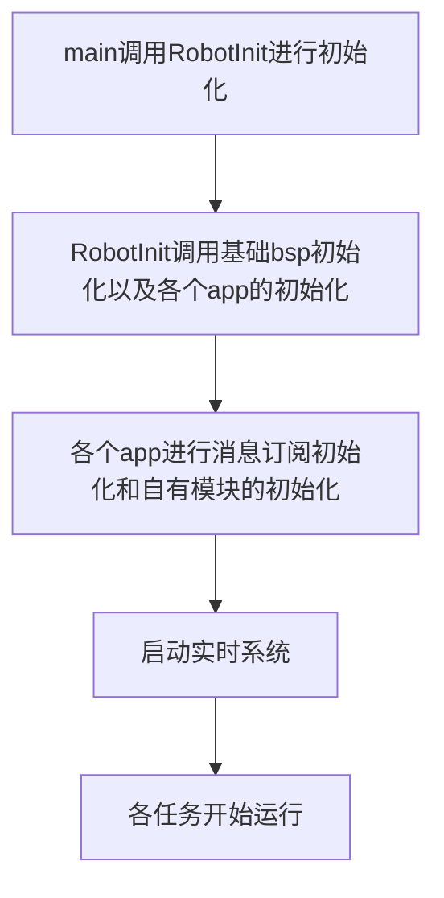
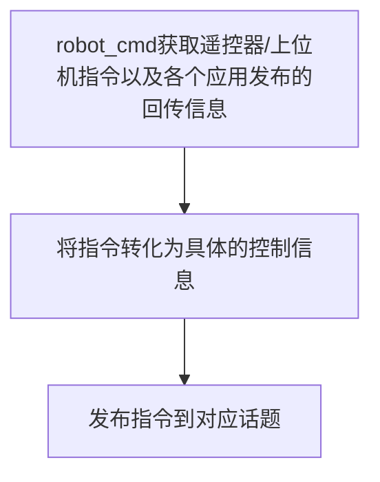

# application

neozng1@hnu.edu.cn

这是application层的说明。

## 使用说明

在 `main` 中包含 `robot.h`，并在启动实时系统之前调用 `RobotInit()`。它会完成 BSP、板级设备、调参策略、各应用和基础任务的初始化；业务代码不需要逐个创建 APP 任务。

**关于运行的任务**，INStask的运行频率必须为1kHz，motortask推荐的运行频率为200Hz\~1000Hz（详情见module/motor/motor_task.c），在MotorTask内部，对于高实时性要求的电机可以提升到1kHz，不过要注意CAN总线的负载。monitortask的运行频率为100Hz；robottask的运行频率推荐为150Hz以上，应当高于视觉发送的频率，若后续使用插帧，同样应该保证不低过motortask太多。

若使用双板，则在`robot_def.h`中给对应的开发板设定宏定义，如底盘板使用`#define CHASSIS_BOARD`，云台板使用`#define GIMBAL_BOARD`；单个开发板控制整车，则定义`#define ONE_BOARD`。在每个应用中，都已经使用编译预处理指令完成条件编译，会自动根据设定的宏切换功能。使用双板的时候，目前板间通信通过CAN完成，因此两个开发板会挂载在一条总线上，在两个开发板对这条总线的其他使用CAN的设备进行配置时注意**不要发生ID冲突**，还要注意**防止负载过大**。

**同样，在该文件中你需要修改一些关于机器人的参数**。比如底盘和云台对齐时yaw电机编码器的值，拨盘的单圈载弹量、底盘的轴距等等。

## 封装总览

目录按职责划分：

- `cmd/`、`gimbal/`、`chassis/`、`shoot/`：并列的业务应用，通过 `message_center` 交换消息。
- `board/`：本车硬件、可选外设和车辆标定的装配入口。硬件句柄和模块实例不通过公共头文件暴露。
- `runtime/`：RTOS 任务、INS/视觉组合调用和整车调参保存策略。任务函数及句柄只在 `robot_task.c` 内可见。
- `runtime/robot_telemetry.c`：整车 USB 遥测采集和 Flash 轮询；格式、协议与传输仍由 `modules/telemetry` 实现。20 ms 调度及采集顺序保持不变。
- `robot.[ch]`：整车唯一入口；`robot_def.h`：跨应用协议和车型参数。

速度底盘应用按职责分为 `chassis_init.c`（设备与话题注册）、`chassis_tuning.c`（配置默认值、校验、恢复与应用）和 `chassis.c`（控制周期、运动/功率组合及快照）。跨文件状态仅在 `chassis_internal.h` 声明，该私有头禁止被其他应用或模块引用；外部仍使用 `chassis.h`。电机指针、速度快照和原控制函数的行为保持不变。力控构建排除这三个速度底盘实现文件。

DJI 驱动通过输出组注册的 `DJIMotorControlPolicy_s` 调用整定策略，车辆策略实现在 `dji_tuning_adapter.c`。调用点沿用原来的注册、周期开始、参考值处理、限流后、禁止驱动与提交后位置；驱动保留最终门控、整数打包和唯一 CAN 提交路径。标定限制在 `ForceCalibrationAppInit()` 中同时传给标定引擎与协议模块，协议不会反向读取板级应用配置。

Robot.c是整个机器人的抽象，其下有4个应用：robot_cmd，gimbal，chassis，shoot。此框架当前是针对步兵/英雄/哨兵设计的，其他机器人只需要根据各自的特殊机构进行修改即可。robot_cmd是整个机器人的核心应用，其负责接受遥控器/上位机发来的指令，并将指令转化为实际的运动控制目标，发送给其他三个应用。后者会根据robot_cmd发来的命令，设定电机和其他执行单元的参考值等。

为了进一步解耦应用之间的关系，app层并没有module和bsp之间的那种层级结构（或设计模式中所谓的**结构类型模式**，即robot_cmd包含其他三个模块），而采用了应用并列的**发布-订阅**机制，四个应用之间没有任何相互包含关系，他们之间的通信通过module层提供的`message_center`实现。每个应用会通过该模块向一些话题（事件）发布一些消息，同时从一些话题订阅消息。如robot_cmd应用会发布其他三个模块的控制信息，同时订阅其他三个模块的反馈信息。其他三个模块会订阅robot_cmd发布的控制信息，同时发布反馈给robot_cmd的信息，他们不需要知道彼此的存在，只是从`message_center`处获取其他应用发布的消息或向自己发布的话题推送消息。

application在初始化module的时候，初始化参数会包含部分bsp的内容，但仅仅是外设和引脚的选择以及id设置（用于通信的外设需要id设置）。实际上当前框架的app层和cubemx初始化部分耦合，在配置的时候就必须确定每个外设的作用和归属权，一旦cubemx完成设置app层必须按照对应参数设置引脚和并分配module的外设。后续考虑将cubemx和bsp耦合，去除顶层代码和底层的关系

## 整车程序流程

任务开始之后，每个app之间的交互关系如下：

gimbal/chassis/shoot则根据订阅的robot_cmd发布的消息，将具体的控制信息根据当前模式转化为执行单元的目标值，通过自己拥有的模块完成这些指令，然后把回传的信息发布到对应话题。

每个应用的具体流程和实现，参见它们各自的说明文档。

## 开发要点

各个应用之间务必通过`message_center`以发布-订阅的方式进行消息交换，不要出现包含关系，这可以大大减小耦合度并提高合作开发的效率。
