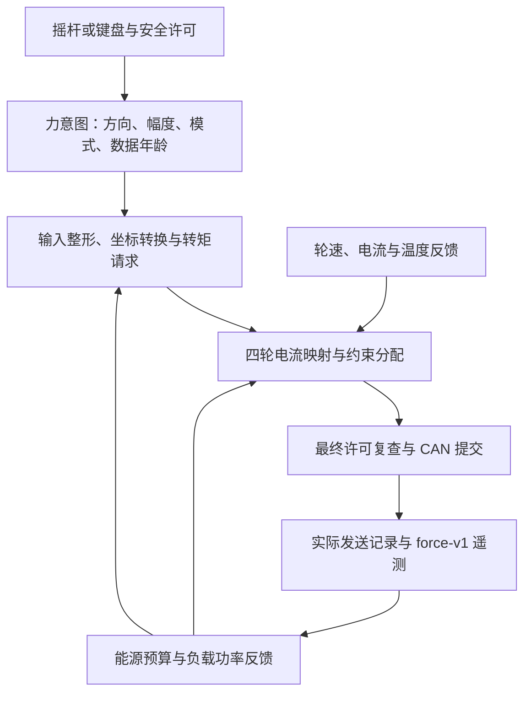

# 底盘直接力控：方案、启用与验证记录

2026-10-25。软件实施完成；未烧录、未完成车辆物理标定及实车验收。

2026-10-26 整理：目前保持默认速控和未标定锁定。后续按 [标定方法与记录表](chassis-force-calibration.md) 测量、回填，再执行本文的启用步骤。测量结果只填写 `application/board/board_chassis_force.c`，算法内部不保存本车标定值。

## 当前交付状态

| 项目 | 当前状态 |
| --- | --- |
| 控制后端 | `CHASSIS_CONTROL_MODE=0` 默认速控；编译为 1 才选择力控 |
| 车辆与任务 | ONE_BOARD 单板，四轮 OMNI_X；使用现有命令、底盘及电机任务 |
| 力控封装 | 算法、板级参数、应用装配、电机适配及遥测已分模块 |
| 可复用参数 | 原工程几何、轮向、功率模型、CAN 电流上限已取用 |
| 调试初值 | 操作力/转矩、斜率、速度、温度和堵转保护已填写，尚待台架复核 |
| 必测参数 | 四轮 `k_out_nm_a`、四轮 `force_limit_n`、一个 `speed_prediction_rpm` 仍为 0 |
| 标定有效标志 | `CHASSIS_FORCE_CALIBRATION_VALID=0`；必测参数为 0 时，改成 1 也不能输出 |
| 单轮标定入口与高速记录 | 当前未提供独立标定工具；后续测量前需准备受限测试入口和记录手段 |
| 硬件验收 | 未完成；软件测试通过不等于已测得轮地力、功率精度或实时上限 |

## 控制方案

操作输入表示所需的力与转矩。摇杆/键盘经死区、曲线、倍率和斜率处理，得到车体合力与旋转转矩；几何模型将请求转换为四轮电流，再在轮力、电流、速度、温度和功率约束内分配。四轮电机适配器最终复查许可，通过现有 CAN 发送路径提交电流。



这是基于标定模型的直接电流驱动，没有轮地力传感器反馈闭环。`fx_sent_model_mN` 等字段表示从发送电流反算的模型估计值，不是测得的接地力。轮速用于实际运动估计和超速保护，不生成目标轮速或速度 PID 输出。

| 运行模式或选项 | 力控行为 |
| --- | --- |
| `CHASSIS_ZERO_FORCE` | 撤销驱动力；急停、数据过期和故障同样不能保留驱动输出 |
| `CHASSIS_NO_FOLLOW` / `CHASSIS_FOLLOW_GIMBAL_YAW` | 映射到平移力模式；FOLLOW 按云台方向平移，不主动跟转 |
| `CHASSIS_ROTATE` | 平移力叠加旋转转矩，资源不足时优先保留平移请求 |
| `CHASSIS_FORCE_SPIN_MODE=0` | 固定转矩请求，由 `spin_torque_nm` 设置；仍受全部约束 |
| `CHASSIS_FORCE_SPIN_MODE=1` | 根据可用物理功率与负载侧功率调整转矩，不设置目标角速度 |
| `CHASSIS_FORCE_EXIT_MODE=0` | 正常退出自旋时撤销旋转驱动力并滑行；当前默认值 |
| `CHASSIS_FORCE_EXIT_MODE=1` | 正常退出自旋时允许受限反向制动，进入停止区、过零或超时后结束 |

松杆会使平移力请求按下降斜率归零，不承诺车辆立即停住或保持位置。可选退出制动只用于正常退出自旋；急停/故障处理仍以撤销驱动为准。

功率自适应模式需要有效负载侧功率计。`P_load` 用于转矩跟踪，`P_input` 用于输入能源和裁判缓冲核算，不能交换测量节点。功率模型补偿不产生额外物理能源额度；超级电容输入目标须经过发送及新反馈确认，不能把旧反馈视为新目标已生效。

## 参数入口与当前初值

完整参数、单位和来源均在 `application/board/board_chassis_force.c`；下表用于查找，修改时以源码为准。

| 类别 | 当前设置 | 后续处理 |
| --- | --- | --- |
| 几何 | 轴距 350 mm、轮距 300 mm、轮半径 60 mm、减速比 19；暂定质心在几何中心 | 核对实物、轮向及质心位置 |
| 单轮电流 | CAN 幅值上限 15000；电流斜率 15000 CAN 单位/s；近零速启动上限 1500 | 沿用/调试值，按实际测试范围及温升收紧 |
| 平移 | 满幅合力 10 N；上升/下降斜率 20/40 N/s | 低力测试后整定 |
| 旋转 | 固定 0.3 N·m；自适应起步 0.1 N·m、请求上限 1 N·m；上升/下降斜率 0.5/1 N·m/s | 先固定转矩，后功率自适应；起步请求不保证起转 |
| 速度保护 | 平移 0.3 m/s、旋转 1 rad/s、转子 1000 rpm；恢复比例 0.9 | 调试边界，核对反馈、峰值与撤力延迟 |
| 温度/堵转 | 50 ℃ 降额、60 ℃ 停机；电流命令至少 1000 且转子低于 20 rpm 连续 100 ms 时判堵转 | 核对温度、静止噪声与保护触发；不做长时间硬堵转 |
| 退出制动 | 0.2 N·m、停止区 0.1 rad/s、超时 300 ms；默认未启用 | 单独验证制动距离、过零结束及超时 |
| 三组必测量 | `k_out_nm_a=0`、`force_limit_n=0`、`speed_prediction_rpm=0` | 按标定文档实测，继续留 0 直到有结果 |

车体坐标为 x 向前、y 向左、俯视逆时针转矩为正。四轮数组顺序为左前/右前/左后/右后，对应 CAN1 电调 ID 1/4/2/3。转速保护及预测参数都是电机转子 rpm，不能填写减速后的轮子 rpm。

## 后续启用顺序

1. 核对轮序、正电流方向、反馈方向、几何和实际载荷；确认功率计节点与方向。
2. 准备独立的单轮限流测试入口和高速记录。当前普通力控入口不能用于绕过未标定锁定；准备工作见 [标定方法与记录表](chassis-force-calibration.md)。
3. 测出四轮转矩常数、接地轮力和转速增长裕量，保存原始记录、计算结果及测试范围。只测小电流时，电流上限也应限制在已验证范围。
4. 将结果回填 `BoardChassisForceConfig()`，复核调试限值。函数末尾已自动计算 checksum，保持它位于所有参数赋值之后。
5. 标定与保护复核完成后，编译固定转矩、滑行退出的力控版本；先架空/受限台架，再低力落地测试平移和固定旋转。
6. 验证操作源、反馈过期、急停、堵转、超速、超温和故障后的中位复位恢复。再启用功率自适应；可选退出制动最后验证。

仅检查力控能否构建、保持禁止驱动的命令：

```powershell
make -j4 PROFILE=atype-vehicle BUILD_DIR=build/force-locked CHASSIS_CONTROL_MODE=1 CHASSIS_FORCE_SPIN_MODE=0 CHASSIS_FORCE_EXIT_MODE=0 CHASSIS_FORCE_CALIBRATION_VALID=0
```

**以下命令仅用于已经回填实测参数并完成标定复核之后**。首次启用选固定转矩及滑行退出：

```powershell
make -j4 PROFILE=atype-vehicle BUILD_DIR=build/force-calibrated-fixed CHASSIS_CONTROL_MODE=1 CHASSIS_FORCE_SPIN_MODE=0 CHASSIS_FORCE_EXIT_MODE=0 CHASSIS_FORCE_CALIBRATION_VALID=1
```

固定模式通过台架验证后，自适应版本使用独立目录，并保留原有适配供电配置：

```powershell
make -j4 PROFILE=atype-vehicle BUILD_DIR=build/force-calibrated-adaptive CHASSIS_CONTROL_MODE=1 CHASSIS_FORCE_SPIN_MODE=1 CHASSIS_FORCE_EXIT_MODE=0 CHASSIS_FORCE_CALIBRATION_VALID=1 POWER_METER_ENABLE=1
```

切换后端是编译选项，遥控器开关只选择已编译后端内的运行模式。回到速控时使用独立目录并设置 `CHASSIS_CONTROL_MODE=0`。

## 现场观察与待验收项

`force-v1` 中先检查 `calibrated`、`state`、`faults`、`limits`、`can_submitted`、`sent_lf/rf/lb/rb` 及各反馈年龄，再观察功率、转矩和速度。零输出时先查锁定、输入许可、数据新鲜度和功率预算，避免先放宽保护。

当前检查门槛包括电机周期不超过 5 ms、四轮反馈年龄不超过 5 ms、操作源和 yaw 连同发布/传递后的累计年龄不超过 10 ms；功率计用于自适应跟踪时要求不超过 20 ms。普通 USB 默认 20 ms 一行，适合观察状态，不能替代毫秒级原始记录。图传约 30 Hz，不能持续满足 10 ms 操作源门槛，不能仅因显示在线就判定可用于此力控方案。

每次验收至少记录固件提交号、构建宏、参数 checksum、测试电流/转速/电压范围、地面和轮载条件。最坏执行时间、任务栈余量、功率误差和保护实际响应时间仍需硬件测量，门槛与既有软件验证见下文。

## 模块边界

| 位置 | 职责 |
| --- | --- |
| `modules/chassis_force/` | 纯 C 力意图协议、参数校验、几何、输入整形、功率自适应转矩、约束分配及状态机 |
| `application/board/board_chassis_force.[ch]` | 车辆标定、功率配置及合法宏组合装配 |
| `application/chassis/chassis_force_app.c` | 现有任务中的消息、安全、能源政策及反馈装配 |
| `modules/chassis_power/chassis_power_force.[ch]` | 每周期冻结共用预算、独立输入/负载功率账目和完成记录 |
| `modules/motor/DJImotor/dji_force_adapter.[ch]` | 四轮直接电流所有权、快照、最终许可检查及发送结果回投 |
| `modules/telemetry/chassis_force_telemetry.[ch]` | 独立 `force-v1` USB CSV；慢任务格式化 |

默认 `CHASSIS_CONTROL_MODE=0` 保留速控。`MODE=1` 的四轮跳过软件角度、速度、电流 PID 和旧符号处理；其他电机保留原路径。FOLLOW 在力控中只执行云台方向平移，不自动跟转。应用主线与交付验证为 ONE_BOARD 单板；协议编解码不改变旧速度报文结构。

## 构建

每种宏组合使用独立构建目录。模块迁移前产生的旧 `.d` 文件可能引用旧路径，应使用新目录重新构建。

```powershell
make -j4 PROFILE=atype-vehicle BUILD_DIR=build/speed-modular CHASSIS_CONTROL_MODE=0
make -j4 PROFILE=atype-vehicle BUILD_DIR=build/force-modular CHASSIS_CONTROL_MODE=1
make -j4 PROFILE=atype-vehicle BUILD_DIR=build/force-modular-brake CHASSIS_CONTROL_MODE=1 CHASSIS_FORCE_EXIT_MODE=1 CHASSIS_POWER_SOURCE_MODE=1
make -j4 PROFILE=atype-vehicle BUILD_DIR=build/force-modular-fixed-direct CHASSIS_CONTROL_MODE=1 CHASSIS_FORCE_SPIN_MODE=0 POWER_METER_ENABLE=0 CHASSIS_BUFFER_POWER_ENABLE=0
make -j4 PROFILE=atype-vehicle BUILD_DIR=build/force-modular-fixed-cap CHASSIS_CONTROL_MODE=1 CHASSIS_FORCE_SPIN_MODE=0 CHASSIS_POWER_SOURCE_MODE=1

cmake -S . -B build/cmake-speed-debug -G "MinGW Makefiles" -DCHASSIS_CONTROL_MODE=0
cmake --build build/cmake-speed-debug -j4
cmake -S . -B build/cmake-force-release -G "MinGW Makefiles" -DCMAKE_BUILD_TYPE=Release -DCHASSIS_CONTROL_MODE=1
cmake --build build/cmake-force-release -j4
```

以上 Make 五种组合与 CMake Debug 速控 / Release 力控均已成功。Release 数值源的最终参数为 `-Ofast ... -fno-fast-math`。修复了旧 `QuaternionEKF` 逆平方根中的指针别名访问，使优化构建通过编译器检查。

## 软件验证

- `make -C tests/chassis_force test`：几何与单位、标定锁定、44 字节协议、序号与 tick 回绕、年龄、非单调功率解析分配与独立密集扫描、退出制动、功率样本不重复积分、量化增量、制动时禁止增长、NaN 故障、实际适配器及发送回投。
- 原生测试还以 `-Ofast -fno-fast-math` 覆盖 EXIT=0/1 × SPIN=0/1 四组合。
- `make -C tests/vehicle_motion test_force`：直接读取原始输入；摇杆、DBUS 键盘与图传键盘坐标一致，倍率明确，发布时刻计入有效年龄。
- 原车辆运动、DJI 驱动、功率模块、缓冲预算、安全、超级电容、USB 遥测及 VTX 测试通过。驱动测试确认四轮 PID 调用为零、普通第五电机仍走 PID，记录电流与 CAN 字节一致，邮箱等待期间停机使全组归零。
- `tests/chassis_force/test_build_contracts.py` 使用实际 CMake 编译参数验证 14 项合法/非法宏组合、Release 数值选项，以及速控无力控符号、力控无旧自旋/速控适配器符号。
- 架构测试确认模块无新增应用反向依赖或硬件依赖。独立审查发现的问题均已修正，并补入回归测试。

2026-10-26 文档整理复核：`make -C tests/chassis_force test` 再次通过，包含实际板级配置在有效标志为 1、必测项仍为 0 时保持锁定；另核对文档本地链接和构建参数传递。此次只修改说明与源码注释，未烧录或执行物理标定。

能源验证覆盖：不以零输出/模型空载损耗申请增补；候选申请有界；发送完成同 tick 的历史反馈不能确认新目标；051/052 独立年龄；发送失败及失联撤销增长；物理 W 与模型补偿分离；配置版本采用。固定模式允许已确认的正向模型学习；自适应模式冻结正向学习并保留负向收紧。输入侧能量估计继续使用 P_input，转矩环使用 P_load。

## 上车前的剩余工作

配置已复用原工程参数并预填调试初值，关键物理量仍未标定。默认标定锁定；单独把 `CHASSIS_FORCE_CALIBRATION_VALID` 改为 1 仍无法驱动。上车前应核对质心/轮向，补齐下述必测量，并复核电流、温度/堵转、启动及速度保护的调试设置，再审核有效标志。

2026-10-26 已预填可复用项与调试初值，具体数值以 `application/board/board_chassis_force.c` 为准：沿用原几何、轮向、功率模型及四轮电流上限 15000；满输入合力 10 N、固定旋转请求 0.3 N·m、自适应起步 0.1 N·m/上限 1 N·m，并配置力/转矩/电流斜率。0.3 m/s、1 rad/s、转子 1000 rpm、50/60 ℃ 等仅为人为设定的调试限制，不是实测机械或热极限；默认退出仍为滑行。仍留 0 的必测量是四轮输出端 `k_out_nm_a`、四轮接地 `force_limit_n`、功率预测增长裕量 `speed_prediction_rpm`。这些项未填时即使有效标志为 1 也禁止输出；其他初值仍须台架复核，不能直接视为验收完成。

仍需实车确认功率计节点/方向、源端硬件与匹配 F334、最高转速和制动行为。当前图传链路约 30 Hz，不能持续满足本设计的 10 ms 操作源门槛；保持严格失效停机，不能把在线看门狗代替新鲜度。

力控电机任务栈已从 512 增为 1024 words。当前 GCC 静态调用链已知部分约 2.3 KiB，尚不包含全部数学库与 RTOS/FPU 开销；必须测量高水位并达到至少 128 words 余量。USB 默认开启时可监视 `chassis_force_motor_stack_free_words` 和 `chassis_force_motor_max_execution_us`。force-v1 提供输入、估计、命令、分配、guard 与 CAN 分段 DWT 时间；最坏力控 <=200 us、整电机任务 <=1 ms 的门槛仍需硬件测量。

上述软件测试不代表已测得轮地力、功率跟踪精度、最坏实时耗时或实车安全边界。
