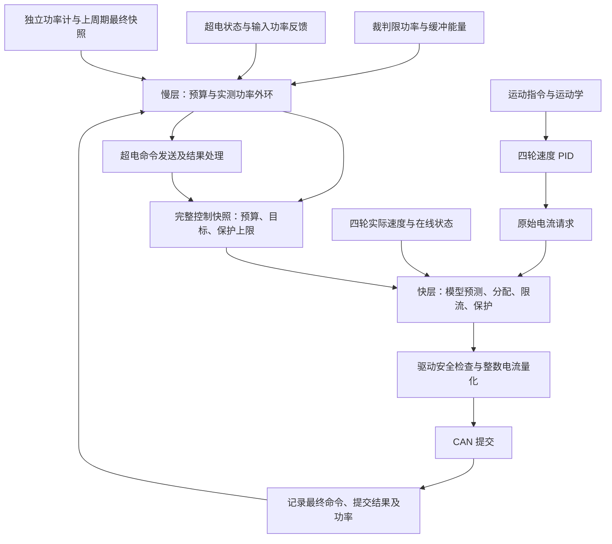

# 底盘功率控制总览：模型、计算、分配与超级电容

更新：2026-11-11。本文根据本仓库源码整理，以当前四轮 M3508 **速度控制后端**为主线，说明从裁判限功率到最终 CAN 电流命令的完整过程。四轮顺序统一为 **LF、RF、LB、RB**。

当前控制方法是：先根据供电和储能状态确定总预算，再根据各轮转速和电流请求估计功率、分配额度、反求限流值，最后用实测功率和预测转速保护修正输出。接入超级电容后，另外管理电源输入功率与底盘负载功率，不能把两者当成同一个量。

本文中的数值是源码默认值；构建宏、在线调参和有效 Flash 参数可能覆盖它们。公式算例用于解释算法，不代表实车标定或性能验收。

## 目录

1. [当前实现与源码入口](#1-当前实现与源码入口)
2. [功率边界、符号与单位](#2-功率边界符号与单位)
3. [功率模型与单轮计算](#3-功率模型与单轮计算)
4. [总预算与裁判缓冲能量](#4-总预算与裁判缓冲能量)
5. [四轮功率分配与电流反解](#5-四轮功率分配与电流反解)
6. [实测闭环、瞬态保护与最终发送](#6-实测闭环瞬态保护与最终发送)
7. [加入超级电容后的功率控制](#7-加入超级电容后的功率控制)
8. [预测功控与当前控制的区别](#8-预测功控与当前控制的区别)
9. [配置与接入步骤](#9-配置与接入步骤)
10. [调试、标定与验证](#10-调试标定与验证)

## 1. 当前实现与源码入口

### 1.1 当前默认配置

| 项目 | 源码默认值 | 含义 |
| --- | --- | --- |
| `CHASSIS_CONTROL_MODE` | `0` | 速度后端，轮速 PID 产生电流请求 |
| `CHASSIS_POWER_SOURCE_MODE` | `0`，DIRECT | 电源直供；启用超电需显式设为 `1` |
| `CHASSIS_BUFFER_POWER_ENABLE` | `1` | 启用裁判缓冲能量预算 |
| `CHASSIS_POWER_CONTROL_STAGE` | `3` | 完整慢环与瞬态保护 |
| `POWER_METER_ENABLE` | `1` | 使用独立功率计反馈 |
| `CHASSIS_PREDICTIVE_POWER_MODE` | `0` | 现役控制；`1` 仅影子计算；`2` 暂不允许编译 |
| `CHASSIS_POWER_SAFETY_FACTOR` | `0.98` | 名义预算到功率目标/模型有效额度的安全系数 |
| 最大电流命令绝对值 | `15000` | DJI 原始命令单位，不是 15000 A 或 15 A |

默认值依据：[能源配置](../modules/algorithm/chassis_energy_config.h)、[应用内部配置](../application/chassis/chassis_internal.h)、[底盘初始化](../application/chassis/chassis_init.c)、[阶段配置](../modules/algorithm/chassis_power_config.h)、[后端配置](../modules/algorithm/chassis_control_config.h)、[预测模式配置](../modules/predictive_power/predictive_power_config.h)。

### 1.2 控制链路



应用任务名义间隔为 **5 ms**，电机任务名义间隔为 **2 ms**，算法使用 DWT 测得的实际 `dt`。任务通过 `osDelay` 调度，不能将名义间隔当作严格固定采样周期。快层还检查慢层快照版本和年龄，避免把不同配置或不同周期的数据拼在一起。

| 职责 | 主要源码与入口 |
| --- | --- |
| 组合设备、初始化模型参数 | [chassis_init.c](../application/chassis/chassis_init.c)：`ChassisInit` |
| 读取反馈、更新策略、发送超电命令、发布轮速目标 | [chassis.c](../application/chassis/chassis.c)：`ChassisTask` |
| 裁判/台架基础命令 | [chassis_power_command.c](../modules/chassis_power/chassis_power_command.c)：`ChassisPowerBuildCommand` |
| 预算与外环组合 | [chassis_power_policy.c](../modules/chassis_power/chassis_power_policy.c)：`ChassisPowerUpdatePolicy` |
| 单轮模型、逐轮分配、反解电流 | [power_model.c](../modules/algorithm/power_model.c)：`PowerModelPredict`、`PowerModelApply` |
| 裁判缓冲与超电预算 | [chassis_power_budget.c](../modules/algorithm/chassis_power_budget.c)：`ChassisPowerBudgetUpdate` |
| 实测功率慢环 | [chassis_power_outer_loop.c](../modules/algorithm/chassis_power_outer_loop.c)：`ChassisPowerOuterLoopUpdateIsolated` |
| 实测快保护与预测转速保护 | [chassis_power_transient.c](../modules/algorithm/chassis_power_transient.c)：`ChassisPowerTransientUpdate`、`ChassisPowerTransientGuard` |
| 快层组合、最终快照 | [chassis_power_limiter.c](../modules/chassis_power/chassis_power_limiter.c)：`ChassisPowerLimit`、`ChassisPowerRecordFinal` |
| 单位转换与电机驱动接入 | [dji_power_adapter.c](../modules/motor/DJImotor/dji_power_adapter.c)、[dji_motor.c](../modules/motor/DJImotor/dji_motor.c) |

## 2. 功率边界、符号与单位

### 2.1 三种功率与两种储能

| 量 | 含义 | 当前主要来源 |
| --- | --- | --- |
| 裁判基础限额 `L` | 本次预算计算的基础功率上限，W | 裁判快照 `chassis_power_limit_w` |
| 输入功率 `P_in` | 从上游电源进入供电系统的功率，W | 直供用功率计；超电用 `0x052.input_power_w` |
| 负载功率 `P_load` | 底盘电机负载侧实际消耗，W | 独立功率计 `power_w` |
| 模型功率 `P_model` | 按命令与转速估计的功率，W | `PowerModelPredict`；不是实测值 |
| 裁判缓冲 `E_buf` | 裁判报告的缓冲能量，J | 裁判快照 `buffer_energy_j` |
| 电容能量比例 `rho` | 超电板报告的储能比例，0～1 | `0x051.energy_ratio` |

**裁判缓冲与电容储能是两个独立状态。** 裁判缓冲用于决定输入端是否可以短时高于基础限额；电容储能用于允许负载端暂时高于输入端。不能把 `rho` 乘以 60 J 当作裁判缓冲，也不能把两种增补直接加到同一个输入目标上。

直供时，在功率计确实覆盖相同支路的前提下，可近似认为 `P_in ≈ P_load`。接入超电后，两者通常不同。软件无法验证接线拓扑，测量点必须与这两个物理边界一致。

### 2.2 模型输入单位

| 符号 | 定义与单位 |
| --- | --- |
| `u_i` | 第 i 轮的有符号 DJI 电流命令 |
| `x_i = abs(u_i) / 1000` | 模型拟合使用的归一化命令 |
| `n_i = abs(rpm_i)` | 电机转子绝对转速，rpm；不是减速后轮速或整车自转 rpm |
| `e_i` | 目标转子 rpm − 实际转子 rpm |
| `eta` | 安全系数，当前为 0.98 |
| `B` | 名义负载预算，W，尚未乘 `eta` |
| `P_target = eta * B` | 实测负载功率目标，W |
| `C_slow`、`C_fast` | 模型预算修正，W；快修正不大于零 |

电机驱动速度环使用角度/秒，适配器除以 6 后得到 rpm。模型中的 `1000` 是拟合归一化系数，源码明确没有确认它是 mA 到 A 的转换；不能据此计算真实铜耗或套用电机力矩常数。

### 2.3 实测功率如何得到

物理上电功率为 `P = U * I`。本项目的独立功率计已经通过 CAN 上报功率，A 板直接解码其 `power_w` 字段，不在控制链中重新用母线电压乘电流覆盖它。协议里的电压/电流为有符号大端 16 位数除以 1000，功率字段除以 100，分别得到 V、A、W，见 [power_meter_protocol.c](../modules/power_meter/power_meter_protocol.c)。

超电 `0x051.chassis_power_w` 是超电板自己的负载功率报告；现役策略的 `load_valid` 和功率外环使用独立功率计，不能把 `0x051` 自动视为功率计的替代输入。裁判旧协议里的功率字段也不能默认当作高频闭环测量。

## 3. 功率模型与单轮计算

### 3.1 从物理关系到项目模型

电机输入功率可概念性地分为机械输出 `T * omega`、电流相关损耗、转速相关损耗和固定损耗。为了直接使用已有的电流命令与转速，本项目采用六项静态拟合：

$$
P_i(u_i,n_i)=k_0+k_1x_i+k_2n_i+k_3x_in_i+k_4x_i^2+k_5n_i^2,
\qquad x_i=\frac{|u_i|}{1000},\quad n_i=|rpm_i|.
$$

| 项 | 可以怎样理解 | 使用限制 |
| --- | --- | --- |
| `k0` | 固定偏置/损耗拟合 | 四轮分别计算，合计含四份 `k0` |
| `k1*x` | 电流命令的一阶修正 | 系数可为负，不表示该项在物理上供电 |
| `k2*n` | 转速相关的一阶修正 | 必须使用拟合时的 rpm 单位 |
| `k3*x*n` | 电流与速度耦合项 | 与机械功率关系相似，但不能直接当作已标定的 `T*omega` |
| `k4*x²` | 电流相关二次损耗 | 未确认安培换算，`k4` 不能直接解释成电阻 |
| `k5*n²` | 转速相关二次损耗 | 属于拟合项 |

四轮当前使用同一组 [CHASSIS_SPEED_POWER_MODEL_INITIALIZER](../modules/algorithm/chassis_power_model_config.h)：

| 系数 | 当前值 |
| --- | ---: |
| `k0` | 1.3123816 |
| `k1` | -0.25836727 |
| `k2` | 0.0007424524 |
| `k3` | 0.0024271158 |
| `k4` | 0.081198552 |
| `k5` | 3.890596e-08 |
| `current_conversion` | 1000.0 |

这些系数沿用已有标定，本文没有重新辨识。模型取电流、速度绝对值，因此不能区分驱动与制动，也没有经过验证的动态有效域。制动判别由瞬态模块另行处理，不能用静态模型证明再生能量能被电容吸收。

### 3.2 单轮算例

设硬限流后的命令 `u=5000`，转子转速 `rpm=3000`，则 `x=5`、`n=3000`：

```text
P = 1.3123816
  - 0.25836727 × 5
  + 0.0007424524 × 3000
  + 0.0024271158 × 5 × 3000
  + 0.081198552 × 5²
  + 3.890596e-08 × 3000²
  = 41.03475689 W
```

若四轮条件完全相同，未做功率限流的总需求约为 `164.14 W`。这里的“未限流”是**未做功率额度限流**，仍已先经过 `±15000` 命令硬限幅。

同样转速下，即使 `u=0`，模型仍给出：

$$
P_i(0,3000)=k_0+k_2\times3000+k_5\times3000^2\approx3.8899\ \mathrm{W}.
$$

因此，电流缩到零不意味着模型功率为零，也不保证任意小预算都存在可行电流解。分配、保护和故障判定必须保留这种情况。

### 3.3 一周期内的三次功率口径

1. **请求功率**：硬限流后的原始 PID 命令与实际转速输入模型，得到 `predicted_unlimited_power_w[4]`，用于判断需求及分配。
2. **候选功率**：分配限流后重算；瞬态保护还用短期预测转速检查候选命令。
3. **最终功率**：经过安全处理和 `int16` 量化后，`ChassisPowerRecordFinal` 按最终命令重算，并记录 CAN 提交结果。

最终预测仍然是模型估计。分析日志时应同时看最终电流、实测功率、在线状态与 `can_submitted`，不能只看限流前的预测值。

## 4. 总预算与裁判缓冲能量

### 4.1 基础限额从哪里来

`ChassisPowerBuildCommand` 优先采用有效裁判快照。裁判数据不可用时，只有显式开启台架回退且台架功率为有限正数，才使用台架限额；没有有效来源时不会凭空提供正常驱动预算。

裁判明确关闭底盘输出时，台架回退不能绕过关闭；零力模式禁止主动驱动，并请求关闭超电 DC/DC。裁判解析、有效期和兼容长度以 [referee_power.c](../modules/referee/referee_power.c) 与 [referee_power.h](../modules/referee/referee_power.h) 为准。

### 4.2 为什么需要缓冲能量估算下限

不能直接用“最近一次收到的焦耳数”批准增补，因为读数已经有帧龄，接收时刻也不等于裁判结算时刻。当前 `UpdateBufferEstimate` 维护保守下限 `E_low`：

- 从裁判读数扣除能量余量、帧龄与结算延迟窗口的历史耗能。
- 连续有效测量时，以相邻两次限额的较小值、输入功率的较大值进行积分。
- 测量缺失或积分间隔超过 20 ms 时，按保守耗能扣减，撤销增补资格。
- 新裁判帧向下修正立即生效，向上修正限制为 20 J/s，避免读数跳变被当成突然新增能量。
- 负输入读数不直接作为无限回充收益；能量观测中的测量先限制为不小于零。

连续有效区间的核心积分关系为：

$$
E_{low}^{-}=E_{low}+\left[\min(L_{prev},L)-\max(P_{in,prev},P_{in})-M_P\right]\Delta t.
$$

这是观测器内部预测，随后仍需新裁判帧校正、上下限约束及异常处理。不能用这一行替代整个观测器。

### 4.3 有需求才申请缓冲增补

速度后端的请求量取：

$$
Q=\max\left(\sum_iP_{i,request},\ P_{load,measured}\right)
$$

实测项只在有效时参与。需求还要求四轮在线使能、反馈新鲜、存在驱动且没有制动、前一周期最终记录有效并成功提交 CAN；缓冲、供电及测量连续性也必须满足条件。

当 `Q > eta*L` 且不在回充状态时，名义输入预算增量为：

$$
\begin{aligned}
\Delta B_{demand}&=\max\left(0,\frac{Q+M_D}{\eta}-L\right),\\
\Delta B_{energy}&=\max\left(0,\frac{E_{low}-E_{enter}}{T_{release}}\right),\\
\Delta B_{guard}&=\max\left(0,\frac{E_{low}-E_{floor}}{T_{guard}}-M_P\right),\\
\Delta B&=\min(\Delta B_{demand},\Delta B_{energy},\Delta B_{guard},\Delta B_{max}),\\
B_{in,target}&=L+\Delta B.
\end{aligned}
$$

实际 `B_in` 上升受斜率限制，下降立即跟随。直供模式下，名义负载预算 `B=B_in`，实测目标 `P_target=eta*B`。

| 缓冲参数 | 当前默认值 |
| --- | ---: |
| 原始缓冲读数有效上限 | 60 J |
| 回充进入 `E_enter` / 退出 `E_exit` / 硬底座 `E_floor` | 10 / 20 / 5 J |
| 能量释放时间 `T_release` / 保护窗口 `T_guard` | 0.25 / 0.30 s |
| 结算延迟 / 能量余量 | 0.10 s / 3 J |
| 功率余量 `M_P` / 需求余量 `M_D` | 5 / 5 W |
| 名义输入增补上限 `Delta B_max` | 60 W |
| 名义输入预算上升斜率 | 1200 W/s |
| 回充最大减让 / 目标恢复时间 / 退出确认时间 | 20 W / 1 s / 0.10 s |

这些是工程配置，不是本文对比赛规则或硬件额定值的声明，定义见 [chassis_energy_config.h](../modules/algorithm/chassis_energy_config.h)。

**直供算例：** 假设 `L=50 W`、`eta=0.98`、有效需求 `Q=60 W`、`E_low=30 J`，其余准入条件满足：

```text
需求余量 = (60 + 5) / 0.98 - 50 ≈ 16.3265 W
能量余量 = (30 - 10) / 0.25 = 80 W
保护余量 = (30 - 5) / 0.30 - 5 ≈ 78.3333 W
增补      = min(16.3265, 80, 78.3333, 60) = 16.3265 W
名义目标  = 66.3265 W
实测目标  = 0.98 × 66.3265 = 65 W
```

在已有 50 W 预算且周期为 5 ms 时，下一周期最多上升 `1200*0.005=6 W`，不会一步跳到 66.3265 W。能量和需求持续更新，目标也会随之变化。

### 4.4 低缓冲时主动留出恢复功率

保护预测为：

$$
E_{pred}=E_{low}-\max(0,P_{in}+M_P-L)T_{guard}.
$$

当 `E_low <= 10 J` 或 `E_pred <= 5 J` 时进入恢复。一般减让量为：

$$
R=\operatorname{clamp}\left(\frac{20-E_{low}}{1\ \mathrm{s}},0,20\ \mathrm{W}\right),
\qquad B_{in,target}=\max(0,L-R).
$$

逼近硬底座时使用完整 20 W 减让；下限恢复到至少 20 J 且连续满足 100 ms 确认后退出。这里的“回充”指恢复裁判缓冲，不能与电容本体充电混为一谈。

## 5. 四轮功率分配与电流反解

### 5.1 先算可分配总额

`PowerModelApply` 接收的 `referee_power_limit_w` 字段在快环中实际装的是**经修正的模型预算**，不一定等于原始裁判限额。

$$
P_{effective}=B_{model}\cdot\operatorname{clamp}(attenuation,0,1)\cdot\eta.
$$

当前模块初始化 `attenuation=1`。没有修正、名义预算 50 W 时，有效额度为 49 W。

### 5.2 初始分配：跟踪误差越大，分配权重越高

令 `S=sum(abs(e_i))`，当前初配参数为误差和阈值 500 rpm、有效功率阈值 54 W、每轮基础保留 8 W：

$$
A_i^{(0)}=
\begin{cases}
P_{effective}/4,&S\le500,\\
P_{effective}|e_i|/S,&S>500\text{ 且 }P_{effective}<54,\\
8+(P_{effective}-32)|e_i|/S,&S>500\text{ 且 }P_{effective}\ge54.
\end{cases}
$$

这是一种按轮速跟踪误差分配的规则。它没有直接求解“平移/旋转各分多少瓦”；自适应自转主要在上游调整速度需求与缓冲申请，不能把它理解成此处分配器有独立旋转权重。

### 5.3 回收轮子用不完的额度

初配后，`RedistributeUnusedPower` 计算各轮需求：

$$
N_i=\max(P_{i,request},P_i(0,n_i),0).
$$

轮子用不完的额度 `max(A_i-N_i,0)` 被回收，按其他轮的未满足缺口 `max(N_i-A_i,0)` 比例再分配，且不超出总额度。零电流损耗被保留，负预测不会成为其他轮额外可借用的电源。

具体地，令 `U=sum(max(A_i-N_i,0))`、`D=sum(max(N_i-A_i,0))`；只有 `U>0` 且 `D>0` 才执行重分配：

$$
A_i'=\min(A_i,N_i)+\min(1,U/D)\max(N_i-A_i,0).
$$

没有闲置额度或没有缺口时，保留原分配。

| 有效总额 | 四轮功率需求，W | 初次均分，W | 回收后分配，W |
| --- | --- | --- | --- |
| 49 W | 10 / 6 / 15 / 11 | 12.25 / 12.25 / 12.25 / 12.25 | 10 / 6 / 15 / 11，合计 42 |
| 49 W | 10 / 6 / 40 / 11 | 12.25 / 12.25 / 12.25 / 12.25 | 10 / 6 / 22 / 11，合计 49 |

这是 [功率模型测试](../tests/power_model/test_power_model.c) 中用于验证额度回收的合成功率需求，不是上文真实 M3508 系数的实车记录。总需求只有 42 W 时无需强行消耗剩余 7 W。

### 5.4 从分配功率反求电流

固定当前转速，令限流后命令为 `s*u`，`0<=s<=1`：

$$
P_i(s)=a s^2+b s+c_0,
\quad a=k_4x^2,\quad b=k_1x+k_3xn,\quad c_0=k_0+k_2n+k_5n^2.
$$

分配给该轮 `A_i` 瓦，就求满足下面条件的最大 `s`：

$$
a s^2+b s+(c_0-A_i)\le0,\qquad 0\le s\le1.
$$

普通凸二次且根有效时，可由判别式求边界；实际源码还处理线性退化、负一次项导致的非单调情况、无可行解及非有限值。入口是 `PowerModelFindFeasibleScale`，不能简单假定“功率与电流成正比”，直接乘 `A_i/P_i`。

上文 `u=5000`、`n=3000 rpm` 的轮子若获得 `20 W`，则：

```text
a = 2.0299638
b = 35.11490065
c0 = 3.88989244
最大可行 s ≈ 0.44722047
候选命令   ≈ 2236.1023
整数命令   = 2236（仍需后续保护与重算）
```

缩放保留原电流命令方向。逐轮分配只是第一道约束，最终仍要通过预测转速总功率保护、驱动安全门控和整数检查。负一次项会使部分工况下的非零电流功率低于零电流功率，因此零电流超额不等于无解；必须检查整个允许缩放区间。只有区间内都不满足约束时才判为不可行，不能声称任意预算都能被模型精确满足。

## 6. 实测闭环、瞬态保护与最终发送

### 6.1 慢环修正模型偏差

静态模型会因电压、摩擦、温度和负载变化产生误差。慢环将实测功率低通后与目标比较：

$$
P_f\leftarrow P_f+\frac{\Delta t}{0.030+\Delta t}(P_{meas}-P_f),
\qquad e=P_{target}-P_f.
$$

阶段 3 使用连续死区 `e_db=sign(e)*max(abs(e)-0.3,0)`。比例与积分构成慢修正，默认 `Kp=1.0`、`Ki=1.5`，正修正最多 `+8 W`，负修正最低可到 `-B`，并带积分回算和学习许可。

正向学习要求新鲜测量、稳定驱动、足够需求及真实基础限流；持续超目标的负向学习需独立确认。低需求、制动、启动或陈旧数据不能持续积累“补功率”。外环上升斜率为 60 W/s；快层实际应用的慢修正另受 20 W/s 上升限制。参数见 [chassis_tuning.c](../application/chassis/chassis_tuning.c)。

**模型预算补偿不增加批准的物理功率上限。** `+8 W` 是允许模型额度校正，不是再批准消耗 8 W 裁判缓冲或电容功率。

### 6.2 快保护与模型预算

实测功率超过当周期保护上限时，快层计算非正修正；核心形式为：

$$
C_{fast,request}=\operatorname{clamp}\left(-0.5\frac{P_{meas}-P_{safe,target}}{\eta},-B,0\right).
$$

当前快修正取已有值与请求值中更负的一个，快速压低预算。实测降到目标以下 0.5 W、至少两个不同时间戳样本并保持 10 ms 后，以 60 W/s 释放；计量陈旧时不进行新的正向补偿，已有快压制按专用退让逻辑处理。

阶段 1～3 的模型预算可概括为：

$$
B_{model}=\operatorname{clamp}(B+C_{slow,applied}+C_{fast},0,B+8).
$$

快层随后再乘安全系数得到有效模型额度。这里要避免把 `eta` 重复乘到已经是物理瓦数的超电输入目标上。

### 6.3 预测转速与启动保护

为减少启动加速时只看当前低转速而低估功率，现役瞬态保护使用相邻有效反馈估计加速度，对驱动轮计算：

$$
n_{guard}=|rpm|+\max(\widehat{\dot n},0)\times0.008\ \mathrm{s}.
$$

加速度低通时间常数为 10 ms；反馈不足时采用电流增长兜底。保护将候选电流带入预测转速模型，检查总功率，并对量化后的候选再次确认可行性。非单调模型不能只用普通单调二分假设处理。

启动检测默认要求四轮在线使能、平均绝对转速低于 100 rpm、上次成功提交电流的最大绝对值低于 500，维持 100 ms，随后至少一轮出现不小于 300 rpm 的目标阶跃，并满足驱动和测量条件。它有最多 30 ms 的启动窗口、`0.30*B_start*0.030` J 额度以及 500 ms 冷却。

`1.30*B_start` 是启动峰值的初始设置，**仍被实际 `power_ceiling_w` 截断**。当前缓冲开启时通常存在显式保护上限，不能据此声称默认允许实际超预算 30%；启动保护也不会直接扩大模型基础预算。

| 阶段 | 主要区别 |
| --- | --- |
| 0 | 保留原模型/旧外环路径，计算新增瞬态诊断 |
| 1 | 应用快保护、恢复及慢积分隔离 |
| 2 | 加入启动和预测约束、反馈不足时的增长限制 |
| 3 | 加入完整慢环学习、连续死区和积分回算 |

阶段 0 不是“关闭全部功控”。`ChassisPowerLimit` 在阶段至少为 2 **或**存在正的 `power_ceiling_w` 时选用保护后的电流，因此显式保护上限也影响低阶段输出。

### 6.4 最终发送的意义

功控模块只返回建议电流，真正输出仍经过 DJI 驱动的使能、在线、停机、量化及发送前检查。`ChassisPowerRecordFinal` 记录实际准备提交的整数命令，只有 CAN 成功提交的命令才更新增长限制历史。

`can_submitted=true` 表示提交成功，不是电调已经执行的硬件确认。失败记录仍可用于诊断，但不能继续支持下一周期的缓冲增补或速度增长。

## 7. 加入超级电容后的功率控制

### 7.1 控制对象变为输入端与负载端两个边界


用电容储能增量表示净功率关系，可写成：

$$
\frac{dE_{cap}}{dt}=P_{in}-P_{load}-P_{loss}.
$$

- `P_load > P_in` 时需要电容补能，储能减少。
- `P_in > P_load + P_loss` 时电容可充电。
- 电容电压对应的能量关系为 `E=0.5*C*V²`，可用能量与允许最低电压有关；当前 A 板协议只收到能量比例，不能仅凭比例计算准确可用焦耳数或续航时间。

当前主机算法不控制 F334 的开关 PWM 或底层电压/电流环。A 板负责发送输入功率请求、约束底盘负载电流；转换器的实际执行、充放电和硬件保护属于匹配的超电板固件。

### 7.2 输入侧预算：管理裁判缓冲

前述裁判缓冲观测继续运行，但 `P_in` 改为 `0x052` 报告的输入功率，不能用底盘负载功率替代。

$$
P_{in,request}=\eta B_{in}.
$$

该物理瓦数写入 `0x061.input_power_target_w`，限幅后转为 `uint16_t`，会截断不足 1 W 的小数。`referee_power_limit_w` 仍发送裁判基础限额，`referee_buffer_energy_j` 仍发送裁判原始缓冲值，不用模型修正预算替代。

因此，“裁判给 50 W”并不意味着超电输入目标始终是 50 W：正常基础目标为 49 W，满足缓冲增补条件时可以提高；低缓冲恢复时会降低。具体许可依赖当前项目的缓冲策略。

### 7.3 负载侧预算：允许电容短时补能

在超电健康、输入控制反馈有效、独立负载功率计有效、缓冲观测连续且存在有效需求的情况下：

$$
f_{cap}=\operatorname{clamp}\left(\frac{\rho-0.10}{0.30-0.10},0,1\right).
$$

这里 10% 是开始允许额外负载预算的阈值，30% 是增补因子达到 1 的阈值，**不是电容物理上的空/满定义**。

用 `P_echo` 表示新鲜 `0x052` 回报的输入目标、`P_available` 表示 `0x051` 的可用负载上限，则当前缓冲开启路径的核心计算为：

$$
\begin{aligned}
B_0&=\min(B_{in},P_{echo}/\eta),\\
B_{board}&=P_{available}/\eta,\\
H&=\max(0,B_{board}-B_0),\\
B_{load,target}&=\min\left(B_{board},B_0+f_{cap}\min(100\ \mathrm{W},H)\right),\\
P_{load,target}&=\eta B_{load}.
\end{aligned}
$$

`B_load` 是以 **200 W/s** 上升、下降立即生效后的名义预算；输入预算则使用独立的 **1200 W/s**。在 5 ms 周期内，负载预算最多上升 1 W。可用上限先除以 `eta` 转换为名义预算，输出目标再乘回 `eta`，避免对超电板的物理上限重复打折。

**单次预算算例：** 若当周期 `B_in=50 W`、回报输入目标 `49 W`、`rho=0.20`、可用负载上限 `200 W`，其他条件满足，则 `B0=50 W`、`f_cap=0.5`、板端名义上限约 204.08 W，负载名义目标为 `50+0.5*100=100 W`，对应物理目标 98 W。

这是斜率处理前的目标，不是该周期立刻消耗 98 W，也不是稳态闭环承诺。若输入实际为 49 W、负载实际为 98 W，电容需额外提供约 49 W 加转换损耗；后续周期会根据需求、储能与反馈重新计算。

当前速度后端的电容增补并不总是再按 `Q+需求余量` 截断。源码中的 `constrain_cap_to_demand` 由力控分支启用。因此给出了较高可用预算，也不代表速度 PID 会主动把功率用满。

### 7.4 超电 CAN 协议

板级初始化在 `BOARD_SUPERCAP_CAN` 上注册超电接口；当前 A 板映射见 [board_config.h](../Inc/board_config.h)。以下三帧 DLC 均为 8，多字节数据使用小端，具体实现见 [super_cap_protocol.h](../modules/super_cap/super_cap_protocol.h) 与 [super_cap_protocol.c](../modules/super_cap/super_cap_protocol.c)。

| CAN ID / 方向 | 字节 | 字段 |
| --- | --- | --- |
| `0x061`，A 板 → 超电 | 0 | DC/DC 使能，`0x01` 为使能 |
| 同上 | 1～2 | 裁判基础限额，`uint16`，W |
| 同上 | 3～4 | 裁判缓冲能量，`uint16`，J |
| 同上 | 5～6 | 输入功率请求，`uint16`，W |
| 同上 | 7 | 使能 DC/DC 且启用输入控制时为 `0xA5`，否则扩展区为零 |
| `0x051`，超电 → A 板 | 0 | 低 7 位错误码；bit 7 为输出关闭标志 |
| 同上 | 1～4 | 超电报告的底盘功率，IEEE754 `float32`，W |
| 同上 | 5～6 | 可用负载功率上限，`uint16`，W |
| 同上 | 7 | 能量比例编码，`rho=byte/255.0` |
| `0x052`，超电 → A 板 | 0～3 | 输入实测功率，IEEE754 `float32`，W |
| 同上 | 4～5 | 输入功率目标回显，`uint16`，W |
| 同上 | 6 | 协议版本，当前必须为 `1` |
| 同上 | 7 | bit 0：输入控制生效；其余位必须为 0 |

`0x051` 低 7 位依次对应欠压、过压、Buck/Boost、短路、过温、无输入和电容错误。DC/DC 是否允许工作还取决于裁判输出许可、零力状态等条件，不能仅看 CAN 在线位。

### 7.5 反馈确认与失效处理

设备层 Daemon 的在线超时为 200 ms，由有效 `0x051` 状态帧刷新，`0x052` 不替代它续期。预算策略对超电状态和输入反馈采用 **20 ms** 新鲜度要求；“设备仍在线”不等于“允许增补”。

当前速度后端的协议没有命令序号、会话号或强 ACK。发送成功只恢复受限流程；新鲜 `0x052`、`input_control_active` 和之前的发送成功状态共同参与预算准入。字段名 `confirmed_input_target_w` 在这条路径表示被选用的反馈目标，不能理解成对本次请求的强确认。

较严格的发送后新帧、目标误差不超过 1 W、确认反馈有效期 20 ms 和未确认超过 50 ms 的超时检查位于力控分支。这里的 20 ms 不是必须先连续匹配 20 ms 才确认。不要把该分支的 `input_confirmed` 直接用作当前速度后端的统一准入条件。

| 情况 | 当前处理重点 |
| --- | --- |
| 超电状态陈旧、输出关闭或有错误 | 撤销相应增补资格，执行降级预算 |
| `0x052` 缺失、陈旧或输入控制未生效 | 不批准依赖输入闭环的超电/缓冲增补 |
| 超电健康但报告的可用功率变小 | 立即收紧负载目标；显式保护上限也受其约束 |
| `SuperCapSendCommand` 发送失败 | 速度后端当周期关闭 `control_enabled`，撤销增补并清理正向外环状态 |
| 裁判明确关闭输出或零力模式 | 禁止主动驱动，并构造 DC/DC 关闭命令 |
| 功率计或轮反馈异常 | 相应增补、正向学习和增长许可受限；严重数值/快照异常进入故障输出 |

预算降级到基础值只是软件行为，不能证明硬件存在可靠旁路。当前速度后端正因为没有配置已验证的旁路，才在超电命令发送失败时禁止主动驱动。超电板断电、关断与旁路行为必须结合实际硬件确认。

### 7.6 关闭缓冲控制时的兼容路径

上文公式针对默认 `CHASSIS_BUFFER_POWER_ENABLE=1`。设为 0 后，预算模块使用旧路径：从基础限额开始，根据超电能量因子和可用上限计算有限增补，再限制上升斜率；不运行前述裁判缓冲观测与 `0x052` 输入预算闭环。不能把关闭缓冲控制理解成仍保留所有双边界约束。

## 8. 预测功控与当前控制的区别

现役保护里的“预测转速”已经可以约束真实输出，但 `modules/predictive_power` 是另一套正在验证的预测框架，两者不能混称为已完成的 MPC 接管。

| 路径 | 当前状态 | 对真实输出的影响 |
| --- | --- | --- |
| 六项静态模型 + 外环 + 瞬态保护 | 默认运行 | 决定现役限流结果 |
| `CHASSIS_PREDICTIVE_POWER_MODE=1` | 影子计算 | 生成候选与诊断，不改写 PID 电流或超电请求 |
| `CHASSIS_PREDICTIVE_POWER_MODE=2` | 未发布 | 编译直接拒绝 |
| 力控后端 | 仓库中有独立路径 | 不能套用本文所有速度 PID 和确认语义 |

影子框架在没有有效动态参数包时，使用现役六项模型的保守凸包络：舍弃负常数/负线性贡献，避免某轮负预测抵扣其他轮消耗，并标记 `baseline_envelope=true`。有有效动态模型时才进行电流响应、局部轮速和功率上界预测。

其分配核心是四维凸优化：在盒约束和总功率二次约束下最小化轮速跟踪、PID 偏离及历史命令变化代价。它有固定迭代、整数候选复核和模型有效域检查；当前板级代价并未完成平移/旋转权重标定。

双储能区间规划和安全监督也已有纯算法/影子基础。当前板级能源影子计划只接入直供缓冲：最多每 10 ms 计算一次，快层只接受 20 ms 内且配置版本一致的计划，并且只能收紧诊断额度。超电模式缺少标定后的绝对焦耳量和强确认，当前不会生成这类能源影子计划。

这些实现不能视为已完成超电强确认、完整动态辨识、在线学习或真实控制权切换。进一步说明见 [预测功控记录](predictive-power-speed.md) 与 [功率模型重建](power-model-rebuild.md)。

## 9. 配置与接入步骤

### 9.1 常用构建配置

以下是构建示例，不包含烧录。使用不同目录保存不同配置，避免混用产物：

```powershell
# 直供、裁判缓冲、阶段 3
make -j8 PROFILE=atype-direct BUILD_DIR=build/power-guide-direct CHASSIS_POWER_SOURCE_MODE=0 CHASSIS_BUFFER_POWER_ENABLE=1 CHASSIS_POWER_CONTROL_STAGE=3 POWER_METER_ENABLE=1

# 接入匹配协议的超电后：输入/负载分别管理
make -j8 PROFILE=atype-vehicle BUILD_DIR=build/power-guide-supercap CHASSIS_POWER_SOURCE_MODE=1 CHASSIS_BUFFER_POWER_ENABLE=1 CHASSIS_POWER_CONTROL_STAGE=3 POWER_METER_ENABLE=1

# 在直供基线上观察预测候选
make -j8 PROFILE=atype-direct BUILD_DIR=build/power-guide-shadow CHASSIS_PREDICTIVE_POWER_MODE=1
```

仅设置供电宏不会更新超电板固件。启用超电前，应确认 `0x061/0x051/0x052` 的格式、版本和输入/负载测量点与本文一致。

### 9.2 软件接入顺序

1. 注册四个电机、功率计和超电设备；装入四轮模型与预算/外环配置。
2. 调用 `ChassisPowerInit`，随后由 `DJIPowerAdapterInit` 绑定 LF/RF/LB/RB。
3. 慢层读取裁判、超电、功率计及上个最终周期快照，调用 `ChassisPowerUpdatePolicy`。
4. 有超电命令时发送，立刻通过 `ChassisPowerCapCommandResult` 把发送结果回写策略。
5. 补入本周期四轮目标、版本与许可，再发布完整控制快照。
6. 电机快层收集 PID 电流和反馈，运行 `ChassisPowerLimit`，由驱动完成安全处理及唯一发送路径。
7. 调用 `ChassisPowerRecordFinal`，发布最终整数命令及提交结果，供下一次策略更新使用。

不要在应用层另外发送一套底盘电流绕过驱动最终检查，也不要先发布“允许增补”的快照，再处理本周期超电发送失败。

## 10. 调试、标定与验证

### 10.1 应一起观察哪些量

建议从 `ChassisPowerGetSnapshot()` 读取同一份完整快照，字段定义见 [chassis_power_types.h](../modules/chassis_power/chassis_power_types.h)：

| 观察对象 | 重点字段 | 用途 |
| --- | --- | --- |
| 需求与最终输出 | `raw_current[4]`、`final_current[4]` | 区分 PID 请求与最后提交的电流 |
| 轮速与数据年龄 | `telemetry.target_speed_rpm`、`actual_speed_rpm`、`feedback_tick_ms` | 分辨功率不足、目标过高与反馈陈旧 |
| 分配与模型 | `power.predicted_unlimited_power_w`、`allocated_power_w`、`predicted_limited_power_w` | 看哪一轮有缺口、额度有没有回收 |
| 物理目标与测量 | `policy.control.nominal_budget_w`、`target_power_w`、`measured_power_w` | 分清名义预算、物理目标和真实消耗 |
| 快慢修正 | `transient.fast_w`、`slow_applied_w`、`policy.outer.correction_w` | 区分瞬态压制与长期模型补偿 |
| 裁判缓冲 | `policy.budget.buffer_lower_j`、`buffer_predicted_j`、`recovering` | 查看增补资格与低能量恢复 |
| 超电输入/负载 | 超电快照的 `input_power`、`status`；`policy.budget.input_target_w` | 确认两个功率边界没有混用 |
| 最终可用性 | `cycle_valid`、`final_valid`、`can_submitted`、`numeric_error` | 排除未发送成功的虚假需求 |
| 保护结果 | `base_limited`、`transient.guard_scale`、`guard_infeasible`、`guard_search_exhausted` | 定位限流原因与无可行解 |

常见判断：

- **目标功率低于限额**：先看 `eta`、回充减让、超电可用上限和输入目标回显，不先增大 PID。
- **预算有余量但实际功率低**：检查运动需求是否足够、速度是否已经达到目标、轮子配额是否用完；可用预算不等于耗电指令。
- **模型不超限但实测超限**：核对功率计测量边界、模型参数与动态误差，以及快保护/慢环是否正常启用。
- **接超电后缓冲下降异常**：确认缓冲观测接的是 `0x052` 输入功率，而不是负载侧功率。
- **反复启动后功率受压**：查看快保护恢复条件、慢积分和启动冷却，不用重置状态反复领取启动额度。

### 10.2 标定时保留单位与测量边界

标定至少同步采集实测功率、最终命令、反馈电流、转子转速、采样时间、在线/使能状态、母线条件及供电模式。静态模型拟合与动态响应辨识分开处理；未确认反馈安培换算前，保留“原始/等效单位”的名称。

已有工具入口：[chassis-power-calibration.md](chassis-power-calibration.md)、[power-model-rebuild.md](power-model-rebuild.md)、[rebuild-power-model.py](../scripts/rebuild-power-model.py)、[chassis-power-startup.md](chassis-power-startup.md)。历史文档中的默认参数可能属于旧阶段，参数以本文链接的当前配置源码及实际生效值为准。

### 10.3 主机验证命令与范围

在仓库根目录、安装 GCC 和 Make 后，可运行以下已有测试。`-B` 强制重编译，避免把旧可执行文件当作本次源码验证：

```powershell
make -B -C tests/power_model CC=gcc test
make -B -C tests/chassis_power_budget CC=gcc test
make -B -C tests/super_cap_protocol CC=gcc test
make -B -C tests/super_cap CC=gcc test
```

本次整理已通过上述四组测试，分别覆盖模型/额度回收、能源预算、超电编解码及设备故障注入。文档公式算例另行数值复核；未改动控制源码，也未执行烧录或实车功率验收。

上板验证应分别记录直供与超电模式下的启动、稳态、制动、限额下降、低储能及反馈中断。评价结果需要同时报告真实输入功率、负载功率、储能变化、数据新鲜度和最终命令，不能只凭预测曲线判断已满足功率约束。
