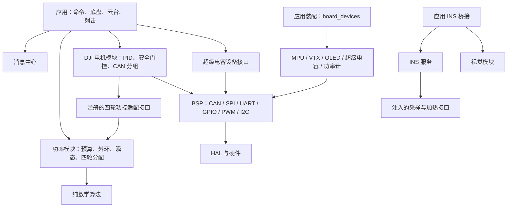

# A 板跃鹿风格模块封装与融合 Implementation Plan

> **For agentic workers:** REQUIRED SUB-SKILL: Use superpowers:subagent-driven-development (recommended) or superpowers:executing-plans to implement this plan task-by-task. Steps use checkbox (`- [ ]`) syntax for tracking.
>
> 本文是待实施方案；编写本文不代表下列重构已完成。执行时以用户授权和项目约定为准，缺少上述执行技能时不自动搜索或安装外部技能。

**Goal:** 将 A 板集成中的功率控制、超级电容、MPU6500、INS、图传和 OLED 按跃鹿框架封装，并通过明确接口重新组合，保留已验证的控制行为与故障保护。

**Architecture:** 使用 `application → modules → bsp → HAL` 分层。模块通过配置初始化、内部实例保存状态、公开接口交换完整快照；应用负责角色、运动目标与模块组合。功率控制独立于 DJI 电机驱动，超级电容独立于功率策略；只在最终电机输出路径执行一次四轮功率限制。

**Tech Stack:** C11、STM32F427、STM32 HAL、FreeRTOS、跃鹿 BSP/Daemon/消息中心、Make/CMake、GCC 主机测试、Python 配置与产物检查。

## 1. Global Constraints

- 代码基线：`f4f70c7a41659f3195865bc9aaadc99478868109`。本文承接 [A 板融合计划](2026-10-22-atype-vehicle-power-integration.md)，重构完成前不能把“构建通过”表述为“架构封装全部完成”。
- 风格依据：[YUELU.md 的设计思想](../../../YUELU.md)，核心为三层组合、模块实例化、应用间消息解耦。
- 延续 [既有功率模块实例约定](../specs/2026-09-20-power-modules-instance-encapsulation-design.md)：当前一车一个功控组、一个超级电容、一个功率计；模块内部持有 `static` 实例指针，应用不访问内部成员。本方案扩大功控实例的职责边界，不要求改成多实例系统。
- 默认硬件、引脚、时钟、CAN ID、通讯协议、控制系数和量纲以 [集成说明](../../atype-integration.md) 为准；重构不夹带重新调参。
- 保持电机任务 2 ms、应用任务 5 ms、INS 任务 1 ms、Daemon 10 ms、USB 20 ms；不新增功控 FreeRTOS 任务。
- 四个底盘轮为 LF/RF/LB/RB，CAN1 电机 ID 为 1/4/2/3；其余五个电机不加入底盘功控组。驱动内速度为 °/s，功控输入为 rpm，转换只在适配边界执行一次。
- 保持 IMU 10 ms、控制许可 10 ms、电机反馈 20 ms 的安全时效要求；双板控制及停机证明继续遵守现有更严格的检查。
- 保持台架模式非底盘电机锁定、急停优先、显式复位、自动整定独占和退出后零力恢复条件。
- 参数存储继续使用 schema 2、扇区 22/23、地址 `0x081C0000/0x081E0000`；写入前在调度暂停区内重新核对全车停机证明。
- 保持 Make/CMake 配置一致、单板/双板/台架/直供/超容/无功率计及可选模块组合可构建。
- 本轮交付仅为本文；实施、刷写及硬件验收分别记录，不提前勾选。

## 2. 现状与选择

| 对象 | 当前证据 | 本方案目标 |
|---|---|---|
| 功率控制 | `application/chassis/chassis.c` 持有预算与外环状态；`modules/motor/DJImotor/dji_motor.c` 持有功控实例、瞬态保护、功率计读取和功控遥测 | 新建独立 `modules/chassis_power`，应用只提交策略输入，电机适配层提交四轮周期数据 |
| 超级电容 | `modules/super_cap` 已有配置、内部单例、CAN/Daemon 和纯协议；`chassis_power_link` 混入裁判系统/台架决策 | 保留设备模块，增加一致快照和诊断契约；把功率决策迁到功控模块 |
| 旧功控文件 | `modules/motor/power_control.c` 仍包含另一套电机注册、PID 和 CAN 发送逻辑，当前 Make 未把它作为有效功控路径 | 明确为历史实现，构建中持续排除，不通过启用它实现“模块化” |
| MPU6500 | `mpu6500driver.h/.c` 绑定 SPI5/PF6 并调用 HAL | 使用 SPI BSP 配置与实例，驱动只处理寄存器和样本 |
| SPI BSP | 传输接口无错误返回；收发等待仍有 SPI2 判断，实际注册支持 SPI1/SPI5；忙等无明确期限 | 先补可靠事务接口，再迁移 MPU 和 OLED |
| INS/视觉 | `mpu6500.c` 同时做采集、校准、EKF、温控和 `VisionSetAltitude` | 设备、姿态服务、应用桥接分开，视觉仍由 1 ms 调度触发 |
| 图传 | `modules/vtx/vt02_control.c` 初始化中直接修改 DMA/FIFO 并重新 HAL 初始化 | DMA 留在板级配置/BSP，模块只持有 USART/Daemon 和协议状态 |
| OLED | SPI/GPIO/I2C/ADC 硬件访问混在显示模块，ADC 失败可能映射为中键 | 显示后端通过 BSP，模拟按键在独立板级适配器读取；失败返回无有效按键 |
| 安全/存储 | motor、tuning_flash 引用应用安全头；Flash 模块直接引用底盘应用 | 共享安全状态下沉模块；存储保护通过应用注册回调；Flash 硬件操作归 BSP |

选择“按现有职责逐步拆分并保持接口兼容”。只替换 HAL 调用不能解决功控状态散落与反向依赖；重写整个框架又会扩大验证范围。已封装的热量控制、堵转、按键、纯功率算法继续复用。

## 3. 目标结构与数据流



### 3.1 功率控制是独立模块

新增 `modules/chassis_power/`，职责划分如下：

| 文件 | 职责 |
|---|---|
| `chassis_power.h` | 配置、输入/输出快照、生命周期与公开 API，不包含 `dji_motor.h` |
| `chassis_power_types.h` | 与电机实现无关的四轮数据及控制/诊断类型 |
| `chassis_power_internal.h` | 私有实例；只供该目录实现文件包含 |
| `chassis_power.c` | 初始化、配置验证、快照同步、5 ms 策略入口 |
| `chassis_power_policy.c` | 当前预算、能量观测、慢外环和超容命令生成 |
| `chassis_power_limiter.c` | 当前 2 ms 瞬态保护、功率模型分配、最终输出诊断 |
| `chassis_power_telemetry.c` | 功控 RTT/捕获数据组织，不负责电机发送 |
| `chassis_power.md` | 单位、调用时序、降级条件、配置及最小接入示例 |

现有 `modules/algorithm/{power_model,chassis_power_budget,chassis_power_outer_loop,chassis_power_transient}.*` 保持为纯算法，状态通过参数传递。功率模块拥有预算状态、缓冲能量历史、外环积分、瞬态状态、模型参数和诊断快照，应用及电机驱动不再各保存一份。

为避免数据类型把 HAL 重新带进功控接口，新增 `modules/super_cap/super_cap_types.h` 与 `modules/power_meter/power_meter_types.h`：分别承载超容整体快照和 `PowerMeterStatus_s` 等纯数据类型，只依赖标准整数/布尔类型及纯协议头。设备配置仍留在各自设备头中，功控只包含纯数据头。旧设备头包含新数据头以维持调用兼容；功控算法测试无需伪造 CAN/HAL 类型。

公开接口采用模块内单例；以下为目标接口，类型定义随对应任务一起交付：

```c
bool ChassisPowerInit(const ChassisPower_Init_Config_s *config);
bool ChassisPowerUpdatePolicy(const ChassisPowerPolicyInput_s *input,
                              ChassisPowerPolicyOutput_s *output);
bool ChassisPowerLimit(const ChassisPowerCycleInput_s *input,
                       ChassisPowerCycleOutput_s *output);
bool ChassisPowerRecordFinal(const ChassisPowerFinalInput_s *input);
bool ChassisPowerGetSnapshot(ChassisPowerSnapshot_s *output);
bool ChassisPowerRequestConfig(const ChassisPower_Init_Config_s *config,
                               uint32_t version);
```

类型与所有权必须满足以下字段契约，不以裸指针暴露运行状态：

- `ChassisPower_Init_Config_s`：四组现有 `MotorPowerModelConfig_s`、`ChassisPowerAlgorithmConfig_s`、预算/外环/瞬态配置、功率源模式、控制阶段、功率计及缓冲控制开关。配置一次复制；运行调参在周期边界验证并整组替换。
- `ChassisPowerPolicyInput_s`：`uint32_t now_ms`、`float dt_s`、裁判功率快照、超容整体快照、功率计快照、上一完整快周期诊断、`bool zero_force/bench_enabled`、`float bench_limit_w`。遥控器、双板许可由应用先解释，不传遥控器内部指针。
- `ChassisPowerPolicyOutput_s`：现有预算/外环输出、`SuperCapCommand_s cap_command`、`bool cap_command_valid`、完整慢环控制快照。慢环快照从现有 `DJIChassisPowerControlSnapshot_s` 提取，保留 version、tick、预算、上限、目标 rpm、安全许可及遥测字段，改用模块中立名称。
- `ChassisPowerCycleInput_s`：一次锁定的慢环快照；`float raw_current[4]/actual_rpm[4]/target_rpm[4]/feedback_current[4]`；`uint32_t feedback_tick_ms[4]/feedback_sequence[4]`；在线与使能位图；功率计快照；`now_ms/dt_s`。
- `ChassisPowerCycleOutput_s`：四轮限流候选、有效标记、瞬态/模型诊断、关联控制版本。无效或故障时输出四个零，返回 false；调用方不得使用上次结果继续驱动。
- `ChassisPowerFinalInput_s`：本周期时间与控制版本、通过所有门控且已量化的 `int16_t current_command[4]`、CAN 提交结果。区分“提交给 CAN 的命令”和“CAN 发送成功”，不把发送成功解释成电机已执行。
- `ChassisPowerSnapshot_s`：策略和快环诊断各自的时间/版本、有效标记、最终四轮命令、发送结果、失效原因；旧 `DJIChassisPowerState_s` 的诊断字段逐项迁入，禁止迁移时丢失故障位和反馈序号。

5 ms 应用周期读取模块快照，调用 `ChassisPowerUpdatePolicy`，根据运动学结果补入四轮目标及安全许可，然后一次发布完整控制快照。超级电容命令由应用交给 `SuperCapSendCommand`，功率模块不直接发 CAN。小陀螺模式仍在应用选择，使用功率模块提供的有效预算/跟随状态，不读取积分器内部成员。

2 ms 电机周期：

```text
原子读取控制快照和电机反馈
→ 计算各电机 PID
→ DJI 功控适配层将已注册四轮映射为 LF/RF/LB/RB，并转换 °/s 为 rpm
→ ChassisPowerLimit（四轮统一分配，仅一次）
→ 原有急停、离线、整定独占及最终安全门控
→ int16 量化并统一组帧/提交 CAN
→ ChassisPowerRecordFinal（使用实际最终命令和提交结果）
```

新增 `modules/motor/DJImotor/dji_power_adapter.*` 管理四轮绑定与字段转换。通用 `dji_motor.c` 只保留注册的组输出处理接口及最终提交通知，不引用功率计、超容、功控算法或功控遥测。适配层可以依赖电机和功率模块，依赖图必须无环。`DJIChassisPowerRegister/PublishControl/GetSnapshot` 的兼容入口暂由适配层承接，内部类型不再留在通用驱动头中。

功控注册必须验证恰好四个不同的、已注册的 M3508；重复、空指针、非底盘型号、第五个成员均拒绝。四轮索引只在适配层保存，功率算法不知道 CAN ID。未注册时不得误把最先初始化的四个电机当底盘。

5 ms 和 2 ms 任务分别独占慢环和快环可变状态，通过短临界区复制快照交换数据，算法运算不放进临界区。禁止两个任务同时写同一个积分器，禁止预算和轮速来自不同控制版本。周期内不分配内存。

初始化失败不发布实例，未初始化的计算接口返回 false 且输出清零，重复初始化返回 false。现有在线调参入口改用 `ChassisPowerRequestConfig` 提交完整配置；沿用原参数校验与提交流程，版本随慢环快照传到快环，旧版本计算期间继续使用旧配置，禁止一半使用新参数。整定 PID 仍由电机/整定模块管理，功率模块只接受本周期的许可与候选输出。RTT/USB 字段和 Flash 存储结构保持兼容。

### 3.2 超级电容是独立设备模块

保留 `modules/super_cap/super_cap_protocol.*` 的纯编解码以及 `super_cap.*` 的 CAN/Daemon 组合；模块只负责设备通信、状态、在线性与诊断，不读取底盘模式、裁判系统全局变量或电机对象。

```c
typedef struct {
    SuperCapStatus_s status;
    SuperCapInputPower_s input_power;
    uint32_t received_frame_count;
    uint32_t rejected_frame_count;
    uint32_t input_received_frame_count;
    uint32_t input_rejected_frame_count;
    uint32_t command_fail_count;
    uint32_t snapshot_tick_ms;
    bool input_feedback_enabled;
} SuperCapSnapshot_s;

bool SuperCapInit(const SuperCap_Init_Config_s *config);
bool SuperCapSendCommand(const SuperCapCommand_s *command);
bool SuperCapGetSnapshot(uint32_t now_ms, SuperCapSnapshot_s *output);
```

- `SuperCapInstance` 内部持有 CAN、Daemon、状态、两类接收时间与诊断；应用只拿复制快照。现有 `SuperCapGetStatus/GetInputPower` 作为兼容包装保留。
- 保持 `0x061` 命令、`0x051` 状态、可选 `0x052` 输入功率帧、DLC 8、`0xA5` 标记及版本 1 的字节定义。CAN 句柄与可配置地址集中在初始化配置；模块不用 `hcan1/hcan2` 硬编码。
- 状态帧和输入反馈分别判定新鲜度；只有有效 `0x051` 刷新状态 Daemon，`0x052` 不能维持缺失状态帧在线。输入反馈保持 20 ms 有效期。
- 兼容接口保留原有状态 Daemon 默认 20 次、10 ms 检查的语义；用于缓冲能量控制的功控策略继续额外要求状态帧年龄 ≤20 ms。不能将两个期限混为一个而改变旧模式行为。
- `GetSnapshot` 在一个临界区复制两类状态及计数，分别保留各自接收时间；一致复制不代表两帧同时采集。使用无符号时间差处理计数回绕。
- 非法 DLC、非有限浮点或协议错误不刷新时间；发送失败返回 false 并计数，不伪造设备已接受的输入功率目标。以新鲜 `0x052` 的确认目标参与能量估计。
- 离线、错误码、输出关闭、能量不足时，由功控模块执行现有降级/预算限制；设备模块报告事实。通讯恢复不得直接越过车辆复位或整定退出保护。
- `chassis_power_link.*` 的裁判/台架/零力判断迁入功控策略，纯协议层不再包含裁判头。既有对应测试跟随策略迁移，不删除测试场景。

功率计继续使用现有独立模块和快照接口，适配层提供 2 ms 最新测量快照；禁止把 5 ms 缓存伪装成当前测量。禁止在 `dji_motor.c` 内恢复读取功率计。

### 3.3 SPI、MPU、加热和 INS

SPI 先提供完整事务，避免把一笔寄存器读拆成两次自动抬片选的调用：

```c
typedef enum {
    BSP_SPI_OK, BSP_SPI_BUSY, BSP_SPI_TIMEOUT,
    BSP_SPI_ERROR, BSP_SPI_INVALID
} BSP_SPI_Result_e;

BSP_SPI_Result_e SPITransferChecked(SPIInstance *instance,
                                    const uint8_t *tx, uint8_t *rx,
                                    uint16_t length, uint32_t timeout_us);
```

SPI 实例增加明确的 `CS_GPIO/CS_NONE` 模式。事务持有总线所有权，成功、错误、超时均释放片选与所有权；总线忙立即返回 BUSY，不无限自旋。SPI1/SPI5 使用一致映射。旧接口暂时保留兼容，但新驱动只使用有结果的接口。

启动过程存在关中断区间，不能依赖停滞的 HAL tick 实现超时；使用已初始化的 DWT 计时实现有界轮询，或先明确调整启动阶段并证明超时可运行。超时配置随板级配置传入，最终值以实测事务耗时与 1 ms 周期预算确定，验收前记录实际值。

MPU 读取采用 15 字节一次全双工事务：首字节为寄存器读地址，后 14 字节为 dummy，解码 `rx[1..14]`；写寄存器采用两字节一次事务。所有寄存器操作返回成功/失败，不继续使用旧缓冲冒充新样本。

```c
typedef struct {
    float gyro_rad_s[3], accel_m_s2[3], temperature_c;
    uint32_t tick_ms;
    bool valid;
} IMUSample_s;

typedef struct MPU6500Instance MPU6500Instance;
typedef struct {
    SPI_Init_Config_s spi_config;
    uint32_t transfer_timeout_us;
} MPU6500_Init_Config_s;

MPU6500Instance *MPU6500Register(const MPU6500_Init_Config_s *config);
bool MPU6500Read(MPU6500Instance *instance, IMUSample_s *sample);
```

加热器通过 `PWM_Init_Config_s` 配置 TIM3 CH2/PB5、100 μs 周期；公开占空比统一为 0..1，在 PID 的 0..100 输出边界只转换一次。初始占空比和温控系数保留现值；样本失败或初始化失败立即置零。

新增 `modules/imu/ins_service.c` 承接校准、坐标转换、EKF 和健康判断，使用类型正确的采样/加热回调及 context 获取设备服务，不包含 MPU 硬件头或视觉头。`modules/imu/ins_task.h` 维持 `INS_Init/INS_Task/attitude_t` 外部兼容接口，另提供完整快照读取。

保留以下语义：6000 个校准样本、15 s 校准超时后的现有保存偏置回退、途中 SPI 错误导致初始化失败、内部 rad/s 与外部 °/s、现有 Pitch/Roll 映射。不得将“采样失败”误当成允许使用偏置继续启动的普通超时。

`INS_Init()` 返回的姿态对象地址固定，替代依靠 `INS_t` 内存布局强转的实现；重复调用不重复注册设备。姿态发布使用短临界区完整复制，电机的反馈指针始终有效。QuaternionEKF 目前有全局状态，本方案明确保留每板单个 INS/EKF，不宣称支持多个滤波器实例。

新增 `application/ins_bridge.*`，在原 INS 任务中调用 `INS_Task`，读取健康姿态，然后在单板/云台板按原 1 ms 节拍执行 `VisionSetAltitude` 和 `VisionSend`。失效样本不更新为新鲜视觉姿态；底盘板不额外启动视觉发送。

### 3.4 图传、OLED、共享安全与存储

- 图传：配置注入 USART，模块持有接收状态、Daemon、校验及控制快照。DMA Direct mode 由 `.ioc`、`Src/usart.c` 和 BSP 保证；去掉图传内部 `HAL_DMA_Init`。保持 CRC、实际长度校验、100 ms 有效期及失联重启接收行为。
- OLED：共用显示状态和绘图接口，SPI/I2C 为可选后端。SPI1/PB9 DC/PB10 RST 从应用配置注入，使用 SPI/GPIO BSP。参考硬件没有软件 CS，明确选择 `CS_NONE`，不虚构片选引脚。I2C BSP 配置用 7 位地址 `0x3C`，不重复左移。
- 模拟按键：PA6/ADC1 IN6 的采样留给独立板级适配器；显示模块接收有效键值。ADC 超时/错误返回“无有效键”，不能触发中键。数字按键继续复用已有 GPIO/Daemon 模块。
- 安全：将 `application/vehicle_safety.*` 中可复用状态机迁到 `modules/vehicle_safety/`，保留现有 API。遥控复位、单/双板权限等应用政策留在应用。电机依赖共享安全模块，不反向包含应用。
- 存储：`tuning_flash` 注册 `bool (*save_guard)(void *context, uint32_t now_ms)`；无回调则拒绝保存。`application/tuning_policy.*` 负责整车条件；回调必须在现有暂停调度区、实际写入前调用，禁止缓存之前的 true。回调不得阻塞、分配内存或执行通信。
- Flash 擦写/解锁/错误处理封装在 BSP，继续使用现有存储 IO 抽象。不能移动检查顺序导致检查通过后电机又恢复运行。
- JScope 保留 RTT 通道 1 和四浮点格式；检查临界区是否恢复原中断屏蔽状态，避免无条件开中断。通道唯一性不要求虚构多个实例。

## 4. 文件调整范围

以下“新增”均为计划文件，不表示当前已存在。每个实施提交同步更新引用、构建清单和测试。

| 操作 | 路径 | 结果 |
|---|---|---|
| 新增 | `modules/chassis_power/` 下第 3.1 节所列文件 | 完整功控模块及说明 |
| 新增 | `modules/motor/DJImotor/dji_power_adapter.c/.h` | 四轮注册、周期字段转换、旧接口兼容 |
| 修改 | `modules/motor/DJImotor/dji_motor.c/.h` | 通用组处理接口，移出功控运行状态与遥测 |
| 修改 | `application/chassis/chassis.c` | 移出预算/外环实例，只保留运动学、策略输入和模块组合 |
| 修改/迁移 | `modules/super_cap/super_cap.c/.h`、`chassis_power_link.c/.h` | 快照与诊断完善；link 策略并入新功控模块 |
| 新增/修改 | `modules/super_cap/super_cap_types.h`、`modules/power_meter/power_meter_types.h`；原设备头 | 纯数据类型与硬件配置分开，旧包含路径继续兼容 |
| 修改 | `bsp/spi/bsp_spi.c/.h` | 有界事务、错误返回、所有权、CS_NONE、头文件防重包含 |
| 修改 | `modules/mpu6500/mpu6500.c/.h`、`mpu6500driver.c/.h`、`imu_temperature.c/.h` | 设备采样和 PWM 封装 |
| 新增/修改 | `modules/imu/imu_sample.h`、`ins_service.c`；`ins_task.h` | 中立样本与独立姿态服务；旧未链接 INS 实现继续排除 |
| 新增 | `application/board_devices.c/.h`、`application/ins_bridge.c/.h` | 板级组合配置、INS 与视觉调度桥 |
| 修改 | `application/robot.c`、`Src/freertos.c` 及当前可选模块初始化入口 | 按启动阶段调用装配与桥接，不重复注册 |
| 修改 | `modules/vtx/vt02_control.c/.h`、`Src/usart.c`、项目 `.ioc` | 模块协议和板级 DMA 配置分离 |
| 修改/新增 | `modules/oled/`；`application/board_analog_key.c/.h` | 显示后端与模拟按键分离 |
| 迁移/新增 | `modules/vehicle_safety/`；`application/tuning_policy.c/.h`；`bsp/flash/` | 共享安全状态、应用保存策略、硬件 Flash IO |
| 修改 | `modules/telemetry/tuning_flash.c/.h`、JScope 对应实现 | 注入保存条件、正确恢复临界区状态 |
| 修改 | `Makefile`、`CMakeLists.txt`、`config/atype-link-symbols.txt`、相关产物检查脚本 | 唯一有效实现、符号与可选配置一致 |
| 新增/修改 | 第 5 节各测试目录、`tests/architecture/test_layers.py` | 行为与模块边界同时验收 |

## 5. 分阶段实施与验证

所有步骤当前均未实施。每阶段遵循“先固定风险测试 → 观察新增断言失败 → 实现 → 回归 → 独立提交”，不把全部文件一次搬迁后再调试。下列 `make -B` 强制重编译，避免旧 exe 造成假通过。

### 阶段 A：建立行为基线与模块边界检查

**文件：** 新增 `tests/architecture/test_layers.py`；扩展 `tests/dji_chassis_power_rtt/test_dji_chassis_power_rtt.c`、`tests/super_cap/test_super_cap.c`；保存测试夹具到对应测试目录。

- [ ] 在基线记录相同输入流下的四轮最终电流、控制版本、预算、瞬态故障位及超容命令字节；覆盖启动、反转/制动、持续超功率、能量恢复、失联和整定退出。
- [ ] 增加九电机乱序注册测试：仅 LF/RF/LB/RB 参与功率分配，其余五电机正常模式输出不受功控改写，台架模式按原规则停机。
- [ ] 增加依赖检查：解析实际 include 路径，禁止目标模块包含 application 头；禁止功控公共头包含 `dji_motor.h`；禁止纯算法包含 HAL/RTOS；硬件句柄和寄存器操作只允许在 BSP/板级装配。允许 BSP 配置类型出现在模块配置中，不将所有 HAL 类型名一律判错。
- [ ] 现有违规项先记录明确白名单，随相应阶段清零；最终不能用新增白名单掩盖目标模块的反向依赖。
- [ ] 执行并提交基线测试；完整构建命令见第 6 节。

```powershell
make -B -C tests/dji_chassis_power_rtt test CC=gcc
make -B -C tests/super_cap test CC=gcc
make -B -C tests/chassis_power_transient test CC=gcc
make -B -C tests/chassis_power_overpower test CC=gcc
```

### 阶段 B：超级电容设备模块补齐

**文件：** `modules/super_cap/super_cap.*`、`super_cap.md`；`tests/super_cap/test_super_cap.c`、`tests/super_cap_protocol/test_super_cap_protocol.c`。接口采用第 3.2 节定义。

- [ ] 测试发送命令编码与基线逐字节相同；输入反馈在年龄 20 ms 时有效、21 ms 时失效；只收 `0x052` 不能保持 `0x051` 在线。
- [ ] 测试无效帧不更新接收时间、两个帧的时间独立、32 位计时回绕、空指针、未初始化、重复初始化和注册失败。
- [ ] 增加纯数据头、整体快照及诊断计数，复用现有协议和 CAN/Daemon，保持旧 getter 兼容；初始/失败快照为离线而非随机旧值。将功率计状态类型提取到纯数据头，字段不变。
- [ ] 若 BSP 已保存半初始化对象回调，失败路径不得释放形成悬空指针；对象不发布给业务 API，禁用有效状态并拒绝二次注册。完整回滚只有在 BSP 有对应注销能力时使用。
- [ ] 执行测试并提交 `refactor: complete supercapacitor module contracts`。

```powershell
make -B -C tests/super_cap test CC=gcc
make -B -C tests/super_cap_protocol test CC=gcc
make -B -C portable_modules/modules/super_cap/tests test CC=gcc
```

### 阶段 C：独立功率模块与 DJI 适配融合

**文件：** 新增第 3.1 节模块与 `dji_power_adapter.*`；修改 `chassis.c`、`dji_motor.*`、构建文件；新增 `tests/chassis_power_module/Makefile` 与 `test_chassis_power_module.c`。接口/输入输出严格采用第 3.1 节。

- [ ] 提取当前模型/瞬态/外环用例作为模块测试，输入相同数据流，断言状态切换、许可和故障位一致，整数 CAN 命令一致；浮点中间值使用绝对误差 ≤`1e-4f` 或相对误差 ≤`1e-5f`，阈值分支必须一致。
- [ ] 将预算与外环状态迁入模块，逐项保留现有配置值、功率源分支、stage 0/1/2/3 和功率计禁用分支。把 `ChassisPowerLinkBuild` 决策迁入策略实现。
- [ ] 将瞬态、四轮模型计算和功控遥测迁入模块；保留纯算法 API。故障输入包括 NaN、Inf、非正 dt、过期测量和非法配置；不得输出非有限电流。
- [ ] 增加 DJI 组处理接口与适配层；四轮绑定只在适配层，保持控制快照与轮速目标原子发布。读取功率计的责任移到适配层提供周期输入。
- [ ] 在最终门控后回报量化命令，新增“功控计算后发生急停/整定锁定”测试：CAN 对应槽位为零，最终快照也为零；CAN 提交失败明确标记失败。这类诊断纠正单列差异，不将错误旧值作为黄金结果。
- [ ] 新增 5 ms/2 ms 交错发布测试：同一周期预算、目标、许可版本一致；两类状态互不覆盖，临界区内无整段算法运算。
- [ ] 保留现有运行调参、RTT/USB 和参数保存测试，增加配置切换版本一致性断言，拒绝非法配置时不得改变当前参数或积分状态。
- [ ] 扩展直供/超容、功率计有/无、缓冲控制有/无、stage 0..3 的组合测试。超容失效关闭升功率能力，能量恢复与外环学习遵循基线；控制快照过期仍最终停机。
- [ ] 清除 `chassis.c` 的预算/外环可变实例和通用驱动的功控实例、功率计读取及功控遥测；旧 `power_control.c` 不进入任何构建。应用可通过模块接口获取显示/小陀螺需要的反馈。
- [ ] 逐个运行下列测试，通过后提交 `refactor: isolate chassis power module and DJI adapter`。

```powershell
make -B -C tests/chassis_power_module test CC=gcc
make -B -C tests/power_model test CC=gcc
make -B -C tests/chassis_power_budget test CC=gcc
make -B -C tests/chassis_power_outer_loop test CC=gcc
make -B -C tests/chassis_power_transient test CC=gcc
make -B -C tests/chassis_power_overpower test CC=gcc
make -B -C tests/chassis_power_link test CC=gcc
make -B -C tests/dji_chassis_power_rtt test CC=gcc
make -B -C tests/chassis_spin test CC=gcc
make -B -C tests/chassis_power_capture test CC=gcc
```

### 阶段 D：可靠 SPI 事务与 MPU/PWM 封装

**文件：** `bsp/spi/bsp_spi.*`、`modules/mpu6500/*`、新增 `imu_sample.h`；新增 `tests/bsp_spi/`、`tests/mpu6500/` 的 Makefile 和 C 测试，保留 `tests/atype` 数学与故障测试。

- [ ] SPI 测试覆盖 SPI1/SPI5、忙返回、超时、HAL/外设错误、空参数、CS_NONE、异步旧接口回归；每条失败路径均检查片选抬高和所有权释放。停止系统 tick 后超时仍能结束。
- [ ] 实现第 3.3 节事务接口及总线映射，异步回调使用活动事务所有者，不通过读片选电平猜测 CS_NONE 设备；一次事务只通知一次完成/错误。
- [ ] 迁移 MPU 寄存器读写，测试 14 字节数据在同一片选窗口内读取，负温度、±8g/1000dps 量纲和失败样本 invalid。
- [ ] PWM 配置从应用注入，测试 50% 对应占空比 0.5、100 μs 对应正确计数值、失败加热为零。
- [ ] 运行测试并提交 `refactor: encapsulate MPU6500 and heater through BSP`。

```powershell
make -B -C tests/bsp_spi test CC=gcc
make -B -C tests/mpu6500 test CC=gcc
make -B -C tests/atype test CC=gcc
```

### 阶段 E：INS 服务与应用装配

**文件：** `modules/imu/ins_service.c`、`ins_task.h`，`application/board_devices.*`、`ins_bridge.*`，实际机器人/RTOS 初始化入口；新增 `tests/ins_service/`。

- [ ] 固定校准第 3000 次采样失败用例：之后恢复 SPI 仍不能启动 EKF，健康为 false、加热为零；另测正常启动和超时偏置回退。
- [ ] 迁移姿态服务，注入采样/加热回调，定义 `INSGetSnapshot` 对完整姿态、tick 和 valid 的复制契约。保留稳定姿态地址及 `INS_Init/INS_Task` 调用兼容。
- [ ] 在 `BSPInit` 后、使用设备的应用前装配必要设备；可选 OLED/键等继续按原延后阶段启动，不把所有阻塞初始化搬入关中断区。
- [ ] 将视觉更新移到应用桥，测试单板/云台板仍为 1 ms 调用、底盘板不发送；输入失效不刷新健康时间。
- [ ] 同时更新 Make/CMake 排除旧 INS 源，检查 EKF/INS 符号只有一份定义；测试通过后提交 `refactor: separate INS service and application bridge`。

```powershell
make -B -C tests/ins_service test CC=gcc
make -B -C tests/atype test CC=gcc
```

### 阶段 F：图传与 OLED 后端

**文件：** `modules/vtx/vt02_control.*`、`modules/oled/*`、板级装配与模拟键适配器、`.ioc`/`Src/usart.c`；扩展 `tests/vtx/`，新增 `tests/oled/`。

- [ ] 保留图传合法帧、坏 CRC、短帧、失联和 100 ms 过期测试，增加初始化不修改 DMA 的检查。
- [ ] 从 VTX 移除 HAL DMA 操作，通过配置/BSP 验证兼容接收模式；未配置时初始化失败，不在模块偷偷重配其他设备。
- [ ] OLED 通过 SPI/I2C/GPIO BSP 接入；逐字节比较初始化、清屏和典型绘图的命令/数据输出，覆盖 CS_NONE、I2C 地址和传输失败。
- [ ] 模拟按键测试正常区间及 ADC 失败不产生按键事件；保持旧显示入口通过已注册默认对象工作，禁止隐式注册硬编码硬件。
- [ ] 更新可选链接符号、两种 OLED 后端构建，通过后提交 `refactor: isolate VTX and OLED hardware access`。

```powershell
make -B -C tests/vtx test CC=gcc
make -B -C tests/oled test CC=gcc
```

### 阶段 G：安全依赖与 Flash 保存边界

**文件：** 迁移 `vehicle_safety.*`，新增 `application/tuning_policy.*` 与 Flash BSP；修改 `modules/telemetry/tuning_flash.*`、相关测试和 JScope 临界区实现。

- [ ] 保留全车新鲜反馈、低速 50 rpm 持续 100 ms、零输出已提交、快环年龄 ≤5 ms、无整定与双板辅助停机证明测试。
- [ ] 增加“之前允许，写前不允许”用例：回调必须在写前重新执行，拒绝时无 Flash 擦写；未注册 guard 同样拒绝。
- [ ] 将共享安全状态下沉，应用注册保存策略，Flash HAL 操作归 BSP。保持调度暂停与写前复核顺序。
- [ ] 验证失败写入/断电模拟、旧 schema 与 CRC 校验仍通过；临界区退出恢复进入前的中断状态。
- [ ] 运行测试并提交 `refactor: remove safety and storage application dependencies`。

```powershell
make -B -C tests/atype test CC=gcc
make -B -C tests/tuning_flash test CC=gcc
make -B -C tests/dji_chassis_power_rtt test CC=gcc
```

### 阶段 H：完整融合、文档与架构验收

**文件：** 构建清单、符号检查、`scripts/validate-atype.ps1`、模块 README、`docs/atype-integration.md`、`docs/atype-validation.md` 及第 1 阶段边界检查。

- [ ] 将新增主机测试和架构检查接入总验证脚本，目标模块白名单清零；检查活动源码只有一套功控/INS/OLED 后端实现。
- [ ] 文档给出超级电容和功控的独立初始化、5 ms 输入、2 ms 限流与最终提交示例；接口错误、单位和所有权可仅凭模块文档理解。
- [ ] 运行第 6 节全部软件验收，记录真实命令数量、测试数量、配置和日志；新增测试后不能继续机械写“75 项”。
- [ ] 审查调用图和输出路径：每帧四轮限流恰好一次、最终安全门控仍生效、功控不自行发送电机 CAN，应用无内部实例成员访问。
- [ ] 对照第 7 节完成软件验收项；硬件项目单独记录实测状态，通过后提交 `docs: validate YueLu-style A-board module integration`。

## 6. 验证命令与判定

从仓库根目录执行。当前可用 Python 为 `D:/APP/inkstone/resources/science-pack/python/python.exe`；CMake 可执行文件目录为 `C:/Users/20802/AppData/Local/uv/cache/archive-v0/mmNk10eGLovqUe77/cmake/data/bin`。其他机器使用实际安装路径，不修改系统 HOME。

```powershell
$env:Path = 'C:/Users/20802/AppData/Local/uv/cache/archive-v0/mmNk10eGLovqUe77/cmake/data/bin;' + $env:Path
& 'D:/APP/inkstone/resources/science-pack/python/python.exe' tests/architecture/test_layers.py
./scripts/validate-atype.ps1 -Python 'D:/APP/inkstone/resources/science-pack/python/python.exe' -FirmwareMatrix -CMake
git diff --check
```

必须保留基线主机、portable、Python、Node、16 个 Make 配置和 3 个 CMake profile 的覆盖，并增加本文的新测试。每个命令退出码为 0；`build/validation/results.json` 的条目全部成功，日志可追溯到提交。

软件通过同时要求：无重复定义，未启用历史功控/INS 实现，RAM/CCM/固件区域不过界，Flash 保留扇区未被链接占用。记录代码大小、静态 RAM、堆栈预算及临界区/任务最长耗时的变化。寄存器与 CAN 帧测试通过不等于硬件时序验收通过。

## 7. 完成标准与硬件验收

### 软件封装完成标准

- [ ] 功率控制可以脱离 DJI/HAL 用四轮输入流做主机测试；预算、外环、瞬态和四轮分配状态由功控模块持有。
- [ ] `chassis.c` 不保存功控算法运行状态，`dji_motor.c` 不读取功率计/超容、不持有功控算法状态、不组织功控遥测。
- [ ] 超级电容可独立测试通信/在线性，功控策略不在设备协议层；应用通过公开接口获取状态、发命令。
- [ ] 四轮统一限流、其他五电机隔离、最终门控及提交结果有测试证明；新旧行为差异仅限明确列出的诊断纠正和 ADC 失败修正。
- [ ] MPU/VTX/OLED 无板级句柄和 HAL 外设操作硬编码，INS 不依赖视觉；BSP 失败可以向上传递。
- [ ] 目标模块无应用反向 include；初始化失败、半注册对象、快照新鲜度和重复初始化均有确定语义。
- [ ] 构建矩阵、主机回归、依赖检查和产物检查全部通过，相关修改已提交并记录提交编号。

### 硬件独立验收项

- [ ] 示波器/逻辑分析仪确认 SPI5 采样片选窗口、事务耗时和温控 PWM 周期/占空比；1 ms INS 周期满足预算。
- [ ] 实机校对 IMU 正负方向、角速度单位、校准失败停机、加热失效关闭及视觉发送节拍。
- [ ] CAN 抓包确认四轮与五个非底盘电机映射、无第二套输出发送者，急停后实际输出为零。
- [ ] 超容正常/低能量/输出关闭/拔线/恢复及输入反馈缺失测试，核对 `0x051/0x052/0x061` 内容和降级行为；恢复不会自行解除安全锁定。
- [ ] 功率计有/无、直供/超容、台架/实车及单/双板分别验证；实际功率响应和安全上限与基线一致。
- [ ] 图传恢复、OLED 两后端及模拟键异常不阻塞电机/INS 实时任务。
- [ ] 实机保存参数时全车停机条件成立，复位后参数可恢复；未满足条件时不能擦写。

最终报告分别给出“模块封装”“软件回归”“硬件验收”的完成状态。仅完成文档或软件构建时，不将尚未执行的硬件项目标为完成。
