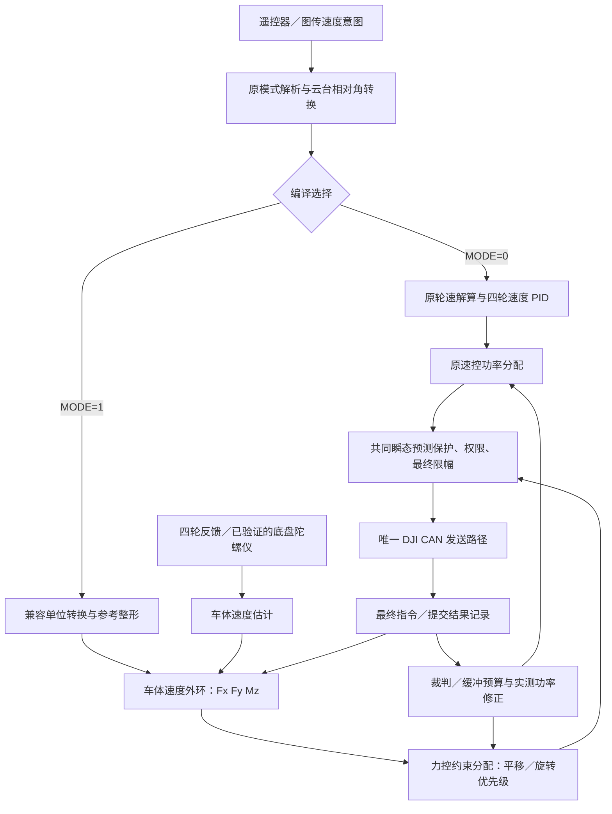

# 底盘速控／力控双后端设计方案

日期：2026-10-24。对象：NSEonLu - atype，STM32F427 / Cortex-M4F，当前四轮 X 型全向底盘。

本文是设计交付，不代表控制代码已经实现、烧录或通过实车验证。以初次检查时本地 HEAD `64cfb32` 为基线，并复核了编写期间出现的工作区更新；底盘速度 P 增益、自旋及跟随／功率策略以实施时实际构建为准，不把这些其他修改纳入本次文档提交。

## 1. 目标与结论

采用“保持操作端速度指令，车体速度外环产生合力／合力矩，分配到四轮电流”的力控结构。保留现有轮速闭环结构，两套源码共存，用 `CHASSIS_CONTROL_MODE` 编译选择，默认仍为速控。第一版不支持运行中切换控制后端。

用户确认的优先目标是：保留操作习惯，改善响应和功率分配，特别是平移与小陀螺同时工作时的表现。力控仍然追踪期望车速，不把遥控摇杆改成直接输出推力。

这里的“力控”指基于模型的车体力／力矩控制和电机转矩执行；项目没有轮地接触力传感器，不能称为实测轮地作用力闭环。力控也不自动保证防滑、速度更快或功率更低，收益必须通过同条件对照确定。

三个可选路线及本方案取舍：

| 路线 | 特点 | 决策 |
| --- | --- | --- |
| 车体速度外环 → 合力／合力矩 → 电流 | 保留操作习惯，可以明确分配平移／旋转能力；需要车体速度估计 | 主方案 |
| 原轮速闭环 + 转矩前馈 | 改动小，适合过渡，但独立轮速控制仍可能互相争抢功率 | 保留原速控作为对照，不额外增加第三套后端 |
| 摇杆直接给力／力矩 | 力控制接口最直接，但松杆制动和速度保持都需重新设计 | 不作为驾驶模式，可用于受控标定工具 |

交付实施后应满足：

1. 速控构建保持原命令、运动模式、功率保护、参数整定行为。
2. 力控构建仅对已注册的四个底盘电机绕过软件轮速 PID，云台和发射电机沿原控制路径执行。
3. 两种后端共用原始操作输入、模式解析、最终输出许可、功率计反馈、裁判／缓冲预算和唯一 CAN 发送路径。
4. 未启用后端的专属执行代码和状态不进入控制任务；不用同时运行两套算法再选择输出。
5. 有明确的单位、坐标、时间戳和版本边界；任何限流都能反馈给力控积分器。

## 2. 当前项目事实与接入约束

以下路径均相对于仓库根目录。

| 项目事实 | 源码依据 | 对设计的影响 |
| --- | --- | --- |
| 默认 `CHASSIS_DRIVE_OMNI_X`，可选麦轮 | `application/robot_def.h` | 第一版力控仅支持 OMNI_X；速控继续支持两种轮型 |
| 基线 `CHASSIS_FOLLOW_MODE=1`；交付复核时工作区已改为 0。0 为原比例跟转，1 为零旋转目标；两者都按云台相对角转换平移 | `application/robot_def.h`、`application/chassis/chassis_motion.h` | 保留两种策略与一次坐标转换；后端选择不得擅自改跟随默认值 |
| 单板 `ONE_BOARD` 为默认 | `application/robot_def.h` | 不能假定另有一套底盘 IMU |
| 轮顺序 LF、RF、LB、RB，对应 CAN1 电机 ID 1、4、2、3 | `application/chassis/chassis.c::ChassisInit` | 新矩阵、功率数组和遥测全部采用同一顺序；旧文档的 ID 描述不能覆盖源码 |
| 轴距 350 mm、轮距 300 mm、半径 60 mm、减速比配置值 19 | `application/robot_def.h` | 换成 SI 单位并进行实物核对；19 是现有配置，不能代替实际总传动比标定 |
| 速度反馈为电机转子 °/s；CAN 解码 rpm 后乘 6 | `modules/motor/DJImotor/dji_motor.c::DecodeDJIMotor` | 新控制层统一 m、s、rad、N、N·m，边界转换 |
| 当前轮速 PID 初始化为 Kp=0.75、Ki=Kd=0，输出上限 15000 | `application/chassis/chassis.c` | 这是初始值；运行时调参／Flash 恢复可覆盖，A/B 必须记录实际参数 |
| `EstimateSpeed()` 为空 | `application/chassis/chassis.c` | 必须新增可验证的车体速度估计，不能只删除轮速 PID |
| 功率适配器先读控制，后限流，再记录最终 CAN 指令 | `modules/motor/DJImotor/dji_power_adapter.c` | 在该链路扩展，避免第二个 CAN 写入者 |
| 基础功率分配使用 `speed_error_rpm`；瞬态保护使用目标轮速、驱动／制动状态 | `modules/algorithm/power_model.c`、`chassis_power_transient.c` | 力控必须替换分配策略，并审计上层语义；不能把期望电流填进目标转速 |
| 功率控制默认 stage 3，功率计开启；当前默认直供 | `chassis_power_config.h`、`chassis_energy_config.h` | 不以超级电容必然存在为前提，保留现有供电模式选择 |
| 编写期间新增直供自适应自旋的 BASE_TRACK／BUFFER_ASSIST／RECOVER 等预算阶段 | 工作区 `chassis_power_budget.[ch]`、`chassis_power_policy.c` | 力控服从共同预算阶段和动态硬上限，不另开一套缓冲能量分配器 |
| 电机任务执行后 `osDelay(2)`，机器人任务执行后 `osDelay(5)` | `application/robot_task.h` | 当前并非严格 500 Hz／200 Hz；所有计算使用实测 dt |
| 快速功率周期有效 dt≤5 ms、控制年龄≤10 ms；瞬态轮反馈默认年龄≤5 ms | `chassis_power_limiter.c`、`chassis_power_transient.c` | 新链路不得无意放宽时效门槛 |
| 有 `INSGetSnapshot` 原子快照，姿态角／角速度为 °／°/s | `modules/imu/ins_task.h`、`ins_service.c`、`ins_service.md` | 先确认 IMU 安装位置和轴向，再决定是否用于底盘 |
| 当前 A 板构建使用 `ins_service.c`，排除了旧 `ins_task.c` | `Makefile`、`CMakeLists.txt` | 不能根据旧 INS 文件推定当前接口具有可用四元数和去重力加速度 |

特别注意：旧代码注释对 `vx/vy/wz`、轮速单位和“右手系／向右为 y”有混用。当前执行链中 `vt/6 → target_rpm → pid_ref=target_rpm*6`，因此 `vt` 在执行边界实际上按电机 °/s 使用。新的物理量换算以执行链和实测方向为依据，不直接把旧 `vx` 当作 mm/s，或把旧 `wz` 当作 rad/s。

## 3. 编译宏、共存与资源隔离

新增 `modules/algorithm/chassis_control_config.h`，由需要选择后端的代码包含。以下是计划接口，当前仓库尚未实现：

```c
#define CHASSIS_CONTROL_SPEED 0
#define CHASSIS_CONTROL_FORCE 1

#ifndef CHASSIS_CONTROL_MODE
#define CHASSIS_CONTROL_MODE CHASSIS_CONTROL_SPEED
#endif

#if CHASSIS_CONTROL_MODE != CHASSIS_CONTROL_SPEED && \
    CHASSIS_CONTROL_MODE != CHASSIS_CONTROL_FORCE
#error Invalid CHASSIS_CONTROL_MODE
#endif
```

轮型兼容检查放在已包含 `robot_def.h` 的应用装配边界：`FORCE && CHASSIS_DRIVE_TYPE != CHASSIS_DRIVE_OMNI_X` 时编译失败。不要让通用配置头反向包含整个机器人应用头。

`CHASSIS_CONTROL_MODE` 加入 `config/atype-options.txt`，Make 和 CMake 共用覆盖入口。它与 `CHASSIS_FOLLOW_MODE`、`CHASSIS_SPIN_MODE`、`CHASSIS_POWER_SOURCE_MODE`、`CHASSIS_POWER_CONTROL_STAGE` 含义独立。初版力控明确要求 stage 3，其余 stage 只在速控允许，避免无意跳过已验证的最终保护。

资源规则：

- 使用 `#if` 选择后端调用、专属状态、注册和初始化，不能只条件编译最后一行输出。
- 力控构建不计算底盘四轮速度 PID；其他 DJI 电机仍按各自配置运行，通用 PID 代码可能仍留在固件中，这是正常的。
- 速控构建不分配力控估计器、积分器、分配器工作区和专属遥测缓存。
- Make 按模式加入新增力控源文件；CMake 对递归发现的力控专属源做条件筛选，配合 `--gc-sections`。用 map／符号表验证，不能只相信链接器会自动移除所有全局状态。
- 不增加独立力控 RTOS 任务；力控快速计算放在现有电机任务，减少调度和跨任务拷贝。
- 第一版不支持运行时后端切换，不保存“上次后端”到 Flash；烧录构建决定后端。参数元数据必须包含后端编号和配置版本。

实施后的构建命令示例（当前直接执行不会得到尚未实现的力控功能）：

```powershell
make -j4 PROFILE=atype-vehicle BUILD_DIR=build/control-speed CHASSIS_CONTROL_MODE=0
make -j4 PROFILE=atype-vehicle BUILD_DIR=build/control-force CHASSIS_CONTROL_MODE=1 CHASSIS_POWER_CONTROL_STAGE=3

cmake -S . -B build/cmake-control-speed -G "MinGW Makefiles" -DATYPE_PROFILE=atype-vehicle -DCHASSIS_CONTROL_MODE=0
cmake --build build/cmake-control-speed -j4
cmake -S . -B build/cmake-control-force -G "MinGW Makefiles" -DATYPE_PROFILE=atype-vehicle -DCHASSIS_CONTROL_MODE=1 -DCHASSIS_POWER_CONTROL_STAGE=3
cmake --build build/cmake-control-force -j4
```

独立构建目录是必要条件，不能切宏后复用另一模式的对象文件。双板时由执行底盘的板选择后端，通信双方保持相同的线上协议布局。

## 4. 结构与数据流



慢任务保留输入模式解析、相对角转换、自旋目标策略和功率预算策略；力控快任务完成估计、参考整形、速度外环、力分配及最终指令反馈。不能让慢任务写一个裸电流数组，再由快任务不检查时效地重复发送。

### 4.1 原子发布与执行顺序

建议新增适配器级 `ChassisActuationSnapshot_s`，包括完整 `ChassisPowerControlSnapshot_s`，并在力控构建中附带 SI 车体速度参考、运动模式和力控参数版本。整包共用 `version/tick_ms`；同一临界区复制。线上 `Chassis_Ctrl_Cmd_s` 不增加条件字段，避免单／双板 ABI 不一致。

每个电机周期按以下顺序执行：

1. 短临界区复制全部电机反馈、控制快照、在线状态及必要的最终指令记录。
2. 校验版本、控制年龄、四轮新鲜度、dt 和驱动许可；失败时四轮输出归零并重置力控状态。
3. 先为全部电机独立记录真实速度反馈。对力控组跳过软件角度／轮速／电流 PID；其他电机继续原逻辑。
4. 适配器在临界区外完成力控估计、速度外环和未约束的力请求，生成诊断电流和期望轮速。
5. 功率模块先更新本周期快保护预算，再对力控请求执行约束分配，然后调用共同的预测电流保护。
6. 发包前再次检查驱动许可、晚到的停机请求、控制版本／年龄和每轮反馈。整数组量化后重新做边界校验；只有这条路径可写 CAN 缓冲区。
7. 记录最终指令、使能掩码、提交成功情况和版本。下一周期抗饱和反馈只使用与上一请求相配、成功提交且新鲜的记录。

“CAN 提交成功”只表示交给发送链路，不证明电机实际执行；实际电流反馈与车体状态仍用于监控。提交失败时不能把上一版期望电流记作已实现力。

### 4.2 必须处理的现有驱动细节

目前 `speed_feedback_aps` 在速度 PID 分支内赋值。若只关闭 `SPEED_LOOP`，功率模块将可能读到零速度。必须把测量速度采集从 PID 分支提取出来，力控和速控都能得到真实反馈。

扩展输出组增加可选的 `prepare_current` 钩子，在反馈快照建立之后、功率限流之前执行；只负责已注册的四个电机。选后端的宏判断留在适配器装配中，通用 DJI 驱动只识别该组是否拥有原始电流输出权。力控准备失败必须清零全组，不能落回上次电流。

不通过改写 `pid_ref` 的含义实现力控；保持它在原速控中的速度语义。力控电流使用独立、带类型和版本的字段。

## 5. 物理量、坐标与几何

### 5.1 新控制核心的统一约定

选择车体右手系 B：x 向前、y 向左、z 向上，正 yaw 为俯视逆时针；原点在标定的车体质心。旧输入坐标继续保留，在边界映射，不全局修改原代码方向。

| 字段 | 单位／意义 |
| --- | --- |
| `velocity_body[3]` | vx、vy：m/s；omega：rad/s |
| `wrench[3]` | Fx、Fy：N；Mz：N·m |
| `wheel_force[4]` | 沿各轮正驱动方向的等效切向力 N |
| `current_a[4]` | 转矩电流 A，不是直流母线电流 |
| `current_cmd[4]` | C620 CAN 原始指令数值，最终 int16 |
| `motor_rpm[4]` | 转子 rpm，保留现有功率模型的输入单位 |
| `radius_m`、`position_m` | 实测轮半径和轮接地点相对质心位置 |

轮序固定 LF、RF、LB、RB。对每轮标定位置 `(x_i,y_i)`、正电流驱动对应的切向单位向量 `t_i=(tx_i,ty_i)`，把方向修正包含在向量内；电流、反馈、运动学不得再次各自翻转同一个符号。

定义 4×3 矩阵 H：

```text
H_i = [tx_i, ty_i, x_i*ty_i - y_i*tx_i]
u = H * v                   # u 是轮缘驱动方向线速度，m/s
W = H^T * f                 # W=[Fx,Fy,Mz]^T
u_i = r_i/N_i * omega_motor_i
omega_motor_i = speed_aps_i * pi/180
```

力映射来自虚功恒等式 `W·v = f·u`，必须用同一个 H，不能另抄一份有不同符号的力分配矩阵。全向轮运动学的通用构建方法可参考 [Modern Robotics 13.2](https://modernrobotics.northwestern.edu/nu-gm-book-resource/13-2-omnidirectional-wheeled-mobile-robots-part-1-of-2/)；本文的轮型实例和软件边界是依据本项目设计。

几何中心与质心不重合时，用实测质心坐标重建 H。旧 `CENTER_GIMBAL_OFFSET_*` 表示云台中心偏移，不自动等于质心偏移。

### 5.2 对称 X 型的解析示例

此例用于推导和测试；轮向与实物一致后才能作为实际标定值。设半轴距 a=0.175 m、半轮距 b=0.150 m，c=1/sqrt(2)，l=(a+b)c≈0.229810 m。

```text
位置：LF=( a, b), RF=( a,-b), LB=(-a, b), RB=(-a,-b)

H = [ -c,  c, l
       c,  c, l
      -c, -c, l
       c, -c, l ]

H^T H = diag(2, 2, 4*l*l)
v_hat = inverse(H^T H) * H^T * u

最小二范数分配 f0 = H * inverse(H^T H) * W：
f_LF = (-Fx+Fy)/(2*sqrt(2)) + Mz/(4*l)
f_RF = ( Fx+Fy)/(2*sqrt(2)) + Mz/(4*l)
f_LB = (-Fx-Fy)/(2*sqrt(2)) + Mz/(4*l)
f_RB = ( Fx-Fy)/(2*sqrt(2)) + Mz/(4*l)
```

一般非对称情况在初始化时计算 `H_plus=(H^T H)^-1 H^T` 和 `A=H(H^T H)^-1`，运行时做固定维数乘法。以特征长度缩放旋转列后检查秩和条件数，不能拿有量纲的原始矩阵行列式随意设阈值。秩不足或标定校验失败禁止力控使能。

第一版令冗余轮力的零空间分量为零，不额外加入无车体合力但增加轮间内力和耗电的电流。上述分配不是含电机损耗约束的全局最优解。

### 5.3 保持旧操控比例的兼容映射

保留 `ChassisResolveMotion` 的现有结果，不再第二次做云台坐标转换。把旧运动学解算记作 `s_legacy=K_legacy(q)`，它返回实际用于电机参考的 °/s。先按每轮半径和减速比得到：

```text
u_legacy_i = r_i/N_i * (pi/180) * s_legacy_i
v_ref_raw = H_plus * u_legacy
compatibility_residual = u_legacy - H*v_ref_raw
```

这保留了旧控制器的目标轮速比例，避免直接把 `wz=6000` 等旧命令当成物理角速度。初始化可通过三个基向量求出 3×3 兼容矩阵，运行时无需重复完整旧解算。

轮向和旧坐标的关系必须通过纯前进／横移／自旋实验确认。若残差不在浮点容差内，说明几何、轮序、符号或旋转中心未对齐；不能默默投影并忽略不可实现的分量。若旧旋转中心与质心不同，要先作刚体速度参考点变换再验收。

力控参考再经物理速度上限和加速度／加加速度限制，因此不会保证所有极端指令都与旧后端有相同轮速；同条件比较应选两者都未触及速度上限的工况。

## 6. 电流到驱动力的标定

C620 的 CAN 转矩电流指令范围为 ±16384，对应 ±20 A；因此对发送指令使用 `I_A = cmd * 20 / 16384`，不能把原始指令直接当 mA。协议依据见 [DJI C620 使用说明](https://cdn-hz.robomaster.com/robomasters/public/document/RoboMaster%20C620%20Brushless%20DC%20Motor%20Speed%20Controller%20V1.0.pdf)。反馈字段的标度应按对应字段说明与实测独立核对，不能仅因发送标度相同就推定反馈标度。

推荐使用每轮减速器输出端的实测有效转矩常数 `K_out_i`，单位 N·m/A：

```text
tau_out_i ≈ K_out_i * I_A_i
f_i ≈ tau_out_i / r_i
cmd_i = f_i * r_i / K_out_i * 16384/20
f_sent_i = final_cmd_i * 20/16384 * K_out_i/r_i
```

若使用转子转矩常数 Kt，则 `K_out=eta*N*Kt`；若已经使用输出端常数，禁止再乘一次减速比。效率和摩擦随速度／方向变化，上式是低阶执行模型，不等同于地面实际力。

初期用低速、短时的已知力臂和测力设备，记录不同正负电流下的输出转矩，拟合斜率及摩擦偏置；不能长期堵转。整车质量用满载称重；Jz 可先从机械模型估计，再以已知转矩下的正反向角加速度辨识并扣除摩擦，或用独立摆动实验交叉核对。之后用已知质量的直线加速数据校验输出常数。没有标定的质量、惯量、转矩常数不得用猜测值宣称“已完成力控”。实现时设置有效标定标志和配置校验，不满足时力控构建可以编译，但不能使能输出。

当前功率模型为：

```text
I_model = abs(current_cmd / current_conversion)
n = abs(motor_rpm)
P = k0 + k1*I_model + k2*n + k3*I_model*n + k4*I_model^2 + k5*n^2
```

现有配置 `current_conversion=1000` 是既有拟合模型的输入缩放。即使原注释称其为 mA 换算，也不能只改成 819.2 而保留所有系数，否则预测功率会变化。力控物理换算与功率模型缩放分别管理；首版保留既有功率模型，后续若改自变量需重标定或严格等价变换系数并回归验证。

该模型取电流和速度绝对值，不是带回馈符号的母线功率模型。制动不能被当作“负功率抵扣”放宽驱动预算。

## 7. 车体速度估计与可观测性

### 7.1 第一版：轮速里程计

使用同一电机周期的四轮快照，将转子速度转成轮缘速度，然后 `v_hat=H_plus*u`。对结果做一阶低通，采用真实 dt；初始低通时间常数候选 10 ms，台架按噪声和延迟调整。不能再次对已有滤波的转速施加过重滤波。

每帧输出 `tick_ms`、轮反馈序号／年龄、有效掩码、估计方法、速度和残差 `rho=u-H*v_hat`。第一版要求四轮均新鲜；单轮掉线时全组停止，不实现三轮继续驾驶。

`rho` 可发现部分轮速不一致、方向错误或单轮滑移，但无法发现四轮一起滑动且仍满足运动学关系的情况。轮速估计是里程计速度，不是无滑移保证下的真实地速。

### 7.2 可选：经过确认的底盘陀螺仪

在明确 IMU 固连底盘并完成轴向标定后，可选择 gyro yaw。用 `INSGetSnapshot`，将 °/s 转 rad/s；已有有效时间检查继续生效。

gyro 给定 omega 后，用 H 的前两列求平移最小二乘：`v_xy=H_xy_plus*(u-h_omega*omega_gyro)`。gyro 帮助识别旋转打滑，但不直接解决平移共同打滑。

默认单板可能随云台安装。云台角速度不能直接当底盘角速度；只有一套云台 IMU 时，第一版仍用轮速估计。以后若采用“云台绝对角速度减相对 yaw 速度”，必须单独处理时间同步、轴投影及 pitch 运动，不在首版隐含启用。

不直接积分当前 `attitude.Accel` 得到底盘速度：它未被证明是底盘质心处、去重力且同步的线加速度。加速度融合和可靠地速传感器属于后续增强。

选择 gyro 源后 gyro 失效，采用显式的估计降级状态：四轮仍健康时回到轮速估计并使用预设低速／低加速度上限，冻结积分和自旋升速；若轮速也不可信则零输出。此为同一力控后端的传感器降级，不是自动切回旧速控。

## 8. 参考整形与车体速度外环

### 8.1 参考生成

保留所有输入方式和按键模式。在电机任务中对慢任务的最新 SI 速度意图进行参考整形，以实测 dt 限制平移加速度、旋转加速度和加加速度；速度向量优先整体限幅，避免逐轴裁剪改变驾驶方向。

参考导数由参考生成器计算并限幅，不能把跨 0/360° 的云台编码器差直接当加速度。身体坐标变动也会改变速度分量，参考更新和外环必须采用同一坐标定义。初期可令加速度前馈为零，确认反馈稳定后再打开。

### 8.2 控制方程

令 `v=[vx,vy,omega]`，`e=v_ref-v_hat`，`z` 是加速度单位的积分输出。平面、近水平、刚体近似下：

```text
ax_cmd = dvx_ref/dt + Kpx*ex + zx
ay_cmd = dvy_ref/dt + Kpy*ey + zy
alpha_cmd = domega_ref/dt + Kpw*ew + zw

Fx_req = m * (ax_cmd - omega_hat*vy_hat)
Fy_req = m * (ay_cmd + omega_hat*vx_hat)
Mz_req = Jz * alpha_cmd
```

旋转交叉项来自 `F_xy=m*(dv_xy/dt + omega*S*v_xy)`，其中 `S*[vx,vy]=[-vy,vx]`。在小陀螺平移时，不能漏掉它，也不能同时在前馈和反馈中重复添加。上述导数是 B 系分量的时间导数；若以后输入的是惯性系物理加速度，先转换定义再使用。

第一版不加速度误差微分项；轮速差分噪声、传动间隙和滚子振动会放大 D 项。起步设置 Ki=0，先调 P，再加有限积分和前馈。

参数以目标时间常数配置更直观：初调可从平移 0.3～0.5 s、旋转 0.4～0.8 s 开始，`Kp=1/tau`。这些是低速调试起点，非已验证实车参数。质量 m、Jz、各轮 K_out 来自称重／测量／辨识，不给出虚构的通用数值。

当轮组旋转惯量对加速有明显影响时，用辨识得到的有效动力学或显式轮惯量项扩展；首版把这一误差作为低带宽控制和标定的限制，不把静态转矩换算称作精确动态模型。

### 8.3 抗积分饱和

用最终成功提交的电流重建等效 `W_sent=H^T*f_sent`，与同版本的 `W_req` 比较：

```text
dz/dt = Ki*e + Kaw * inverse(diag(m,m,Jz)) * (W_sent-W_req)
```

`Kaw` 单位 1/s，z 分别按最大允许加速度比例限幅。功率约束、轮电流限制、参考限幅和最终保护均会降低可实现力，因此不能只看外环自己的饱和标志。

长时间限功率时抑制继续向不可实现方向积分，允许反向误差解除积分。停机、后端初始化、失联和故障时清零积分；普通模式切换清除不适用的旋转积分并从当前参考平滑过渡。

最终记录超时、版本不匹配或 CAN 提交失败时冻结积分并进入故障处理，不拿零／旧电流假装当前实际输出。第一版全链路 Ki=0 运行合格后，再逐轴开放积分。

## 9. 力与电流约束分配

### 9.1 为什么不用旧的轮速误差分配

力控已在车体层决定 `Fx/Fy/Mz`。按某轮速度误差再分配功率，可能改变合力方向或把平移额度分给旋转；也会让外环与功率分配器竞争。首版保留功率预测函数和快保护，力控不使用旧 `AllocatePower` 的轮速误差权重。

约束至少包括：四轮电流幅值、保守轮缘力限值、正常电流变化率、参考转速上限、当前预算和最终预测功率上限。轮缘力限值可用 `mu_safe*N_i` 的保守估计，但需承认缺少动态法向力测量，不能当作精确摩擦锥。

### 9.2 低计算量的分层分配

采用解析最小范数分配加两次一维约束求解，不在 STM32 上引入通用 QP／MPC。

把请求分成高优先部分 W_H 与低优先部分 W_L：

- 默认 W_H 包含平移请求，以及与当前旋转方向相反的制动／超速抑制转矩。
- W_L 包含同向旋转驱动转矩；小陀螺功率不足时先减少它。
- 无平移请求时，旋转可使用剩余全部能力。正常跟随／非跟随档的零角速度阻尼属于高优先部分。
- 高优先是偏好而非硬性保证；总功率不足时平移和制动都可能受限。

设未约束电流 `c_H=ForceToCurrent(A*W_H)`、`c_L=ForceToCurrent(A*W_L)`：

1. 在 `c=alpha*c_H` 上求最大可行 alpha∈[0,1]。
2. 固定 alpha，在 `c=alpha*c_H+beta*c_L` 上求最大可行 beta∈[0,1]。
3. 校验候选并交给共同的瞬态预测保护，最终回算 W_sent。

两次求解不保证全局最优，可能放弃利用旋转抵消部分轮电流来进一步提高平移的机会；它换取稳定的计算上界和易解释的优先级。若后续数据证明能力损失明显，再考虑四变量约束优化。

### 9.3 一维可行区间的求法

对 `c_i(t)=a_i+b_i*t`，先与各轮允许的电流区间相交，得到 t 的线性可行区间。正常电流斜率限制也转换为该区间；急停和硬功率限制可越过软斜率直接减流。

固定本周期用于分配的各轮转速后，功率模型含 `abs(c_i(t))` 和 `c_i(t)^2`。在最多四个电流过零点处分段，每段总功率都是二次式。逐段求 `P(t)≤P_allow` 的可行区间，取全局最大可行 t，不做“从零开始一定单调”的二分搜索。

原因：现有模型 `k1<0`，且平移／旋转电流可能互相抵消；功率沿 t 未必单调。需要测试二次、线性、常量、双可行区间、根贴边和浮点容差情形。所有搜索次数有确定上界：每次最多 5 个符号区间，两次最多 10 个，不是无界迭代。

分配预算取同一周期 `ChassisPowerTransientUpdate` 输出允许的模型／保护额度中的保守值，不再重复乘多个安全系数，也不直接用旧 nominal budget 代替快环修正后的预算。可用额度的具体取值由功率模块单点计算并输出。

若软斜率使解集为空，先丢弃软斜率重新求解，硬电流与功率约束不放宽。若仍无解，置 `allocator_infeasible`，零输出并冻结积分／自旋升速。高速下模型即使在零电流仍可能预测超预算，零输出是无法继续驱动的处置，不能宣称它瞬间保证实测功率已达标。

最终电流整数化后复验约束，因为绝对值模型中“截向零”也不一定使预测功率严格下降。最终保护仍保留现有搜索和无解标志。对预测 guard 修改后的输出，按最终合力而非分配前合力执行抗饱和。

## 10. 与既有功率、自旋、整定的兼容

### 10.1 功率模块

保留 `ChassisPowerUpdatePolicy` 的预算来源、缓冲恢复、慢功率修正、快超功率抑制和最后预测保护。扩展 `ChassisPowerCycleInput_s` 的力控专属输入，不改变原速控输入含义；由 `#if` 排除未启用后端分支。

工作区新增的自适应直供自旋预算阶段也由两后端共用。`adaptive_spin` 继续来自同一运动模式；`spin_capability_limited` 在力控来自执行器／车体跟踪状态，不读取停用的速度 PID。基础功率确认使用真实新功率样本，缓冲增补服从该策略输出的 `power_ceiling_w`。第 9 节的“平移优先”仅决定已获准电流／功率内的分配，不提前消耗尚未获准的缓冲额度。进入能量恢复或额度降低时，力控立即重算约束并抗饱和。

力控流程内部顺序固定：未约束力请求／电流 → 瞬态预算更新 → 力控分配 → `ChassisPowerTransientGuard` → 全组最终检查。原 `PowerModelApply` 的轮间再分配只用于速控；力控填充等价的功率遥测并用 `PowerModelRecomputeFinal` 重算最终预测值。

`target_rpm` 在力控仍保留：由整形后的 `v_ref` 经 H 和传动比计算，它是运动目标和诊断量，不接回轮速 PID。瞬态驱动／制动分类以当前电流与实际轮速的方向关系为准，零速用电流需求死区；启动判据兼顾真实力／电流需求，不仅依赖目标轮速大阶跃。以上改变须在力控分支测试，速控结果保持一致。

功率计丢失时沿现有模型降级策略，禁止新增正向预算学习和自旋加速；若预算本身无效则禁止驱动。第一版不引入再生功率抵扣，主动制动仍受既有电气功率和电流约束。

### 10.2 小陀螺与跟随

保留 `ChassisSpinUpdate` 的固定／功率自适应／正弦目标策略，输出仍是旧命令单位，在兼容层转换。自适应升速许可在力控中增加：估计有效、车体角速度已跟上、平移误差在容差内、alpha/beta 未受限、最终 guard 未削减、无打滑疑似状态。

原“速度 PID 饱和”条件改为力控实际执行器饱和；不可检查已经不运行的 PID 输出。不能为追求用满功率而持续增加不可达到的角速度。

`CHASSIS_FOLLOW_MODE=1` 时跟随档仍 `omega_ref=0`，但速度外环会产生抑制实际旋转的阻尼转矩；这不是绝对 yaw 角位置锁定。交付复核时工作区默认已恢复为 `CHASSIS_FOLLOW_MODE=0`，必须保留其原比例跟转目标；两种跟随策略、NO_FOLLOW 和小陀螺都经同一参考整形。小陀螺退出后，目标意图立即切换到目的模式：FOLLOW=1／NO_FOLLOW 为零，FOLLOW=0 为当前角度误差产生的跟转目标；执行参考受控过渡，急停直接零输出。

### 10.3 调参与自动整定

原轮速 PID 调参／自动整定仅在速控后端拥有底盘执行权。力控构建拒绝底盘轮速自动整定启动，不能暂时接管成另一套控制；其他参数读取可保留并标明“不参与当前底盘控制”。

新增独立 `TUNING_FORCE` 参数组：质量、惯量、转矩标定、Kp/Ki/Kaw、参考加减速与 jerk、估计滤波、轮力／电流限值。结构带版本、单位、范围和 CRC；不能复用旧 `TUNING_PID` 的 Flash 数据布局。

为控制范围，第一版力控参数可先仅编译配置；接入持久化时完整走现有停稳和保存许可。几何／转矩标定只能停稳时修改并重建矩阵；不允许运动中改变 H。

## 11. 状态机与故障行为

| 状态 | 进入条件 | 输出和恢复 |
| --- | --- | --- |
| DISABLED | ZERO_FORCE、原安全系统不允许驱动 | 四轮零电流，清积分；不以主动抱死替代现有急停语义 |
| READY | 标定有效、指令／反馈有效且满足现有复位许可 | 零输出，参考从当前测得速度初始化，随后受控趋向命令 |
| RUN | 许可持续有效 | 正常外环、分配和保护 |
| LIMITED | 功率／电流／速度约束生效 | 输出可行电流，抗饱和，限制自旋增速；不是故障重启 |
| DEGRADED | 可选 gyro 失效但轮速估计仍可信 | 轮速估计，低速上限、冻结积分与自旋升速 |
| FAULT | 轮掉线、NaN、版本错误、控制超时、dt 超限或 CAN 提交失败 | 全组零输出，清积分，记录原因；恢复采用原安全复位条件并等待新鲜反馈 |

实现时运行许可取原 `VehicleSafety` 与力控健康锁存的逻辑与，不让局部“健康恢复”绕过原急停复位要求。力控复位须重新看到中立／复位输入及连续新鲜反馈，不能仅凭 `VehicleSafetyAllowsDrive` 保持为真自动重启。重复故障保留诊断计数。

轮速超过标定物理上限时阻止继续同向加速，并在允许功率内制动；电流失控／反馈不可信时零输出。无法凭软件零电流保证立即停住，验收记录滑行距离和制动距离，二者分别评估。

## 12. 模块边界与建议文件

新增文件名均为建议实施位置，不声称已存在。

| 模块／文件 | 职责及接口语义 |
| --- | --- |
| `modules/algorithm/chassis_control_config.h` | 后端宏、合法值检查 |
| `modules/algorithm/chassis_force_geometry.[ch]` | 几何、SI／旧命令边界、H/H_plus/A、力与电流转换；初始化校验，不依赖 HAL |
| `modules/algorithm/chassis_force_estimator.[ch]` | 轮速／可选 gyro 估计，时效、残差和可信度 |
| `modules/algorithm/chassis_force_controller.[ch]` | 参考整形、车体速度 PI、旋转交叉项、最终输出抗饱和和状态重置 |
| `modules/algorithm/chassis_force_allocator.[ch]` | 两层有界分配和一维分段功率约束；输入本周期额度，输出电流与 alpha/beta |
| `application/chassis/chassis.c` | 构建选择、共用命令解析、一次原子发布；力控专属初始化 |
| `modules/motor/DJImotor/dji_power_adapter.[ch]` | 持有力控快环状态，组合算法，原始电流钩子、预算适配与最终记录 |
| `modules/motor/DJImotor/dji_motor.[ch]` | 反馈与 PID 解耦、四轮组输出所有权；保留统一 CAN 打包 |
| `modules/chassis_power/chassis_power_types.h`、`chassis_power_limiter.c` | 力控请求数据和后端分配分支，保留共用保护 |
| `modules/algorithm/chassis_power_transient.[ch]` | 审计力控启动／制动语义，必要变更限于力控输入策略 |
| `modules/telemetry/`、`tools/usb-telemetry/` | 后端元数据、力控遥测扩展；旧协议版本继续可解析 |
| `config/atype-options.txt`、`Makefile`、`CMakeLists.txt` | 宏传递、按模式源文件选择和链接隔离 |

算法接口按值输入／输出，显式传配置、状态和 dt，无内部 HAL 时钟，无周期 malloc。最小契约如下：

- Geometry：输入四轮位置、方向、半径、传动比与 K_out；输出只读矩阵及兼容映射，非法配置返回 false。
- Estimator：输入一次完整轮反馈快照和可选同步 gyro；输出带时间戳的 `v_hat`、残差和有效标志。
- Controller：输入参考、估计、上一版本最终指令反馈；输出 W_req、整形速度、积分／限幅诊断。
- Allocator：输入 W_H/W_L、实际转速、额度和电流限制；输出候选电流、alpha/beta、预测功率与可行性。失败时输出数组归零。
- Final feedback：最终 int16 电流、使能掩码、版本、时间与 CAN 提交结果；只由原发送链路发布。

这些本地结构不放在 `robot_def.h` 的压缩线上结构区，避免对齐访问问题和双板消息布局变化。

## 13. 运算负担、Flash 与 RAM

源码同时存在不会让两套控制同时运行。额外运行负担来自选中力控后新增的算法，而非“共存”本身；Flash／RAM 是否完全移除需由条件编译、注册和链接结果共同证明。

力控每周期主要增加：4 轮单位转换、固定 3×4／4×3 乘法、三个速度通道控制、两次至多 5 段的一维可行区间求解。预计算矩阵逆、兼容变换和固定常数。使用 `float` 与 `sqrtf`，不用周期内通用矩阵求逆、堆分配、CSV 格式化或无上限优化。

原瞬态预测 guard 默认最多 256 个搜索节点，可能比新增矩阵计算更耗时。必须分别测估计、外环、分配、原 guard、CAN 发送及整任务耗时，不能只对新控制函数计时。

建议资源验收目标（属于实施门槛，不是当前测量结论）：

- 新力控估计＋外环＋基础分配的最坏耗时目标≤200 μs；完整电机任务最坏执行时间目标≤1 ms，给现有 2 ms 延时策略和中断留余量。
- 实测快速周期最大 dt 不触发既有 5 ms 有效性门槛；若不能满足，先降低求解／遥测负担，再单独评审调度，不能直接放宽门槛掩盖超时。
- 新算法常驻 RAM 目标≤4 KiB（不含可选长时记录缓存）；电机任务栈最小余量至少 128 个 FreeRTOS words，并以 map 和高水位实测确认。
- 速控构建在 map 中无力控专属状态和函数；对相同输入的输出回放保持一致。记录 speed／force 两构建的 text/data/bss 差值。
- 计时用 DWT，并记录最大值／分位数和 CAN 错误计数。旧 `chassis_power_motor_max_dt_ms` 实际测的是任务执行耗时，不等于两次调用间隔；新增统计分别命名。

目标未达到时，方案不通过时序验收，即使架空时能转也不能判定完成。首版保留原任务调度形式，改用 `vTaskDelayUntil` 等属于另一个需回归的调度变更。

## 14. 遥测与调试信息

利用现有 USB／RTT 通道，快速任务仅写固定大小快照，慢任务格式化。新增协议版本或独立力控帧，不在旧帧中悄悄重解释单位。

必需字段：

| 类别 | 字段 |
| --- | --- |
| 身份 | 构建后端、轮型、跟随／自旋模式、几何／力控／功率参数版本 |
| 参考与状态 | 原命令、SI 速度意图、整形速度、估计速度、残差、估计来源和年龄 |
| 力请求 | W_req、分配后 W、最终电流重建 W_sent、三个积分输出 |
| 执行 | 每轮原始／分配／guard／最终电流、转子 rpm、反馈电流、温度 |
| 约束 | alpha/beta、每轮电流饱和、速度上限、功率／斜率限制、不可行原因 |
| 能量 | nominal／target／本周期可分配预算、预测／实测功率、缓冲恢复状态 |
| 时序与故障 | 指令／反馈序号和年龄、实际 dt、各段耗时、CAN 提交结果、故障计数 |

每次 A/B 记录地面、电池电压、负载、轮胎、供电模式、预算、速度目标、所有运行时参数和固件标识。比较能耗使用相同距离／动作的积分能量，不能只看瞬时功率低。

## 15. 标定、实施顺序与阶段产物

本节是实施路线及验收依赖，不是已经执行的变更清单。

### 阶段 A：冻结基线与单位契约

保存当前速控构建和实车参数，记录原始输入到四轮目标 °/s／rpm 的回放数据。核对 CAN 顺序、正电流方向、轮向、实测半径和总传动比。新增后端宏但默认速控，先验证默认构建与原行为一致。

产物：速控基线、宏编译矩阵、几何／单位约定。未通过，不接入力控输出。

### 阶段 B：只读几何与估计验证

实现纯 C 几何和估计器，在速控实验固件中通过显式测试开关短期采集影子数据；正常发布的速控构建不运行影子算法。架空验证转向，落地直线／横移／旋转对照外部测量，检查兼容残差。

产物：已验证 H、H_plus、旧命令兼容映射、轮速估计误差记录。IMU 安装无法确认时明确采用轮速源。

### 阶段 C：电流执行与保护闭环

标定 K_out、质量 m、Jz、保守电流和力限制。添加输出组原始电流钩子、真实反馈路径、版本／超时检查和最终指令记录；以受控单轮／低电流短时测试核对正负方向和故障归零。

产物：绕过底盘速度 PID 后仍能正确限流、停机和记录的执行链。原自动整定在力控构建必须拒绝启动。

### 阶段 D：低速车体闭环

先轮速估计、Ki=0、加速度前馈关闭、低速度／低加速度上限、固定低速自旋。逐轴调 P，验证松杆、正反切换和模式切换；随后增加旋转交叉补偿验证、前馈和有限积分。

产物：稳定且有基本抗饱和行为的车体速度外环。交叉项在完整模型中必须存在；分步调试可对比开关，但不能把关闭交叉项作为最终高速方案。

### 阶段 E：平移优先约束与自适应自旋

接入两层分配、同周期快保护额度及全部保护状态；先固定自旋 A/B，再开放现有功率自适应自旋与正弦策略的力控升速许可。验证预算突降、启动、制动和无解恢复。

产物：响应和功率分配指标达到约定门槛，速控回归保持通过。

### 阶段 F：完整构建与实机交付

完成 Make／CMake 两后端、宏非法值、资源隔离、故障注入、遥测、Flash 版本（若本阶段接入）和实车对比。交付构建命令、固件标识、参数文件、测试记录及回退步骤。回退使用独立速控构建重新烧录，不依赖在故障中的运行时切换。

## 16. 验证矩阵与完成标准

### 16.1 主机算法测试

拟新增 `tests/chassis_force_geometry`、`tests/chassis_force_estimator`、`tests/chassis_force_controller`、`tests/chassis_force_allocator`；扩展现有 `tests/dji_chassis_power_rtt`、`tests/chassis_power_module`、`tests/vehicle_motion` 和模式测试。

必须验证的性质：

1. 随机速度／轮力满足虚功等式；三种基向量的解算与回代误差在数值容差内；轮序和方向翻转一致。
2. °/s↔rad/s↔rpm、减速比、毫米↔米、CAN 指令↔A 的单元测试；输出端常数不重复乘 N。
3. 旧命令兼容：相同未限幅参考经过 SI 反算后重建同一四轮目标；明确残差故障。
4. 无滑移合成数据估计正确；轮序颠倒、单轮失效、过期、时钟回绕、gyro 异常和共同滑移的可观测性限制均有案例。
5. 理想独立刚体动力学仿真验证速度阶跃、旋转中的固定惯性方向平移、PI 抗饱和和解除限功率后的恢复，不用同一控制公式替代整个被控对象。
6. 分配结果满足硬电流／功率约束；分段求根与离线高密度扫描交叉核对，包括非单调／零点／根边界／无解／整数化后重验。
7. 力控绕过 PID 时功率模块仍看到真实转速；最终输出记录与 CAN 字节一致；其他电机控制不受影响。
8. NaN、Inf、dt≤0 或 >5 ms、指令过期、反馈过期、版本不符、CAN 提交失败和晚到急停，均不会重复输出旧电流。
9. 速控分支用相同输入记录回放，轮速参考、原始电流、限流和最终输出与基线一致；已有 PID 整定测试继续通过。

### 16.2 构建矩阵

- MODE：默认、0、1、非法值 2；非法值必须编译失败。
- 速控：OMNI_X／MECANUM、FOLLOW 0／1、自旋固定／自适应／正弦，既有供电与保护阶段测试保持覆盖。
- 力控：OMNI_X、stage 3；FOLLOW 0／1、自旋三种模式；力控+麦轮或不支持的 stage 明确编译失败。
- 两后端都覆盖单板和底盘板编译；双板的消息长度、字段偏移和版本一致。
- Make 和 CMake 都验证宏实际进入编译命令。Release 对 NaN 检测敏感的控制／保护源禁止使用破坏 `isfinite` 语义的 fast-math；当前 CMake Release 使用 `-Ofast`，实施时必须单独审计并对相关源关闭 fast-math，不能仅在主机 `-O0` 测试。

### 16.3 实机顺序与初始验收门槛

以下为建议验收目标；先用相同工况测速控基线，再判断力控是否通过，不能把它们写成已经达到的性能。

| 工况 | 方法 | 门槛 |
| --- | --- | --- |
| 架空单轮低电流 | 四轮逐一正负方向与反馈核对 | 轮序、转向和电流指令标度全部一致；故障时无旧输出 |
| 低速直行／横移 | 外部测速或已知距离测时，速度在已验证范围 | 稳态误差≤目标的 10% 或 0.05 m/s（取较宽者），超调≤15%，无持续振荡 |
| 原地旋转 | 外部角速度参考／已标定底盘 gyro | 稳态误差≤目标的 10% 或 0.1 rad/s，无积分持续堆积 |
| 平移＋固定小陀螺 | 同预算、同参考、同地面重复至少 5 次 | 平移响应 t90 中位数比速控改善≥10%；稳态误差、振荡和功率超限指标不恶化 |
| 饱和后释放 | 高需求到低需求／预算降低再恢复 | 无长时间反向冲击；解除限制后能回到正常误差范围 |
| 松杆与模式切换 | 正反平移、小陀螺进入／退出、云台朝前侧后 | 方向与既有操作相同；制动连续，不把模式切换误触发成失联重启 |
| 功率边界 | 预算阶跃、缓冲恢复、功率计失联 | 预测输出符合当期有效硬约束；实测超限幅度／持续时间不劣于速控，同一策略不越过源端硬上限 |
| 失联／急停 | 指令／轮反馈断开、晚到停机、CAN 失败 | 检出后至下一次可发送输出为全组零；恢复需复位及新鲜反馈，记录实测延迟 |
| 时序和热稳定 | 最大遥测负载、复杂小陀螺持续运行 | 满足第 13 节周期和栈门槛，无异常温升／CAN 错误趋势 |

加速性能比较需外部地速测量；只看轮速达到目标更快可能只是打滑更严重。功率限制不是精确瞬时电功率保证，分别记录模型限幅是否正确和实测瞬态表现。

如果力控不能稳定优于或至少满足关键指标，保持 `CHASSIS_CONTROL_MODE=0` 为默认；“增加了算法”不等于可以替换成熟控制器。

## 17. 明确的边界与后续扩展

本方案已给出控制结构、数学关系、共存宏、模块边界、功率接入、故障策略、资源门槛和实施验收路线。落地前仍需要测量的实物数据是：实际轮向／CAN 对应、传动比、半径、质心、整车质量、Jz、K_out、IMU 安装位置、轮地力上限和实际任务耗时。每项均有上述标定或验收入口，不以猜测值替代。

首版不承诺强防滑、不加入全状态 EKF／MPC、不加入运行时后端切换、不迁移全部旧命令单位、不重写现有功率预算模块。后续可根据 A/B 记录增加外部地速融合、轮惯量／摩擦补偿、零空间损耗优化和更完整的约束分配。

对于“共同存在是否增加单片机负担”：编译期只选一个后端，未选后端没有周期执行成本；力控自身的计算、常驻状态和保护开销必须按第 13 节实测。设计目标是可以随时构建回原速控，并能用数据说明力控带来了什么收益。

## 18. 本次设计验证记录

已对对称 X 型示例做 16 种轮向符号组合、每组 1000 个随机样本，共 16000 组独立数值检查，验证虚功等式、速度逆解、力分配回代以及旧命令兼容映射。双精度检查最大误差分别约为 2.3e-13、3.6e-15、4.3e-14、8.9e-16。这些检查只验证示例公式；实际 float 实现、非对称标定、约束求解、固件时序和实车效果仍须执行第 16 节验证。

本次仅新增方案 Markdown，不修改控制源码，不执行烧录，不将其他工作区修改一起提交。
