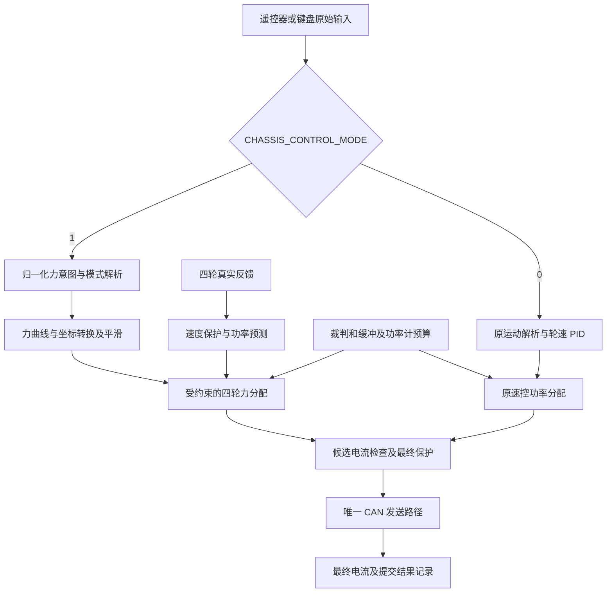

# 底盘速控／直接力控：宏切换实施方案

日期：2026-10-25。适用项目：NSEonLu - atype，STM32F427，四轮 X 型全向底盘。

状态：设计交付，控制代码尚未实施。本方案替代 2026-10-24 方案中的“车体速度外环产生力／力矩”路线。编写时已核对本地 HEAD `bf07270` 和当前底盘相关工作区代码；本文不代表已完成编译、烧录、标定或实车验证。

## 1. 已确定的控制原则

1. 用 `CHASSIS_CONTROL_MODE` 编译选择原速控或直接力控，默认速控；不在运行中切换。
2. 直接力控主线为：操作输入 → 车体期望力／力矩 → 四轮力分配 → 转矩电流 → C620。
3. 力控模式不运行底盘四轮速度 PID，也不运行车体速度 PI/PID；不生成用于跟踪的目标车速或目标轮速。
4. 小陀螺直接施加旋转力矩，最高转速作为保护边界，不维持某个目标转速。
5. 速度反馈仅用于功率预测、限速、制动方向与结束判断、故障检查和遥测，不作为正常驱动力的速度误差来源。
6. 电调内部电流／转矩控制保留。只有四个已注册底盘电机使用直接电流入口，云台和发射电机继续走原驱动路径。
7. 保留唯一 CAN 打包发送路径、VehicleSafety、裁判／缓冲预算和功率计保护。

禁止在力控路径中使用 `Kp*(v_ref-v)`、速度误差积分、角速度目标跟踪，或用“阻尼／前馈”的名称隐含恢复这些环节。不通过先生成旧目标轮速再换算电流实现直接力控。

本方案控制的是基于标定模型的等效轮缘力。没有轮地力传感器时，不把模型重建值称为实测轮地力闭环。轮组惯量、传动损耗和滑移会影响实际地面作用力。

### 1.1 本版明确采用的操作默认值

| 项目 | 本版定义 |
| --- | --- |
| 平移摇杆／WASD | 直接给平移力，幅度表示用力大小 |
| 平移松杆 | 按正常力下降斜率回到零，之后滑行；不自动保持零速度 |
| 小陀螺开启 | 按转矩上升斜率施加指定方向的旋转力矩 |
| 小陀螺最高转速 | 达到上限后抑制同向加力，降至恢复阈值后允许重新加力 |
| 小陀螺退出 | 尚未指定主动制动偏好，默认立即撤销旋转力矩；可用独立宏选择一次受限制动 |
| NO_FOLLOW | 云台方向平移，正常旋转力矩为零，不自动抑制旋转漂移 |
| 原 FOLLOW 档 | 力控首版保留云台方向平移，不执行自动底盘跟转；UI 明确显示此差异 |
| ZERO_FORCE／急停 | 四轮立即零输出，不经过平滑或主动制动 |

原 FOLLOW 的“角度误差 → 目标角速度”只在速控后端保留。角度直接生成转矩属于另一项角度控制功能，本版不隐含加入。原“相同摇杆位置保持相同车速”的操控承诺不再适用。

## 2. 编译宏与合法组合

拟新增 `modules/algorithm/chassis_control_config.h`。以下是实施接口，不是当前已存在的代码。

```c
#ifndef CHASSIS_CONTROL_CONFIG_H
#define CHASSIS_CONTROL_CONFIG_H

#define CHASSIS_CONTROL_SPEED 0
#define CHASSIS_CONTROL_FORCE 1
#ifndef CHASSIS_CONTROL_MODE
#define CHASSIS_CONTROL_MODE CHASSIS_CONTROL_SPEED
#endif

#define CHASSIS_FORCE_EXIT_COAST 0
#define CHASSIS_FORCE_EXIT_BRAKE 1
#ifndef CHASSIS_FORCE_EXIT_MODE
#define CHASSIS_FORCE_EXIT_MODE CHASSIS_FORCE_EXIT_COAST
#endif

#ifndef CHASSIS_FORCE_CALIBRATION_VALID
#define CHASSIS_FORCE_CALIBRATION_VALID 0
#endif

#if CHASSIS_CONTROL_MODE != CHASSIS_CONTROL_SPEED && CHASSIS_CONTROL_MODE != CHASSIS_CONTROL_FORCE
#error Invalid CHASSIS_CONTROL_MODE
#endif
#if CHASSIS_FORCE_EXIT_MODE != CHASSIS_FORCE_EXIT_COAST && CHASSIS_FORCE_EXIT_MODE != CHASSIS_FORCE_EXIT_BRAKE
#error Invalid CHASSIS_FORCE_EXIT_MODE
#endif
#if CHASSIS_FORCE_CALIBRATION_VALID != 0 && CHASSIS_FORCE_CALIBRATION_VALID != 1
#error Invalid CHASSIS_FORCE_CALIBRATION_VALID
#endif
#endif
```

在已包含 `robot_def.h` 和功率配置头的应用装配边界检查轮型与功率阶段，通用宏头不反向包含应用头：

```c
#if CHASSIS_CONTROL_MODE == CHASSIS_CONTROL_FORCE
#if CHASSIS_DRIVE_TYPE != CHASSIS_DRIVE_OMNI_X
#error Direct force control requires OMNI_X
#endif
#if CHASSIS_POWER_CONTROL_STAGE != 3
#error Direct force control requires power stage 3
#endif
#endif
```

| 宏 | 速控构建 | 力控构建 |
| --- | --- | --- |
| `CHASSIS_CONTROL_MODE=0/1` | 0：原轮速闭环 | 1：直接力／电流路径 |
| `CHASSIS_FORCE_EXIT_MODE=0/1` | 不参与控制 | 0：退出滑行；1：退出一次制动 |
| `CHASSIS_FORCE_CALIBRATION_VALID=0/1` | 不参与控制 | 0：禁止使能；1：还须通过全部参数校验 |
| `CHASSIS_DRIVE_TYPE` | 原支持范围 | 仅 OMNI_X |
| `CHASSIS_POWER_CONTROL_STAGE` | 原支持范围 | 必须为 3 |
| `CHASSIS_FOLLOW_MODE` | 保留原语义 | 不调用原跟随速度策略 |
| `CHASSIS_SPIN_MODE`、旧自旋参数 | 保留原语义 | 不用于生成转矩；无固定／自适应／正弦转速目标 |
| `CHASSIS_POWER_SOURCE_MODE` | 原供电选择 | 使用同一供电与缓冲预算策略 |

旧自旋宏可以在公共工程配置中存在，但力控不包含和初始化旧自旋控制器，启动信息明确显示 `spin=direct_torque`。如以后增加力矩波形，另设力矩参数，不能把旧 WZ 参数解释为 N·m。

### 2.1 构建系统与资源隔离

- 把上述三个新配置宏加入 `config/atype-options.txt`，Make／CMake 同时支持覆盖。
- 构建系统先将未指定的 `CHASSIS_CONTROL_MODE` 解析为 0，并验证值为 0 或 1；源文件筛选与传给编译器的宏必须一致。
- Make 按后端加入专属源；CMake 对递归发现的源做同等筛选。速控不编译力控专属实现，力控不注册旧底盘自旋速度控制器。
- 应用状态、初始化、任务调用和调参入口均使用 `#if` 隔离，不同时计算两套输出再选择。
- 通用 DJI PID 仍供其他电机使用，不能把“固件中存在 PID 符号”误判为底盘仍运行速度环。
- 用 map／符号表和调用计数验证：速控无力控专属状态，力控四轮速度 PID 调用次数为零。
- 不新增 RTOS 任务。力控在现有电机任务中执行，慢任务负责输入、模式和预算发布。
- CMake 当前 Release 使用 `-Ofast`。实施时对力控、功率保护及相关数值校验源显式使用 `-fno-fast-math`，检查最终编译参数顺序和 Release 下的 NaN／Inf 用例。

### 2.2 实施完成后的构建命令

以下命令是预期使用方式；当前仓库尚未实现新宏，不能据此得到力控固件。

```powershell
# 原速控
make -j4 PROFILE=atype-vehicle BUILD_DIR=build/control-speed CHASSIS_CONTROL_MODE=0

# 直接力控，退出小陀螺时滑行；未标定时固件禁止驱动
make -j4 PROFILE=atype-vehicle BUILD_DIR=build/control-force-coast CHASSIS_CONTROL_MODE=1 CHASSIS_POWER_CONTROL_STAGE=3 CHASSIS_FORCE_EXIT_MODE=0

# 直接力控，退出小陀螺时执行一次受限制动
make -j4 PROFILE=atype-vehicle BUILD_DIR=build/control-force-brake CHASSIS_CONTROL_MODE=1 CHASSIS_POWER_CONTROL_STAGE=3 CHASSIS_FORCE_EXIT_MODE=1

cmake -S . -B build/cmake-control-speed -G "MinGW Makefiles" -DATYPE_PROFILE=atype-vehicle -DCHASSIS_CONTROL_MODE=0
cmake --build build/cmake-control-speed -j4
cmake -S . -B build/cmake-control-force -G "MinGW Makefiles" -DATYPE_PROFILE=atype-vehicle -DCHASSIS_CONTROL_MODE=1 -DCHASSIS_POWER_CONTROL_STAGE=3 -DCHASSIS_FORCE_EXIT_MODE=0
cmake --build build/cmake-control-force -j4
```

每种宏组合使用独立构建目录。标定完成后，在受版本管理的车辆配置中填写参数并设有效标志；只把有效标志改成 1 不构成标定。回退为重新烧录独立速控固件。

## 3. 总体结构



力控的数据流中不存在 `v_ref`、`omega_ref` 或目标轮速。估计速度不回到正常力指令生成器。输入整形器只处理操作意图与力变化率；保护器单独约束允许输出。

## 4. 输入与消息契约

### 4.1 从原始操作输入产生力意图

当前 `robot_cmd.c` 对遥控器、DBUS 键盘和图传键盘使用不同的速度系数、符号。力控必须在这些系数之前读取输入，各来源显式映射为统一坐标，不能从旧 `vx/vy` 数值除以某个经验常数恢复意图。

- 输入坐标 G：云台前方为 +x，云台左方为 +y。遥控器按实际满量程归一化；W/S 对应 +x/−x，A/D 对应 +y/−y。
- 各来源在主机测试中验证“前／后／左／右”一致，保留既有输入许可和来源切换规则。
- 摇杆二维输入先限制到单位圆，使用径向死区，避免对角方向力大于直行。
- 速度倍率按键在力控中映射为明确的 `force_scale`，范围 [0,1]；不复用旧速度数值作为力单位。
- 鼠标和云台原控制映射不改。首版旋转力矩来自小陀螺模式及方向，不额外占用云台输入。

令 q 为二维归一化输入，r=||q||，初始输入曲线参数 d=0.05、gamma=1.5：

```text
r <= d: F_G_raw = [0, 0]
r > d:  amplitude = ((min(r,1)-d)/(1-d))^gamma
        F_G_raw = force_scale * F_max_N * amplitude * q/r
```

上述两个曲线值只是初始软件配置，需驾驶验证。键盘也先做单位圆归一化，再应用力上升／下降斜率。

### 4.2 坐标转换与平滑

以已验证符号的云台相对 yaw 将力向量 G 转到车体 B，`F_B=R_BG*F_G`；只转换一次。期望力定义为作用于车体质心，云台坐标仅定义方向，不额外引入云台位置的力臂矩。

在 G 系对操作意图进行向量整体的力变化率限制，然后转到 B 系。这样不会因小陀螺中车体坐标旋转，把稳定的云台方向指令错误当成操作端剧烈变化。每轮电流斜率另在分配器处理，最终可能牺牲部分方向精度，必须记录。

相对 yaw 必须带采样年龄。快任务只使用新鲜角度；首版采用保持最近有效角度，并在实车高速旋转测试中验证方向误差，不凭空假定获得同步惯性系方向。角度过期禁止力控输出。

### 4.3 后端类型与双板通信

原 `Chassis_Ctrl_Cmd_s` 及速控线上布局保持原样。力控新增 `ChassisForceIntent_s` 和独立 `chassis_force_cmd` 主题；双板时采用明确序列化的 force-v1 报文。不能把力写进旧速度字段，也不能在共享结构内部用 `#if` 改变字段布局。

force-v1 负载固定为 44 字节，小端整数与 IEEE754 binary32，逐字段编解码，不直接发送带编译器填充的 C 结构体：

| 偏移 | 字段 | 类型／语义 |
| --- | --- | --- |
| 0 | protocol_version | uint16，固定为 1 |
| 2 | backend | uint8，固定为 FORCE=1 |
| 3 | motion_mode | uint8，明确编码的 ZERO／TRANSLATE／SPIN |
| 4 | command_seq | uint32，发送端发布序号 |
| 8、12 | input_x、input_y | float32，归一化原始方向输入 |
| 16 | force_scale | float32，[0,1] |
| 20 | relative_yaw_rad | float32，G 到 B 的已定义相对角 |
| 24 | source_age_ms | uint32，操作源样本在发送时的年龄 |
| 28 | aux_age_ms | uint32，辅助机构反馈年龄 |
| 32～35 | input_permitted、safety_reset、aux_stopped、bench_permitted | 各 uint8，必须为 0 或 1 |
| 36 | spin_direction | int8，仅 −1 或 +1 |
| 37 | source_id | uint8，受支持来源枚举 |
| 38～39 | reserved | 两个零字节 |
| 40 | yaw_age_ms | uint32，相对角样本在发送时的年龄 |

接收端记录本地接收时间。源年龄按“发送时年龄＋接收后经过时间”保守累加并检查溢出；不直接比较两块 MCU 的独立 tick。传输时延另用测量上界计入年龄裕量。重复／倒退序号不刷新样本有效期，序号回绕用有界差值处理。协议、后端、枚举、长度、数值或保留位非法均禁止输出。

双板命令端和底盘端必须使用相同后端宏与协议版本，固件清单记录配对。速控旧报文与力控报文不能混用；长度／类型不匹配必须拒收，不能回退解释。测试覆盖两板类型不匹配、旧固件配新固件和重复报文。

## 5. 几何、单位和电流标定

### 5.1 统一坐标与轮序

车体 B：x 向前、y 向左、z 向上，正 yaw 为俯视逆时针，原点为标定质心。轮顺序 LF、RF、LB、RB，对应当前 CAN1 ID 1、4、2、3。

速度用 m/s、rad/s；力用 N；力矩用 N·m；转子转速在功率接口使用 rpm；最终电流命令为 CAN 原始 int16。当前几何配置为轴距 350 mm、轮距 300 mm、轮半径 60 mm、减速比 19，须实物复核后转成 SI。

每轮位置为 (x_i,y_i)，正 CAN 电流对应的驱动方向单位向量为 (tx_i,ty_i)：

```text
H_i = [tx_i, ty_i, x_i*ty_i-y_i*tx_i]
u = H*v
W = H^T*f                    # W=[Fx,Fy,Mz]^T
H_plus = inverse(H^T*H)*H^T
A = H*inverse(H^T*H)
f = A*W                      # 首版取零空间分量为零
u_i = radius_i/reduction_i * speed_aps_i*pi/180
```

方向约定统一到原始 CAN 电流及原始转子反馈。力控拥有的四轮不得再被旧 `motor_reverse_flag`／`feedback_reverse_flag` 重复翻转；这些标志只沿原路径作用于速控及其他电机。方向校验失败禁止使能。

对称 X 型示例：a=0.175 m，b=0.150 m，c=1/sqrt(2)，l=(a+b)c：

```text
H = [-c,  c, l;
      c,  c, l;
     -c, -c, l;
      c, -c, l]

f_LF = (-Fx+Fy)/(2*sqrt(2)) + Mz/(4*l)
f_RF = ( Fx+Fy)/(2*sqrt(2)) + Mz/(4*l)
f_LB = (-Fx-Fy)/(2*sqrt(2)) + Mz/(4*l)
f_RB = ( Fx-Fy)/(2*sqrt(2)) + Mz/(4*l)
```

此例是数学校验基准，不代替实车轮向标定。非对称几何在初始化预计算矩阵，以特征长度缩放旋转列后检查秩与条件数；快任务不做矩阵求逆。虚功等式 `W·v=f·u` 必须成立。

### 5.2 力到电流

每轮使用实测减速器输出端转矩常数 `K_out_i`，单位 N·m/A：

```text
I_A_i       = f_i * radius_i / K_out_i
current_cmd = I_A_i * 16384/20
f_sent_i    = final_cmd_i * 20/16384 * K_out_i/radius_i
W_sent_est  = H^T*f_sent
```

C620 CAN 指令 ±16384 对应 ±20 A，依据 [DJI C620 使用说明](https://cdn-hz.robomaster.com/robomasters/public/document/RoboMaster%20C620%20Brushless%20DC%20Motor%20Speed%20Controller%20V1.0.pdf)。反馈电流字段标度另行核对。使用输出端 K_out 后不再乘减速比。

用短时低电流、已知力臂和测力设备拟合正反向转矩；检查摩擦偏置和工作区误差。质量 m、惯量 Jz 用于独立动力学仿真、加速核验与限值设计，不参与正常力指令生成，不引入 m*(速度误差) 的路径。

## 6. 小陀螺直接转矩与退出策略

### 6.1 正常旋转

`Mz_request = spin_direction * spin_torque_nm`，进入时从零按 `torque_rise_nm_s` 增加。只有操作模式、方向和转矩配置决定正常请求，实际转速不参与正常请求大小的计算。

分配器优先保留平移需求，小陀螺驱动使用剩余能力。功率不足时削减旋转力矩，不通过提高目标转速“追功率”。旧 `ChassisSpinUpdate`、转速正弦生成器和速度跟踪许可不进入力控路径。

正常旋转过程中持续的固定转矩可能继续加速，负载变化也会改变转速；本模式不保证恒速。反向切换先按正常斜率降至零，再建立反向转矩。

### 6.2 最高转速保护

配置 `omega_limit_rad_s>0` 与 `omega_resume_rad_s=0.9*omega_limit_rad_s`，该比例为初始配置，可在台架验证后调整。

- 达到上限时锁存该旋转方向的超速限制，要求最终合力矩满足 `Mz*omega_hat<=0`。
- 降至恢复阈值后解除限制，恢复转矩仍受上升斜率和电流斜率约束，不能跳回全转矩。
- 保护只削减或禁止同向加力，不自动生成维持边界转速的正负转矩；允许已有反向操作或退出制动请求。
- 同时检查每轮转子最高 rpm，超速轮禁止继续同向驱动；约束必须检查所有力分量叠加后的最终电流。
- 转速估计失效进入故障。限速是输出约束，不能承诺外力或惯性作用下转速永不越界；验收记录实际峰值和延迟。

### 6.3 退出宏

`CHASSIS_FORCE_EXIT_MODE=0`：SPIN → TRANSLATE 的边沿立即清零旋转请求和旋转平滑状态，平移仍按操作输入运行。旋转零请求不等同于保持静止。

`CHASSIS_FORCE_EXIT_MODE=1`：仅在正常退出边沿启动一次制动状态：

1. 若 `abs(omega_hat)<=brake_stop_rad_s`，直接完成，不施加转矩。
2. 否则锁存退出时旋转符号，产生固定幅值、反向的 `brake_torque_nm`，允许按制动上升斜率建立，但始终受当前功率、电流和轮力约束。
3. 速度进入停止死区、符号反转或达到 `brake_timeout_ms`，立即撤销制动力矩并锁存完成；速度重新漂移不重新触发制动。
4. 重新进入 SPIN 时取消退出制动并重新建立正常转矩；ZERO_FORCE、急停、失联及反馈失效直接零输出。

该策略只有方向、死区和超时判断，不使用 `K*(0-omega)`，不积累速度误差，不执行零速保持。制动未完成但超时必须记录。制动功率不能当作负功率抵扣其他驱动预算。

## 7. 速度估计与保护边界

已有 `chassis_velocity.[ch]` 和 `EstimateSpeed()` 已实现速度估计；不再沿用旧文档“EstimateSpeed 为空”的结论。实施时审计当前估计的参考点、方向和单位，几何中心速度若用于质心约束必须作刚体参考点转换。现有角速度输出为 rpm，进入力控后显式转换 rad/s。

首版保护采用四轮同周期快照和已标定几何，`v_hat=H_plus*u`。四轮都须新鲜；不支持三轮继续驾驶。原始转速用于每轮超速和功率预测，车体速度可轻度滤波用于显示及状态判断，禁止滤波掩盖超速峰值。

相同运动学模型的残差 `rho=u-H*v_hat` 可发现部分异常，不能证明没有共同滑移。仅有随云台安装的 IMU 时，不把其 yaw rate 当作底盘角速度；可选底盘 gyro 融合留到独立验证后的扩展。

除角速度上限外，车体平移速度超过配置上限时，对最终力施加 `F_xy·v_hat_xy<=0`，限制继续增加当前运动方向动能。使用恢复滞回。该约束不能保证瞬间降低车速，也不负责补偿外部推力。

以上保护均是对已请求力的约束，正常工作区内不建立目标速度。UI 同时显示保护估计来源、有效性和触发原因。

## 8. 力分配与功率约束

### 8.1 分层请求

令 `C=diag(radius_i/K_out_i * 16384/20)*A`，则未约束电流为 `c=C*W`。

- 高优先 W_H：操作员平移力，以及已触发的退出制动力矩。
- 低优先 W_L：小陀螺正常驱动力矩。
- 没有平移时，旋转可使用全部获准预算；没有力请求时不人为生成驱动力填满预算。
- 平移与制动同为高优先时整体缩放，硬约束仍优先于任何分配偏好。

```text
c_H = C*W_H
c_L = C*W_L
第一阶段：在 c=alpha*c_H 上求最大可行 alpha∈[0,1]
第二阶段：固定 alpha，在 c=alpha*c_H+beta*c_L 上求最大可行 beta∈[0,1]
```

它是有限计算量的优先级策略，不保证全局最优；可能放弃利用旋转电流抵消来提高平移能力的机会。首版不增加零空间优化或通用 QP。

### 8.2 每次候选的硬约束

1. 每轮电流上限、保守等效轮缘力上限及温度降额。
2. 超速轮的电流方向约束；车体平移和旋转限速对最终 W 的约束。
3. 当前有效模型预算和预测保护预算，均来自同周期预算快照。
4. 非有限数、标定错误、反馈失效或失去许可时禁止驱动。

正常电流斜率为软约束，用上一成功提交且新鲜的最终指令建立区间。急停、硬限制收紧、退出撤销转矩可越过软下降斜率。软斜率造成无解时，仅移除软斜率再求一次；仍无解则全组零输出并记录原因。

两阶段只搜索规定的两条直线，不能把“这两条线上无解”表述为“整个四维电流空间无解”。不自动回退旧轮速环。

### 8.3 功率模型与有限步求解

沿用现有拟合变量和系数：

```text
x_i = abs(c_i/current_conversion_i)
n_i = 本周期固定的保守转速包络
P_i = k0+k1*x_i+k2*n_i+k3*x_i*n_i+k4*x_i^2+k5*n_i^2
P_bound = sum(max(0,P_i))
```

现有 `current_conversion=1000` 是拟合缩放，与物理电流换算 16384/20 分别管理。不得只改缩放而保留系数。力控所有候选、整数化复验与最终预测使用相同的非负功率约束，不允许某轮模型负值抵扣其他轮功率。

转速包络在本周期求解开始前固定，至少覆盖当前转速；对正向速度增长作保守预测，并加入经验证的启动裕量。不能依赖“分配前某轮是制动轮”而省略候选中可能需要的预测。

对一维 `c_i(t)=a_i+b_i*t`：

1. 将每轮电流区间、斜率和车体限速约束转换为 t 的线性区间并相交。
2. 在各轮电流过零点分段；由于有 `max(0,P_i)`，还必须加入每轮功率多项式的零点。
3. 每段总功率为二次式，解析求 `P_bound<=P_allow`，遍历所有段并取最大可行 t。
4. 每轮 `P_i(abs(a+b*t))` 最多有四个零点，四轮加四个电流零点最多 20 个内部断点、21 段；两阶段最多 42 段。重复点合并，线性／常量退化单独处理。
5. 当前模型可能有负的一次项，不能假定功率随缩放单调，也不能只做从零起的二分搜索。

二次求根须避免相近数相减，处理近零判别式、边界根、退化系数和浮点容差。按固定数组存储，无动态分配、递归或无上限迭代。

### 8.4 最终保护不能改变优先级而不复验

分配后进入最终 guard。guard 若修改部分轮电流，必须重新校验电流、功率、轮速方向和重建车体 W；不得因单独削减某些轮子，重新生成已禁止的同向旋转力矩。

最终 int16 量化后再校验。截向零在当前绝对值模型下不保证功率严格下降，不能省略检查。优先在同一 alpha／beta 结构内进行有界修正；不能得到合法整数候选时全组零输出，并区分数值失败、搜索上限和约束无解。

高速时零电流的模型功率仍可能超预算。此时零输出表示停止继续驱动，必须记录“零输出仍预测超限”，不能把它当成已满足功率约束。

## 9. 接入现有功率模块的必要修改

### 9.1 移除目标轮速依赖

当前 `chassis_power_limiter.c` 计算 `speed_error_rpm`，`chassis_power_transient.c` 使用目标轮速判断近零速方向和启动阶跃。力控不填假的目标轮速，也不调用以轮速误差分配预算的 `PowerModelApply` 路径。

力控新增有类型的需求输入：期望力、未约束电流、操作需求跃迁、正常驱动／退出制动模式、实际转速。速控保留原目标转速语义。近零速时非零转矩需求保守归类为驱动需求，不因目标轮速不存在而漏掉启动保护。

第一版力控关闭“目标轮速阶跃触发的额外启动峰值预算”，仍执行所有启动限流、预算和功率保护。后续若增加电流需求触发的峰值能力，必须独立标定和验收，不直接继承旧阶跃阈值。

### 9.2 分配后重新分类

必须拆分“更新预算／状态”和“检查候选电流”两个职责，或提供不重复更新状态的候选检查函数：

1. 每周期只更新一次功率计滤波、缓冲状态和快保护预算。
2. 分配器读取冻结的本周期额度并生成候选。
3. 以候选电流与实际转速重新判断每轮驱动／制动，刷新 guard 所需分类。
4. guard 修改候选后检查分类与预测是否仍一致；整个候选验证不重复积分功率状态。

例如某轮平移电流为 −3000、旋转电流为 +5000，原始合成为 +2000；旋转削至 0 后合成为 −3000，驱动／制动分类可能反转。当前按原始 `raw_current` 得到的 `drive_mask` 不能不加验证地沿用。

### 9.3 共用预算与遥测

裁判上限、缓冲 BASE_TRACK／BUFFER_ASSIST／RECOVER、源端硬上限和功率计修正继续由现有功率模块单点负责。力控的 `spin_capability_limited` 来源改为分配限制、超速限制、故障和反馈有效性，不读取停止运行的速度 PID。

旧 `adaptive_spin` 标志承载的预算策略与速度控制器应在接口上拆开：力控只有在 SPIN、存在实际驱动力需求且满足既有缓冲许可时才请求对应能量策略；不能因为进入 SPIN 就强行耗尽剩余功率。

力控显式构造有效的功率输出与状态，填齐原始／分配／最终电流、预算、预测值和限幅原因。现有 `PowerModelRecomputeFinal` 要求输出状态已为 OK，实施时不能跳过 `PowerModelApply` 后拿零初始化状态直接调用并忽略失败。力控非负功率合计须由同一专用求值函数计算，保持约束与遥测一致。

功率计失联沿现有降级预算，但禁止新增正向预算学习；无有效预算则零输出。最终 CAN 提交失败不得推进“已发送电流”的斜率历史或被当作已实现力。

## 10. 电机快任务、时序与执行权

### 10.1 输出组接口

给 `DJIMotorOutputHooks_s` 增加可选 `prepare_current`，并给输出组增加明确的原始电流所有权。通用 DJI 驱动只识别组的所有权，不依赖底盘编译宏；适配器按后端注册能力。

力控四轮跳过通用软件角度／速度／电流 PID、旧前馈及旧反向处理。直接电流已经采用最终 CAN 符号。其他电机继续原路径。真实转速采集必须移到 PID 条件分支之外，力控、停机和滑行时都可读到有效原始反馈。

力控禁用底盘轮速自动整定的启动与执行权接管；不能只在 UI 隐藏按钮。原 PID 参数可以读出，但标明不参与当前底盘控制。

### 10.2 原子快照与序号

慢任务发布 `ChassisForceActuationSnapshot_s`：完整力意图、许可、来源年龄、本周期可用的慢预算、命令序号、参数版本。整包在同一临界区复制。

区分四个标识：

- `command_seq`：慢任务命令序号，可供多个电机周期使用。
- `cycle_seq`：每次电机计算递增，唯一识别本次电流候选与最终记录。
- `config_version`：几何、转矩、限制等参数版本。
- `safety_epoch`：停机／复位或权限变化代次。

仅有慢任务 version 不足以匹配两次快任务输出。最终记录必须包含以上标识、发送时间、每轮最终字节对应电流和 CAN 提交结果。

### 10.3 每周期顺序

1. 短临界区复制四轮反馈、命令、许可和上一成功提交记录。
2. 校验配置、源年龄、命令年龄、角度年龄、四轮反馈及实际 dt；建立 cycle_seq。
3. 更新状态与速度保护，产生平滑后的直接力请求。
4. 更新一次本周期预算，形成固定转速包络和全部约束。
5. 分层分配，按候选重新分类，执行最终 guard 和整数化复验。
6. 发包前再次检查安全代次、局部故障、最新停机、命令新鲜度和四轮反馈。晚到停机使全组归零。
7. 通过唯一 CAN 路径发送，记录实际打包电流及提交结果；失败进入故障，不更新成功发送历史。

普通新命令恰好在计算中到达时，允许当前仍新鲜的整包快照完成本周期，下一周期采用新命令；不能把每次慢任务序号变化当成故障。安全代次变化、配置改变或命令过期必须取消旧候选。

保留现有有效 dt≤5 ms、控制年龄≤10 ms、四轮反馈年龄≤5 ms 的门槛。操作源与相对角有效年龄也必须有明确上限，首版使用≤10 ms并计入通信裕量；真实来源不能满足时先解决采样／发布路径，不静默放宽门槛。首周期先建立计时基准并输出零，不用上电总时长作为 dt。

## 11. 状态机与复位

| 状态 | 条件 | 行为 |
| --- | --- | --- |
| DISABLED | ZERO_FORCE／安全系统不允许驱动 | 全组零输出，清平滑及制动状态 |
| UNCALIBRATED | 标定标志为 0 或参数验证失败 | 禁止驱动，显示具体参数错误 |
| READY | 参数、许可、新鲜反馈和复位条件满足 | 从零力初始化，等待新命令进入 RUN |
| RUN | 正常请求且未触发约束 | 直接力分配 |
| LIMITED | 功率、电流、超速或斜率限制 | 输出合法候选，记录削减原因 |
| EXIT_BRAKE | 正常退出且宏选择制动 | 一次反向固定转矩制动，完成后零旋转请求 |
| FAULT | NaN、反馈过期、超时、非法版本或 CAN 提交失败 | 全组零输出，锁存故障原因 |

运行许可为 `VehicleSafety` 与力控健康状态的逻辑与。故障恢复要求现有安全复位条件、重新看到中立／复位输入和连续新鲜反馈；局部健康恢复不得绕过原急停锁存。建议连续三个有效快周期作为最小反馈恢复确认，并纳入时序测试。

没有速度积分器；需要复位的是输入平滑、旋转上升斜率、超速滞回、退出制动和发送历史。缓冲／功率状态按原模块许可恢复，不能被力控自行清零来获得新预算。

## 12. 配置与调参

首版使用编译期车辆配置结构，不增加 Flash 持久化。配置带 backend、schema_version 和校验摘要；以后持久化单独升级格式，不复用旧 PID Flash 数据。

| 参数 | 单位／有效条件 | 初始处理 |
| --- | --- | --- |
| 各轮位置、方向、半径、减速比 | m、单位向量、正值 | 实物确认；矩阵有效后才允许输出 |
| K_out[4] | N·m/A，全部正且有限 | 实测；未填写禁止使能 |
| force_max_n、spin_torque_nm | N、N·m，正且有限 | 从低电流标定结果设置 |
| force_rise/fall_n_s | N/s，正且有限 | 台架确认输入平滑 |
| torque_rise/fall_nm_s | N·m/s，正且有限 | 台架确认旋转建立与换向 |
| current_limit[4] | CAN 指令幅度，≤16384及已验证硬件限值 | 采用更小的有效限值 |
| wheel_force_limit[4] | N，正且有限 | 保守接地能力标定，不声称精确摩擦锥 |
| current_slew[4] | CAN 指令/s，正且有限 | 正常变化率；硬保护可越过下降限制 |
| velocity_limit_mps、omega_limit_rad_s、wheel_limit_rpm | 全部正且有限 | 经验证的机械／运动上限 |
| resume_ratio | (0,1) | 初始 0.9 |
| brake_torque_nm、brake_stop_rad_s、brake_timeout_ms | 正值且与上限相容 | 仅退出制动宏启用时必填 |
| input_deadzone、input_gamma | [0,1)、正值 | 初始 0.05、1.5 |

没有实测依据的物理限值不提供可使能的通用默认数。默认标定标志为 0；这不是文档占位，而是明确的未标定锁定行为。运行中禁止修改几何和转矩标定；停稳修改必须重新校验并更新版本。

## 13. 建议文件与职责

以下文件名为拟实施接口：

| 文件 | 职责 |
| --- | --- |
| `modules/algorithm/chassis_control_config.h` | 后端及退出策略宏、合法值检查 |
| `modules/algorithm/chassis_force_config.[ch]` | 标定、限制、参数校验 |
| `modules/algorithm/chassis_force_geometry.[ch]` | H、逆映射、力／电流换算 |
| `modules/algorithm/chassis_force_command.[ch]` | 直接力曲线、平滑、旋转与退出状态 |
| `modules/algorithm/chassis_force_limits.[ch]` | 速度约束与候选合法性 |
| `modules/algorithm/chassis_force_allocator.[ch]` | 两阶段有界约束求解 |
| `application/chassis/chassis_force_intent.[ch]` | 归一化输入契约和 force-v1 编解码 |
| `modules/motor/DJImotor/dji_power_adapter.[ch]` | 后端装配、原子快照、准备电流及最终记录 |
| `modules/chassis_power/*` | 共用预算；力控专属需求与候选检查分支 |
| `application/cmd/robot_cmd.c` | 按后端从输入源产生命令 |
| `application/chassis/chassis.c` | 按宏初始化及调用后端，保留安全与反馈发布 |
| `modules/telemetry/*` | 独立版本力控遥测帧 |
| `Makefile`、`CMakeLists.txt`、`config/atype-options.txt` | 宏入口、源选择、数值编译选项 |

算法层为纯 C，不依赖 HAL、RTOS、CAN 或动态内存。HAL 时间与反馈由适配器注入。已有速度估计优先复用经审计的几何／单位逻辑，避免复制一套符号不一致的实现。

## 14. 遥测与可观察性

独立 force-v1 遥测，不在旧帧中重解释单位。快任务只写定长快照，慢任务格式化：

- 后端、退出宏、标定摘要、配置版本、状态及故障码。
- 原始归一化输入、F_G、F_B、正常／制动 Mz 请求。
- alpha、beta，原始／分配／guard／最终电流，W_request 和 W_sent_est。
- 实际轮速、实际反馈电流、温度、估计车体速度和残差。
- 预算来源、nominal／当前额度／源端硬上限、预测及实测功率。
- 车体及轮级超速滞回、退出制动触发／完成／超时。
- command_seq、cycle_seq、安全代次、样本年龄、实际 dt、各段耗时和 CAN 结果。

力控 UI 不显示虚构目标转速；显示旋转力矩请求和转速上限。电流重建的 W_sent_est 明确标为模型值，CAN 提交成功不等于已经物理执行。

## 15. 实施阶段与交付物

### A：冻结速控基线与宏骨架

保存实际速控参数、固件和输入回放。加入宏、构建筛选、未标定锁定及启动身份信息。默认速控输出回归一致，非法宏编译失败。

### B：纯算法和输入契约

实现几何、力换算、输入曲线、force-v1 编解码、旋转／退出状态和保护约束。先通过主机测试，再生成只记录请求、保持零电流的验证固件。

### C：电流执行与最终保护

接入四轮原始电流所有权、真实反馈、候选分类、最终量化复验及成功发送记录。验证其他电机不受影响，所有故障均全组归零，自动整定不能抢占力控。

### D：低电流标定与直接操作

逐轮正反向标定，然后低力直行、横移和低转矩小陀螺。验证松杆与退出宏、输入方向、实际超速保护。仅在通过标定后开启有效标志。

### E：功率与混合动作

接入完整分层分配与缓冲预算，验证平移＋小陀螺、预算骤降、功率计失联、制动、候选电流反向和零电流仍预测超限。

### F：双构建和实机交付

完成 Make／CMake、速控回归、双板协议、Release 数值保护、资源与时序测量。交付宏组合、固件标识、参数文件、测试记录及速控回退命令。完成标准以以下矩阵为准。

## 16. 验证矩阵与完成标准

### 16.1 主机验证

1. 几何：三个基向量、16 组轮向符号组合、随机虚功与回代；轮序或方向错误可被检测。
2. 单位：mm/m、度/rad、转子 rpm、减速比、CAN/A 换算；K_out 不重复乘减速比。
3. 直接力语义：同一操作输入在不同实际速度下，保护未触发时产生同一正常力请求；不出现速度误差状态或积分状态。
4. 输入：遥控器、DBUS 键盘和图传键盘方向一致；对角输入不超圆限幅；松杆、来源切换和角度跨周连续。
5. 旋转：固定转矩、进入斜率、反向切换、上下限滞回；不以恒转速为通过条件。
6. 退出：COAST 立即撤销旋转请求；BRAKE 仅触发一次、停止死区／反转／超时撤销；急停永远零输出。
7. 分配：一维解析解对照独立高密度扫描，覆盖负一次项、负模型片段截断、非单调、零点、根边界、退化和空集。
8. 保护：分配导致单轮电流反向时重新分类；guard 后 W 不违反车体超速约束；整数化后约束仍成立或明确零输出失败。
9. 驱动：力控四轮不执行 PID，反馈真实；其他电机结果与基线一致；最终记录与 CAN 字节完全一致。
10. 时序与故障：NaN、Inf、dt≤0／>5 ms、源／角度／反馈过期、tick 和序号回绕、CAN 失败、晚到急停及配置版本变化。
11. 协议：44 字节布局、序列化往返、非法枚举、保留位、长度／后端不匹配、重复帧、独立 MCU 时钟。
12. 速控回归：相同输入和参数下，参考、原始电流、功率限幅、最终输出及既有整定测试一致。

### 16.2 构建矩阵

| 组合 | 预期 |
| --- | --- |
| MODE 默认／0 | 原速控可构建，宏默认值与构建源选择一致 |
| MODE=1，OMNI_X，stage=3，EXIT=0／1 | 力控可构建；未标定时零输出 |
| MODE=2、非法 EXIT 或非法标定标志 | 编译失败 |
| MODE=1＋MECANUM，或 stage≠3 | 编译失败 |
| MODE=0＋既有轮型、FOLLOW、自旋及供电组合 | 保留既有支持范围与回归 |
| 单板／双板，Make／CMake，调试／Release | 类型一致、宏实际生效、非法数值可检测 |
| 两板后端或协议不匹配 | 拒收并禁止驱动，不解释为其他类型命令 |

### 16.3 实机验收

| 工况 | 验收内容 |
| --- | --- |
| 单轮短时低电流 | CAN 顺序、正负方向、反馈标度和转矩标定一致；报告测量误差 |
| 低力直行／横移 | 推力方向正确，力增大产生预期加速趋势，零输入无隐含速度保持 |
| 原地小陀螺 | 转矩按配置建立，功率限制生效；最高转速保护能撤销同向加力 |
| 平移＋旋转 | 预算收紧时按优先级削减；记录合力方向误差与旋转削减，不只看轮速 |
| 退出宏 | 分别测滑行距离／时间与主动制动距离／时间；制动不反向持续驱动 |
| 预算与失联 | 预测符合获准边界；故障检出后下一次可发送帧全组零，测量实际延迟 |
| 长时运行 | 记录温度、电流、CAN 错误和供电边界；没有持续故障重启或限速抖动 |

不使用“速度稳态误差≤10%”或“目标速度 t90 必须改善≥10%”作为直接力控验收标准。与速控比较驾驶性能时，用明确的操作任务、外部位移／速度测量和相同供电条件；转矩标定精度报告测量方法及误差，不凭轮速推断真实接地力。

### 16.4 资源与时间目标

预计算矩阵，运行时使用 float/sqrtf 和固定数组。新增力控计算目标最坏≤200 μs，整个电机任务目标最坏≤1 ms，新增常驻 RAM 目标≤4 KiB，电机任务栈最小余量≥128 个 FreeRTOS words。这些是待测门槛，不是已经取得的结果。

用 DWT 分别测输入、估计、分配、guard 和 CAN；记录任务执行时间与相邻周期 dt，不能混为同一指标。若最坏分段求解或现有 guard 超出预算，先收敛计算量再验收，不通过放宽 5 ms 有效门槛掩盖超时。

## 17. 与旧方案的替换关系

| 旧方案内容 | 本版处理 |
| --- | --- |
| 保留速度意图并追踪车速 | 改为原始输入直接决定力／转矩 |
| 旧轮速到 SI 目标速度兼容映射 | 删除，新增明确力意图协议 |
| 车体速度 PI、加速度前馈、交叉补偿 | 不进入正常指令生成；刚体动力学仅用于仿真与验证 |
| 速度积分抗饱和 | 删除；保留指令平滑、约束状态和发送历史 |
| 目标转速型固定／自适应／正弦小陀螺 | 力控使用直接转矩＋最高转速保护；旧策略仅速控 |
| 目标轮速驱动的启动和功率分类 | 力控使用有类型电流需求及候选分类 |
| 几何、转矩标定、分配、预算、CAN、安全 | 保留基础结构并按本文收紧接口 |
| 速度跟踪误差与 t90 主要验收 | 改为力／电流标定、约束、操作语义、故障与时序验收 |

## 18. 资料与交付边界

- [原设计文档](2026-10-24-chassis-force-control-design.md)：仅供理解历史路线，发生冲突以本文为准。
- [DJI C620 使用说明](https://cdn-hz.robomaster.com/robomasters/public/document/RoboMaster%20C620%20Brushless%20DC%20Motor%20Speed%20Controller%20V1.0.pdf)：转矩控制能力与 CAN 电流指令协议。
- [ODrive 控制结构说明](https://docs.odriverobotics.com/v/latest/manual/control.html)：作为“转矩模式保留电流控制、取消速度跟踪”的概念参考；其限速器实现不直接移植到本项目。

本次交付为具体 Markdown 设计及旧方案替代标记。表中模块、宏、报文和测试为后续实施要求；未生成或烧录新控制固件。
