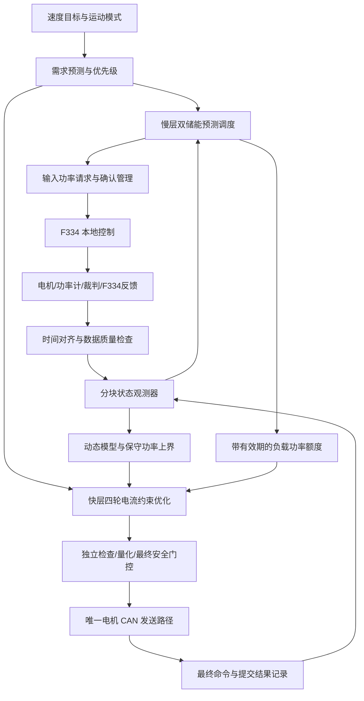

# 底盘功率与超级电容预测控制重构方案

- 日期：2026-10-28
- 状态：详细架构提案，供评审；尚未实施、标定或完成硬件验证
- 适用项目：NSEonLu - atype，现有速度控制路径
- 范围：电机功率模型、功率决策、超级电容能量调度及必要通信接口

## 1. 结论与设计目标

本方案将功控重构为**动态模型、状态观测、储能预测调度、四轮约束分配和独立保护协同工作的系统**。

目标是增加现有系统尚不具备的完整能力：

1. 根据候选电流预测随后几个周期的电流响应、轮速和负载功率。
2. 同时管理裁判缓冲和电容储能，提前决定助力幅度、持续策略及回充安排。
3. 功率受限时，依据速度跟踪与平移/旋转优先级选择四轮电流组合。
4. 根据有效测量修正模型，并显式维护估计误差、反馈延迟和可信范围。
5. 通过独立最终检查和确定的回退路径，使新算法的计算失败不直接变成错误电流输出。

这是架构级重构。是否达到“质的飞跃”，由相同条件下的模型预测、运动表现、储能利用和异常恢复对照实验判定，不能由算法名称判定。

### 1.1 本次交付边界

本文只形成方案，不修改控制代码、不更改参数、不烧录固件。

后续实施以 A 板为主，设计中定义与 F334 协同所需的信息和能力；F334 的实际修改须在确认板上固件、硬件版本及对应源码后进入独立实施阶段。

明确排除：

- `CHASSIS_CONTROL_MODE=1` 的现有力控后端及其标定工具。
- 云台、发射机构和遥控协议的功能改造。
- 在本任务中直接把现有速度 PID 全部替换为 LQR/LQI。
- 未经辨识直接采用神经网络或高阶多项式接管限流。
- 修改裁判规则、绕过裁判输出许可或取消 F334 本地保护。

快层即使直接求解四轮候选电流，仍服务于现有速度目标，不接入力控后端。现有 PID 在迁移阶段提供基准电流、参考行为和回退候选；新优化器接管输出后的积分、整定和使能关系必须显式管理。

### 1.2 设计选择

| 决策 | 本方案选择 | 原因 |
|---|---|---|
| 总体架构 | 两个时间尺度的预测决策 | 分离电机响应与能量储备变化，控制计算量 |
| 模型 | 物理结构加数据辨识 | 保留可解释性、可约束性和电流求解能力 |
| 观测器 | 分块观测，条件允许时使用小型 EKF | 避免把所有未知量放入不可观的大滤波器 |
| 快层 | 四变量电流分配，凸二次功率上界约束 | 优先保证可行性检查和执行时间可控 |
| 慢层 | 小规模储能 MPC，分段常值输入 | 联合规划输入、负载与储能恢复 |
| 在线学习 | 少量参数、带范围和准入条件 | 不在正常运行中自由学习整台车所有参数 |
| 首版制动 | 保守估计，不提前抵扣再生能量 | 电调、母线和电容的回馈能力尚需实测 |
| 兼容性 | 旧协议可运行受限版本，新协议支持完整能力 | 不把新字段当作已经存在 |

## 2. 当前代码基线与证据

以下是 2026-10-28 工作区源码快照，包含用户已有未提交修改。源码默认配置不等于板上正在运行的配置，Flash 整定和编译宏也可能改变行为。

| 项目 | 当前源码行为 | 证据 |
|---|---|---|
| 控制后端 | 默认速度控制 | [chassis_control_config.h](../../../modules/algorithm/chassis_control_config.h) |
| 电源模式 | 默认直供 | [chassis_energy_config.h](../../../modules/algorithm/chassis_energy_config.h) |
| 功控阶段 | Stage 3 | [chassis_power_config.h](../../../modules/algorithm/chassis_power_config.h) |
| 功率安全系数 | 0.98 | [chassis.c](../../../application/chassis/chassis.c) |
| 默认轮速 PID | Kp=0.75，Ki=0，Kd=0，误差为 °/s | [chassis.c](../../../application/chassis/chassis.c) |
| 电机功率模型 | 共享六项系数，电流命令/1000，电流和转速分别取绝对值 | [power_model.c](../../../modules/algorithm/power_model.c) |
| 模型电流上限 | 原始命令 15000 | [chassis.c](../../../application/chassis/chassis.c) |
| 裁判缓冲 | 最高有效值 60 J，进入恢复 10 J，退出恢复 20 J，硬底座 5 J | [chassis_energy_config.h](../../../modules/algorithm/chassis_energy_config.h) |
| 增补与斜率 | 输入名义增补上限 60 W、上升 1200 W/s；电容负载名义增补上限 100 W、上升 200 W/s | [chassis.c](../../../application/chassis/chassis.c)、[chassis_energy_config.h](../../../modules/algorithm/chassis_energy_config.h) |
| 控制周期 | 电机任务执行后 osDelay(2)，应用任务执行后 osDelay(5) | [robot_task.c](../../../application/runtime/robot_task.c) |
| 最终输出记录 | 保存量化后的电流及 CAN 提交结果 | [dji_power_adapter.c](../../../modules/motor/DJImotor/dji_power_adapter.c) |

当前任务调度是“执行时间加延时”，不能直接当作严格的 2 ms 和 5 ms 固定采样系统。新模型设计前必须测量实际周期、抖动与数据时延。

现有六项模型为：

\[
P_i=k_0+k_1x_i+k_2n_i+k_3x_in_i+k_4x_i^2+k_5n_i^2,
\quad x_i=|u_i|/1000,\quad n_i=|\mathrm{rpm}_i|
\]

当前参数为 `1.3123816, -0.25836727, 0.0007424524, 0.0024271158, 0.081198552, 3.890596e-08`。`x` 是拟合缩放量，不应未经核实解释为实际安培数。

### 2.1 现有基础应保留的能力

- 裁判数据有效性、底盘输出许可和车辆安全门控。
- 分离输入功率与负载功率的设计。
- 裁判缓冲的延迟扣减、保守能量估计和恢复迟滞。
- 功率计快速超功率收紧机制。
- 电流量化后的预测复核与最终命令记录。
- 对离线、超时、非有限数值和不匹配配置版本的拒绝。

这些能力进入新架构的基础设施与监督层，不能在重构中丢失。

### 2.2 需要解决的结构性限制

1. 静态功率模型没有描述命令到实际电流、速度变化和传感器读数的动态。
2. 驱动与制动在绝对值模型中无法区分；混合工况尤其容易产生偏差。
3. 当前预算主要围绕当前需求和短窗口计算，没有完整的双储能滚动规划。
4. 功率分配主要依据轮速误差和保留功率规则，没有显式优化预测运动误差。
5. 速度路径的驱动需求准入未完整检查最终 CAN 提交成功状态。
6. 速度应用忽略超电命令发送返回值，失败未直接参与当周期预算降级。
7. 部分说明仍写 0.95 和 600 W/s，实施基线必须以实测构建配置为准。

## 3. 对“能力跃迁”的具体定义

| 场景 | 新系统要做到什么 | 可测证据 |
|---|---|---|
| 加速阶跃 | 提前预测功率上升，安排有效助力并限制过冲 | 功率峰值、超限能量、速度上升时间 |
| 持续自旋 | 依据储能余量逐步调整可持续功率 | 转速下降曲线、最低能量、完成时间 |
| 平移叠加旋转 | 按明确权重分配电流，减少限流后的运动失真 | 平移/旋转跟踪误差、独立测速结果 |
| 负载变化 | 观测扰动、修正预测，不把全部误差交给慢 PI | 预测残差、恢复时间、参数变化 |
| 两份储能恢复 | 协调取电、助力与回充，避免同时过度消耗 | 输入/负载功率和两份能量轨迹 |
| 通信延迟和丢帧 | 新能力确认后才使用，超时后按确定路径降级 | 故障注入记录、实际 CAN 字节 |

新增能力不等于额外物理能量。电容容量、电源限额、电机效率和硬件额定值仍决定性能边界。

## 4. 系统边界与功率计量口径

### 4.1 先建立测量拓扑

实施第 0 阶段必须画出实车供电接线，明确独立功率计位于输入侧还是电机负载侧，是否包括板载电子设备、其他执行器和线损。

采用以下统一变量：

| 变量 | 单位 | 定义 |
|---|---|---|
| `u_i` | 原始 CAN 命令 | 实际尝试发送的电流指令，带正负号 |
| `i_i` | A 或已标定等效量 | 电机反馈电流，不等同于母线电流 |
| `omega_i` | rad/s | 电机转子角速度；rpm 只在接口转换 |
| `P_in` | W | 裁判电源进入整个受控供电网络的功率，正值为取电 |
| `P_load` | W | 负载边界的耗电功率，包含哪些支路由接线记录确定 |
| `P_cap,bus` | W | 电容变换器向母线提供的功率，正值为放电 |
| `P_path_loss` | W | 尚未计入其他变量的公共路径损耗 |
| `E_buf` | J | 裁判缓冲能量估计及上下界 |
| `E_cap` | J | 最低工作电压以上的电容可用能量估计及上下界 |

统一功率平衡：

\[
P_{in}+P_{cap,bus}=P_{load}+P_{path,loss}
\]

电机和电调损耗已经计入 `P_load` 的模型时，不得再计入公共路径损耗。电容变换器效率在电容能量方程中处理，也不能重复扣减。

### 4.2 两板职责

| A 板 | F334 |
|---|---|
| 理解运动需求和裁判许可 | 执行 DCDC 本地快速控制 |
| 估计/规划两份储能 | 测量电容电压、电流和变换器状态 |
| 生成输入功率请求 | 在本地约束内接受并执行请求 |
| 求解四轮电流 | 实施电压、电流、温度及故障保护 |
| 检查协议确认与数据新鲜度 | 上报实际接受目标、能力及降额原因 |

高层优化不能覆盖 F334 的本地故障锁停。现有零力、急停与 DCDC 禁用语义默认保持；若需要“停车充电”，必须定义独立许可模式，不把急停自动解释为允许充电。

## 5. 总体架构

### 5.1 时间尺度建议

以下是实施起点与性能预算，不是已验证执行能力：

| 功能 | 建议起点 | 要求 |
|---|---|---|
| 最终门控、快保护、四轮分配 | 目标 2 ms 周期 | 每次更新使用实际 dt，单次计算有上限 |
| 应用控制快照、超电命令 | 约 5 ms | 保持通信节奏，不让慢求解阻塞发送 |
| 储能预测调度 | 10 ms | 使用非均匀预测步长覆盖较长时间 |
| 模型参数学习 | 随新的有效功率样本触发，受频率上限约束 | 重复帧不能重复学习 |
| 人机遥测 | 20～50 ms | 算法运行数据与日志输出解耦 |

慢层首版可采用 10 个预测节点、5 个分段常值控制块，总预测时域约 0.5 s；再根据收益和执行时间评估是否扩展。节点间隔可取 `10,10,20,20,40,40,80,80,100,100 ms`。预测范围越长，对未知用户指令越不能作乐观假设。

## 6. 动态电机与功率模型

### 6.1 三个用途必须分开

1. **解释模型**：使用已对齐的实际反馈解释过去测得的功率，用于辨识和诊断。
2. **预测模型**：输入候选命令，预测随后电流、轮速和功率，用于决策。
3. **保护上界**：在预测误差、状态区间和有效域内给出保守功率，用于最终准入。

平均预测值、置信区间和硬保护阈值不能混用。统计分位数不是分布变化下的绝对保证。

### 6.2 命令到电流的动态

首选辨识结构：

\[
i_{i,k+1}=a_i i_{i,k}+b_i u_{i,k-d_i}+g_i+v_{i,k}
\]

- `a_i,b_i,g_i,d_i` 由实验辨识；确认是否确实需要延迟项。
- 输入是最终发送记录，发送失败期间不能假定新指令已执行。
- CAN 提交成功也不等于电机已执行；响应延迟和误差必须进入模型区间。
- 反馈电流已有平滑时，需要建模或测出滤波延迟，不直接对平滑数据拟合“瞬时电流”。
- 若电流反馈标度或质量不足，暂用命令到功率的动态模型，并扩大不确定性，禁止宣称得到实际转矩电流。

### 6.3 电流到轮速的动态

以局部线性模型为起点：

\[
\omega_{i,k+1}=\alpha_i\omega_{i,k}+\beta_i i_{i,k}+d_{i,k}\Delta t
\]

`d_i` 为短时负载扰动状态。加速度由观测器估计，避免直接差分噪声。

动力学辨识需覆盖落地直行、横移、自旋和组合运动；架空实验只能提供电机/轮组的部分信息。若单轮独立模型在落地条件下误差过大，再采用局部耦合矩阵模型，不先假定四轮完全独立。

模型第一版服务于轮速预测。通过轮速运动学计算的车体速度只能称作轮速里程计估计，不能据此识别真实打滑或证明实际车体速度精度。

### 6.4 功率结构

推荐待辨识结构：

\[
\hat P_{load}=P_0+
\sum_i\left[a_{m_i}i_i\omega_i+b_i(T_i)i_i^2+c_i|\omega_i|+d_i\omega_i^2\right]
\]

`m_i` 区分驱动、制动和近零速区域；`P0` 是测量边界内的公共基础消耗。

约束与解释：

- `i*omega` 保留符号；它表示等效机电转换项，不把负值全部当作实际回馈收益。
- 平方电流损耗系数必须非负，温度修正只在传感器与绕组温度关系有证据时启用。
- 速度项是附加损耗近似，不重复添加已经由机电项包含的机械功率。
- 每轮可有少量校准差异；总功率计不足以在普通工况下独立辨识每轮所有系数。
- 首版优先共享主要损耗参数，逐轮校准电流响应和速度动态。
- 在标定有效域外扩大余量并限制增长，不自由外推高阶曲线。

### 6.5 制动与再生

默认不使用预测再生功率抵扣其他轮的耗电，也不将未发生的回馈计入可用储能。

完整再生能力需要验证：电调回馈行为、母线吸收路径、电容充电能力、母线过压保护及反馈时延。在此之前：

- 制动轮采用专门的保守功率范围。
- 近零速与换向使用迟滞，避免模式每周期跳变。
- 未标定的制动象限进入受限回退，不扩大驱动电流。
- 电容接近满电时，不主动增强电机制动来“回收能量”。

### 6.6 保护模型

定义：

\[
P^+(u)=\max_{x\in\mathcal X,\theta\in\Theta}P(u,x,\theta)+\epsilon_{delay}+\epsilon_{quant}
\]

实际实现不每周期执行通用鲁棒优化。根据已标定的状态区间与系数范围，预先构造低成本的凸二次上界：

\[
P^+(u)=u^THu+g^Tu+c,\qquad H\succeq0
\]

首版冻结保护窗口内的速度区间、驱动/制动象限和参数版本。若动态模型直接代入产生非凸项，用有证据的包络代替，不能通过忽略高阶项冒充上界。

上界仅对记录的有效域、误差边界成立。实验未覆盖的条件下，使用更保守的旧模型约束或禁用新能力。

## 7. 状态观测与在线辨识

### 7.1 分块结构

| 观测块 | 状态 | 测量 | 主要输出 |
|---|---|---|---|
| 电机动态 | 轮速、电流响应、慢变负载扰动 | 电机 CAN、最终命令历史 | 对齐状态、短时预测、误差范围 |
| 裁判缓冲 | 能量区间、结算相位不确定性 | 裁判缓冲、输入功率 | 可释放缓冲额度、恢复条件 |
| 电容储能 | 可用能量区间、慢变偏置 | 电容电压/比例、输入和负载功率 | 放电额度、回充需求 |
| 功率残差 | 总模型偏差及统计分布 | 对齐负载功率、模型预测 | 可信度与保护余量 |

不构建一个同时估计全部电机参数、轮胎摩擦、容量、效率和负载的巨大 EKF。首先检查每个状态是否可观，并区分状态估计与参数学习。

### 7.2 时间对齐

- 同时保存采样时间、接收时间、序号和质量标记。
- 对没有采样时间的设备，辨识其延迟范围，不能把接收时间等同于采样时间。
- 保存有限长度的最终命令与状态环形历史；容量由最大已验证延迟和任务周期确定。
- 对延迟测量，在其对应历史时刻更新小型观测块，再传播到当前时刻；超出历史窗口则降级，不能强行对齐。
- 同一功率帧只用于一次参数更新。功率计无序号时使用接收事件计数；只看毫秒时间戳可能合并同毫秒多帧。
- 32 位计时使用统一时钟和无符号差值；回绕、倒序、重启均有测试。

### 7.3 RLS 学习准入

在线只学习预先选定的少数参数，例如公共偏置和共享电阻损耗修正；是否学习交叉项由离线可辨识性结果决定。

允许更新的条件：

1. 电机、功率计和能量反馈有效，时序匹配。
2. 对应最终命令提交成功；状态预测与反馈不存在未解释的异常。
3. 电流、转速和模式位于标定有效域。
4. 回归量变化充分，条件数与协方差正常。
5. 没有模式切换、严重饱和、硬保护或传感器冲突。

保护措施包括特征归一化、参数投影、更新斜率限制、协方差上限、异常样本拒绝和最后可信参数回退。遗忘因子按有效新样本频率与期望记忆时间选择，不按快任务频率机械套用固定数字。

### 7.4 与现有功率外环的关系

新模型、旧慢外环和新快优化器不能无条件同时增加输出。

- 影子阶段：旧控制器输出，新模型只观察。
- 新模型接入旧限流阶段：保留有界外环，冻结或收紧重叠的正向学习，进行独立对照。
- 新快层接管阶段：模型/扰动观测负责长期偏差；原慢 PI 不再并行叠加正向功率额度。
- 快速实测超功率保护始终独立，仅能收紧，恢复需要新鲜样本确认。

这属于明确的控制权切换，不通过保留多个正向补偿环来获得“更强输出”。

## 8. 双储能模型

### 8.1 裁判缓冲

规划模型：

\[
E_{buf,k+1}=\operatorname{clip}\left(E_{buf,k}+
(P_{ref,k}-P_{in,k})\Delta t,0,E_{buf,max}\right)
\]

这是一种控制近似，不宣称逐毫秒重现裁判内部结算。保留帧龄、结算延迟、未知历史最坏扣减及向上校正限速。

采用上下界轨迹：取电超限风险使用 `P_in` 上界推算缓冲下界，不能用乐观输入均值做保护。

### 8.2 电容可用能量

有效容量近似恒定时：

\[
E_{cap}=\tfrac12 C_{eff}\max(V_{cap}^2-V_{min}^2,0)
\]

若容量明显随电压变化，改用实测能量—电压曲线，不把单个常数强行覆盖全范围。

工作区一份 F334 实现以 `Vcap²/Vmax²` 上报 `capEnergy`，随后量化到 0～255。它是相对零电压的比例，不是最低工作电压以上的可用能量比例。对应源码见第 20 节，板上版本尚须确认。

旧协议下可建立保守估计：

\[
E_{cap}^{-}=\tfrac12 C_{min}\max\left(V_{max}^2r^{-}-V_{min}^2,0\right)
\]

`r^-` 由已验证编码误差、采样误差、帧龄和期间耗能确定。没有有效容量、最低电压和固件映射校准时，只保留比例降额功能，不能输出可信的剩余秒数。

### 8.3 电容能量变化

令 `q=P_cap,bus`，则：

\[
\dot E_{cap}=\begin{cases}
-q/\eta_d-P_{leak},&q\ge0\\
-\eta_c q-P_{leak},&q<0
\end{cases}
\]

效率采用经验证的范围。放电能量扣减使用不利效率，充电能量收益使用保守效率。由相减得到的输入/负载差受各自偏差影响，不能无限积分而不接受电压锚定。

持续回充、满电、断电重启和负载阶跃分别验证观察器漂移。重启后从有效电压/比例重新建立保守初值，不直接继承未经校验的积分值。

## 9. 慢层：双储能预测调度

### 9.1 输入与输出

输入：运动目标及其变化、可信需求包络、两份储能上下界、输入响应模型、F334 能力、裁判许可、快层实际结果。

输出：输入功率请求、负载侧功率上限、有效期、保留能量目标、恢复状态和限制原因。

慢层输出是**允许额度**。实际负载可以更低；额度不能直接当作已发生的功率用于能量积分。

### 9.2 需求预测

依据目标轮速、目标变化和动态模型构造短时需求，不仅依据已被限幅后的电流，否则会形成“额度低→实际电流低→判断无需求→额度始终低”的闭锁。

同时禁止把故障、失效 PID 累积或不可达目标无限解释为真实需求。使用目标合理性、反馈有效性、可达到加速度、电流上限和持续受限时间约束需求包络。

不预测未知的操作者意图。首版采用当前目标保持、受限目标变化两种需求假设进行离线比较，选定可实时运行的保守实现。

### 9.3 优化问题

决策量采用少量分段常值的输入目标 `p_cmd` 和负载额度 `p_allow`。概念目标函数为：

\[
J_E=\sum_j\left[
w_d(P_{demand,j}-P_{allow,j})_+^2+
w_b(E_{buf,j}-E_{buf,ref})^2+
w_c(E_{cap,j}-E_{cap,ref})^2+
w_r(\Delta P_{cmd,j})^2\right]+J_{terminal}
\]

能量恢复项不得驱动无需求的电机耗电。高电量应降低充电请求，不通过提高实际负载来“跟踪能量目标”。

主要约束：

- 裁判缓冲与电容能量的上下界、保留量和终端余量。
- F334 已接受目标、输入执行延迟、输入上下限与变化率。
- 电容实际充放电功率能力及公共供电能力。
- 底盘负载功率上界及恢复策略。
- 裁判/车辆许可、反馈新鲜度和模式限制。

运动需求跟踪和期望恢复速度可以软化；故障许可、电流上限、已确认硬件能力等不能靠松弛变量绕过。

### 9.4 首版求解结构

不直接在 F427 上运行包含全部电机动态的通用非线性 MPC。

慢层使用局部仿射输入响应、保守能量模型和冻结能力，形成小型 QP 子问题。充/放电符号采用有限的模式候选：保持当前模式，或在预定边界切换一次；最多比较固定数量的候选，不进行指数级全模式搜索。

首版规模固定为 10 个预测节点、5 个控制块，每块包含输入目标和负载额度，共 10 个主要控制变量。能量状态通过递推消元；需求不足的正部平方使用辅助变量表达，求解器实际维数包含这些辅助变量。候选模式最多 3 个：保持当前模式、在中间控制块边界切换一次、全时域采用另一模式；不满足初始状态或能力约束的候选直接拒绝。所有变量、约束数量和工作区上限在编译期确定。

首版采用当前有效速度目标保持作为名义预测，用受限目标变化构造不确定性包络。第 9.2 节的离线比较用于决定是否升级预测方式，不能在运行中隐式切换未经验证的预测假设。

每个模式明确充放电符号约束，不允许“同时充放电”变量制造虚假可行解。候选必须通过原始能量方程和能力约束复核，QP 的代价低不代表可以直接执行。

### 9.5 不确定性与首步执行

每个候选同时检查：

- **高输入轨迹**：用于裁判缓冲耗能及过充风险。
- **低输入轨迹**：用于电容放电耗能和负载供给能力。
- **高负载轨迹**：用于储能下界。
- **低负载轨迹**：用于可能的充电与满电风险。

未确认的新输入目标不能被当作首步可用供电。未来步骤只能在已辨识的输入响应区间内使用；没有可信下界时，不提前计入充电收益。

首步负载额度由当前已确认能力与保守储能共同限制。后续优化方案每周期重算，不能把计划中的供电当作已经执行。

### 9.6 终端策略

终端保留能量用于降低短视耗尽风险，但有限时域、经验终端惩罚本身不构成递归可行性证明。

首版要求每个首步动作均通过独立的短窗口能量保护，并维护可立即切换的保守策略。后续若要宣称鲁棒递归可行性，需要给出扰动边界、终端集合和证明条件。

## 10. 快层：四轮电流约束优化

### 10.1 定位

每个电机周期只优化当前四轮命令，不将完整长时域电机 NMPC 放进 2 ms 路径。

使用观测状态预测一个固定短响应窗口内的轮速；该窗口由电流响应和有效反馈速率确定，不固定承诺只看 2 ms。在局部模型下，预测轮速对当前命令采用仿射近似。

### 10.2 目标函数

\[
J_I(u)=\|W_v(\hat\omega_{k+h}(u)-\omega_{ref})\|^2
+\lambda_s\|u-u_{prev}\|^2
+\lambda_b\|u-u_{baseline}\|^2
\]

- 第一项改善预测轮速跟踪。
- 第二项约束输出突变。
- 第三项用于迁移初期限制偏离原 PID 候选的程度；其权重可在验收后降低。
- `Wv` 可结合运动学映射表达平移、旋转的不同优先级，但只能评价轮速推算的运动。
- 速度目标、反馈角速度与转子/轮轴单位在适配层统一。

### 10.3 约束

\[
u_{min,i}\le u_i\le u_{max,i},\quad
|u_i-u_{prev,i}|\le\Delta u_{max,i}
\]

\[
P^+(u)\le P_{allow}
\]

另含在线/使能掩码、速度保护、模式象限和必要的命令边界。

首版不允许优化器为了省功率主动创造基准控制未请求的制动象限。制动/换向按照经过验证的专用模式处理；近零区域不能依靠噪声乘积决定能量流向。

### 10.4 求解方法

固定状态包络下，凸二次目标加凸二次功率约束构成小型凸 QCQP，不是普通线性约束 QP。

首版候选算法：对单个功率约束使用非负拉格朗日乘子搜索；每个乘子下求解四维带盒约束的凸二次子问题。限制搜索次数、活动集迭代次数及总时长，利用前一周期结果初始化。

如果要求多个功率包络同时成立，首版优先合成为一个更保守的上界；不未经重新验证就扩展求解器维度。任何近似、早停结果都必须单独检查原始约束。

为保证可检查性，目标 Hessian 应正定或经过有记录的正则化，所有变量先归一化，避免电流原始值和瓦特量级差异导致数值病态。

### 10.5 量化与最终检查

1. 对优化电流执行 int16 量化。
2. 用量化后的命令重新评价功率上界、电流与变化率约束。
3. 需要修正时采用有界搜索；不能假定电流向零取整必然减小所有工况功率。
4. 执行最新的裁判、车辆、电机离线与故障门控。
5. 经唯一 CAN 发送路径提交。
6. 记录实际字节、提交结果、数据版本和最终预测。

高速空转时，零命令仍可能对应模型基础损耗，甚至存在回馈。因此“输出零”是停止主动驱动的回退动作，不等于证明物理功率立即为零。若零驱动下仍无法满足功率/母线限制，报告无可行驱动解并由硬件保护承担相应动作，禁止伪造可行状态。

## 11. A 板与 F334 通信设计

### 11.1 当前协议

| 帧 | 当前内容 | 局限 |
|---|---|---|
| `0x061` | 使能、原始裁判限额、缓冲、扩展输入目标 | 没有应用层命令序号 |
| `0x051` | 状态、负载功率、总可用功率、电量比例 | 电量量化，缺少明确可用焦耳和独立充放电能力 |
| `0x052` | 输入实测功率、输入目标、版本、扩展有效位 | 没有请求序号、采样时间和限幅原因 |

保持原始裁判限额字段语义，不把增补后的电机负载额度写进去。

### 11.2 接受目标与请求目标分离

所查 F334 的 `InputPowerPolicy::boundTarget()` 会再次限制请求。例如其缓冲增补受 `min(60,(E-15)/0.5)` 约束，低缓冲时还会减让输入。这说明 `0x052` 的目标可以合法小于请求值。

因此不能用“反馈目标必须等于请求目标”作为唯一成功条件。应维护：

- `requested_target`：A 板希望执行的目标。
- `accepted_target`：F334 在本地限制后接受的目标。
- `measured_input`：功率计量得到的实际输入。
- `pending`：已提交但未得到对应接受结果的请求。

`accepted_target` 也不是实际功率，供电预测仍需执行响应和误差区间。

### 11.3 旧协议兼容模式

- 维持最新有效反馈，不把一次新请求自动视为旧确认能力失效。
- 新增输入额度等待有效新反馈及响应证据；降额立即在本地生效。
- 发送失败禁止增长并记录原因；不能让失败请求刷新确认有效期。
- 用新鲜度、发送前后接收事件计数和合理目标范围做弱关联，但明确它不能证明精确的命令身份。
- 目标被板端限幅时接受较小额度；不要求精确相等导致永久等待。
- 目标采用有限更新频率和最小变化阈值，周期保活仍照常发送，避免每个周期改目标又撤销目标。

旧协议模式只允许相应保守能力，不宣称具有新协议的强确认语义。

### 11.4 完整能力所需的新协议信息

新协议采用显式版本/能力协商，并保留旧帧兼容；不能直接改变旧 DLC 或复用未协商字段。

应提供的语义：

| 信息 | 用途 |
|---|---|
| 启动会话标识、命令序号及回显 | 区分重启、旧反馈和当前请求 |
| 请求接受结果、接受目标、限幅原因 | 正确处理板端合法降额 |
| 电容电压、电流或可用能量下界 | 改善储能估计 |
| 独立充电、放电能力及对应有效期 | 避免从总能力中错误推算分项能力 |
| 采样计数/时刻、温度、保护状态 | 对齐、估计误差及能力降额 |
| 能量/容量模型版本 | 保证 A 板与 F334 对电量语义一致 |

使用新 CAN ID 分帧传输，ID 在全车总线清单审计后分配；本文不预留未经核实的 ID。跨帧快照必须通过序号重组完整版本后发布，半帧不能更新控制能力。

总线负载评估包含电机、裁判转发及现有反馈，按实际波特率、帧长、位填充上界和重发场景计算。未通过带宽与最坏延迟验证前不提高发送频率。

### 11.5 供电路径回退条件

超电离线或 DCDC 禁用后能否继续基础功率驱动，取决于实车是否有有效旁路/直供路径。

- 已验证直供仍可用：撤销电容能力，回到输入侧可确认基础额度。
- 供电路径不明或不可用：禁止主动驱动，不能仅因为裁判限额有效就假定电机能获得供电。

## 12. 运行状态与故障策略

| 状态 | 进入条件 | 允许动作 |
|---|---|---|
| `DISABLED` | 无许可、零力或急停 | 电机零驱动，保持现有 DCDC 禁用语义 |
| `INITIALIZING` | 启动、重启、模型/时钟初值未建立 | 只建立快照；许可和基础路径明确后才可保守运行 |
| `BASE_ONLY` | 电容或缓冲能力不可确认，但基础供电有效 | 使用保守基础额度，禁止储能增补 |
| `PREDICTIVE_READY` | 模型、反馈、确认和求解均健康 | 双层预测控制 |
| `RECOVERING` | 规划或保护要求恢复储能 | 限制负载、协调回充，保持运动需求软约束 |
| `DEGRADED` | 失去部分反馈、模型超域、超时 | 冻结学习、收紧额度、使用经验证回退 |
| `FAULT` | 非有限数值、硬件故障、无安全供电路径等 | 禁止主动驱动，按故障类别恢复 |

恢复需连续新鲜样本和明确许可。软件不得通过反复禁用/使能自动清除硬件锁停。

### 12.1 失效优先级

1. 车辆急停、裁判明确禁用、电机硬故障优先于所有优化结果。
2. 超过快周期时限或求解失败，只接受通过本周期全部约束复核的候选。
3. 旧解若不满足新降额、旧版本或新离线掩码，立即丢弃。
4. 功率计失联后冻结学习并撤销储能增长；此前超功率降额不能因“没看到超功率”自动释放。
5. 无有效回退候选则输出零驱动；对被动损耗/回馈继续报告并监测硬件状态。

慢层首版策略快照有效期设为 20 ms，作为与当前关键功率反馈新鲜度一致的初始设计值，须在实时性验收时复核。一次慢求解失败时，只有仍在有效期内且通过当前能力、能量和许可复核的旧额度可以继续使用；期间禁止增长。超过有效期则转入 `BASE_ONLY` 或 `DEGRADED`。独立的 5 ms 应用发布继续更新控制快照，不能通过刷新其时间戳掩盖慢层额度已经过期。

### 12.2 制动、饱和与积分

现有默认速度控制 Ki 为零，但运行时配置可能启用积分。预测优化器接管时，PID 积分必须跟踪最终可执行输出或冻结，避免回退瞬间跳变。

模型观测输入使用最终发送历史，不使用限流前 PID 候选。状态转换采用无突跳初始化；允许的命令变化率不能阻止急停清零或硬保护降额。

## 13. 实时性与数值设计

### 13.1 初始工程预算

| 项目 | 初始预算目标 | 发布条件 |
|---|---|---|
| 快层观测、优化、复核新增时间 | 单次不超过 300 μs | DWT 测量全工况，结合整个电机任务时长判断 |
| 慢层求解 | 单次不超过 2 ms，10 ms 调度 | 不持锁求解，不阻塞 5 ms 通信保活 |
| 新模块静态状态和工作区 | 合计先控制在 32 KiB 内 | map 文件确认总 RAM 余量；超预算先重设计 |
| 快任务栈 | 避免大局部矩阵 | 静态栈分析与最坏运行高水位联合检查 |
| 周期内内存分配 | 0 次 | 初始化后不 malloc/free |

这些数值是实现预算，不是已证明可满足的板上能力。若不满足，优先缩短时域、减少候选和参数维数，不能靠延长电机周期掩盖超时。

### 13.2 调度与共享数据

- 测出完整任务执行时间和相邻周期 dt，区分这两个指标。
- 确认全系统调度影响后，再决定是否改为 `vTaskDelayUntil` 等固定节拍。
- 慢求解分时执行或放入低优先级执行上下文，发布有完整版本的结果。
- 快层读取一次完整快照；不在迭代中跨版本读取目标、预算或模型。
- 参数更新使用双缓冲与短临界区，算法计算在锁外执行。
- 控制配置、模型、能力和策略分别带版本及有效期，禁止混用。

### 13.3 数值准入

所有输入检查有限性、范围和时间一致性；特征归一化；对称矩阵检查正定/半正定条件；容差按物理单位和浮点误差定义。

求解器输出包含 `feasible`、`optimality_gap_or_residual`、`iterations`、`elapsed_us`、`fallback_reason`。达到迭代上限不等于失败，也不等于可用；是否可用由独立可行性检查决定。

## 14. 模块划分与工程接入

建议新增模块名仅为实施边界约定，不表示已经创建：

| 模块 | 职责 |
|---|---|
| `power_identification` | 离线参数包、在线有限辨识、有效域管理 |
| `power_observer` | 时间历史、电机/能量观测、置信范围 |
| `power_prediction` | 动态功率预测、模式判断、凸保护上界 |
| `energy_scheduler` | 双储能滚动规划与输入响应预测 |
| `power_allocator` | 四轮电流约束优化与可行性检查 |
| `power_supervisor` | 模式切换、故障、独立快保护和回退仲裁 |
| 现有 `super_cap` | 协议、设备快照、提交结果；扩展确认管理接口 |
| 现有 `dji_power_adapter` | 单位与四轮绑定、快照注入、最终提交记录 |

纯算法头不依赖 HAL/RTOS；板级装配、设备回调、控制算法和遥测各自独立。

### 14.1 关键数据契约

- `AlignedMeasurement`：采样/接收时间、事件计数、各设备值、质量掩码、延迟区间。
- `PredictionState`：状态均值/边界、模型版本、有效域和新鲜度。
- `EnergyAllowance`：负载瓦特上限、输入请求、确认能力、能量余量、到期时间。
- `AllocationResult`：四轮候选、量化后候选、保护功率、约束残差和求解状态。
- `FinalActuation`：最终字节、实际掩码、发送结果、策略/模型/配置版本。

显式区分物理瓦特与旧模型的名义预算，避免重复乘 0.98。新模块统一使用物理边界单位；旧接口转换只发生在适配层。

### 14.2 旧路径兼容

新增独立构建/运行模式区分旧控制、影子计算和新控制，不复用现有 Stage 0～3 来表达完全不同的后端语义。

力控构建仍使用原有接口和行为。共享类型扩展需保持零初始化和向后兼容，测试源选择不得因宏裁空导致默认主机测试失败。

## 15. 遥测、标定与复现

至少记录以下字段组，原始高频数据与低频展示分开：

| 字段组 | 内容 |
|---|---|
| 时间 | 快周期 dt、各采样/接收时刻、事件计数、帧龄 |
| 电机 | 目标/实测/预测轮速，候选/量化/最终电流，反馈电流、温度 |
| 功率 | 输入/负载实测、模型均值、保护上界、输入请求/接受目标 |
| 能量 | 裁判原值、两份能量估计上下界、预测最低值、终端余量 |
| 优化 | 限制原因、可行性残差、迭代、运行时间、回退状态 |
| 学习 | 模型版本、参数变化、准入/冻结原因、残差分布 |
| 通信 | CAN 提交结果、命令身份、设备会话、限幅原因 |

日志包必须带固件提交号、构建宏、Flash 整定参数、模型参数校验和、传感器标定、接线图版本和轨迹编号。

### 15.1 标定实验

1. 静止与不同轮速空载：分离公共基础损耗及速度相关损耗。
2. 受限电流阶跃/斜坡：识别电流和转速响应、延迟、限幅行为。
3. 落地直行、横移、自旋及组合运动：建立真实负载覆盖。
4. 冷态与热态重复：检查参数漂移及温度信息的有效性。
5. 独立受控制动与换向：确认能量流向和母线吸收边界。
6. 电容受控充放电：标定有效能量、效率区间和能力随电压变化。
7. 输入目标阶跃：确认 F334 接受目标、实际响应、二次限幅与时延。

不使用长时间硬堵转获取参数；所有实验使用已验证的电流、速度、温度和电压限制。

### 15.2 数据划分

按完整实验段、日期和工况划分训练/验证/测试集，不随机打散相邻时序样本。模型选择不使用最终测试集；不同算法使用同一份时间对齐与筛选规则。

统计正常驱动、混合制动、近零速和高功率区域的误差，不能用大量低负载数据掩盖高负载低估。

## 16. 验证矩阵与验收

### 16.1 软件验证

| 层级 | 必须覆盖 |
|---|---|
| 纯模型 | 单位、符号、有效域、延迟响应、能量守恒、异常数值 |
| 观测器 | 重复/倒序/缺失帧、延迟变化、重启、计时回绕、长间断 |
| 优化器 | 无约束解、功率边界、盒边界、无可行解、早停、数值病态 |
| 量化 | 截断边界、零速非单调区、正负切换、量化后约束复核 |
| 通信 | 目标被合法限幅、延迟反馈、旧命令、会话重启、发送失败 |
| 集成 | 安全门控优先、配置切换、基准回退、整定互斥 |
| 实时性 | 最坏输入与全部限制同时激活、日志拥塞、低优先级任务干扰 |

对优化器使用双精度离线求解作为参考，验证可行性和目标差距；不能只检查“输出在范围内”。

### 16.2 典型闭环场景

- 静止、低速爬行、启动、停车与反向。
- 持续直行、横移、自旋、平移加自旋。
- 目标突然增大、裁判限额突然降低。
- 高/低电容电量与高/低裁判缓冲的四种组合。
- 功率计失联、只丢 `0x051`、只丢 `0x052`、电机部分离线。
- F334 接受较小目标、输入执行滞后、电容满电充电受限。
- 超电禁用后旁路有效/无效的分别验证。
- 求解器超时、参数包异常、反馈突变及临界区并发。

### 16.3 指标定义

\[
e_P=\hat P-P_{measured},\quad
e_{under}=\max(P_{measured}-\hat P,0)
\]

\[
E_{over}=\int\max(P_{measured}-P_{allowed},0)\,dt
\]

输入侧与负载侧分别计算超限指标，不能把合法电容助力误算为裁判输入超限。电机跟踪指标使用积分绝对误差、峰值误差和恢复时间；车体运动指标需要独立测速验证。

### 16.4 发布门槛

**必须通过的约束门槛：**

- 所有软件故障注入中，不发生许可绕过、非法数值下发或使用过期能力增长输出。
- 所有下发候选通过当周期量化后约束检查；被动损耗导致的物理无可行状态有明确记录和动作。
- 新算法不增加对照工况下的输入侧超限风险；硬件绝对边界使用实测确定的阈值。
- 栈、RAM、任务周期及求解时限满足整车运行预算。
- 基准控制与新控制切换、故障恢复均无未经允许的电流跳变。

**建议的能力目标，需在第 0 阶段根据仪器精度和基线冻结：**

| 维度 | 建议目标 |
|---|---|
| 动态功率预测 | 独立高功率测试集 RMSE 比基线下降至少 20%，低估尾部不恶化 |
| 限功率运动表现 | 预先指定组合轨迹的速度积分误差下降至少 15%，超限风险不增加 |
| 能量利用 | 相同初始能量和终端储备下，完成时间或能量消耗至少一项改善 10%，另一项不明显恶化 |
| 平顺性 | 增补退出与恢复过程无新增持续振荡，电流变化满足约束 |

这些比例是立项验收建议，不是已实现结果。基线误差低于仪器可分辨范围时，改用在测量不确定度内不退化的标准。阈值必须在测试集评估前冻结，不根据结果事后调整。

### 16.5 对照实验协议

- 基线为记录了提交号、编译宏和 Flash 参数的现有速度控制固件，不能在比较中同时更换电机、轮胎、功率计或安全阈值。
- 固定裁判限额、载荷、场地和目标轨迹；初始两份储能及温度落入预先冻结的允许区间。
- 每个主要工况至少进行 10 组有效配对实验，交替或随机安排新旧算法顺序，减少电池状态和温升造成的顺序偏差。
- 排除规则在实验前确定，通信异常或求解失败不能仅因结果不好被剔除；另作异常工况统计。
- 同时报告每次结果、配对差值、均值或中位数、区间估计和最差值；不只展示最好的一次曲线。
- 能量比较优先使用相同轨迹、相同完成标准和匹配的初末储能；若终端储能不匹配，必须单独报告储能差，不把额外消耗的电容能量当作效率收益。
- 未达到运动完成标准的实验记为未完成，不能通过提前停机得到更低耗能。
- 第 16.4 节的建议性能目标按预先指定的主工况判定；其他工况同时执行不退化检查，退化容差在第 0 阶段根据测量误差冻结。

## 17. 实施阶段与退出条件

| 阶段 | 交付 | 进入下一阶段的条件 |
|---|---|---|
| 0：基线与拓扑 | 固件/配置快照、接线图、时间测量、对照轨迹、验收阈值 | 明确功率边界与板上版本，数据可复现 |
| 1：离线模型与回放 | 数据处理、动态模型、保护上界、独立测试报告 | 高功率与瞬态误差达到冻结目标，域外行为可控 |
| 2：影子系统 | 观测器、快优化、慢调度只计算不执行 | 无数值/时序异常，预测与参考求解一致 |
| 3：快层接管 | 基础功率内的四轮优化，储能增补关闭 | 运动与功率约束对照通过，可随时回退 |
| 4：裁判缓冲规划 | 直供模式储能调度 | 缓冲估计和恢复验证通过 |
| 5：电容协同 | 确认管理、电容观察、双储能调度 | 匹配 F334、容量/效率/能力有效，异常场景通过 |
| 6：有限在线适应 | 带准入与回退的少量参数学习 | 跨温度/负载测试改善且无学习漂移 |
| 7：整车验收 | 完整轨迹、长时运行、故障与实时性报告 | 达到约束门槛及冻结的能力目标 |

阶段交付按独立提交组织，参数、协议、控制权切换不混成一次不可回退的大修改。任何阶段未通过门槛，只停留在已通过阶段，不能为了展示新算法强行启用。

## 18. 实施前必须取得的证据

| 信息 | 获取方式 | 缺失时的明确处理 |
|---|---|---|
| 实际 F334 固件/硬件版本 | 读取构建记录和板号，对照源码 | 不启用强确认和完整电容预测 |
| 电容有效容量、最低/最高工作电压 | 受控充放电和硬件规格核对 | 保留比例降额，不承诺可用焦耳 |
| 功率计实际接线与精度 | 接线审查、参考仪表比对 | 不拟合跨边界混合功率 |
| 电机反馈电流标度/延迟 | 协议核对及受控响应实验 | 使用等效量模型并扩大误差界 |
| 旁路供电行为 | 受控禁用/故障试验 | 超电路径异常时禁止主动驱动 |
| CAN 波特率、负载与最坏帧龄 | 总线抓取和压力测试 | 不增帧、不提高通信频率 |
| F427 执行与存储余量 | DWT、map、栈高水位 | 新算法保持影子或缩减问题规模 |
| 再生吸收能力 | 独立制动实验 | 不使用回馈能量收益 |

此表是实施门槛和默认行为，不是允许用猜测参数填补的空白。第 0 阶段记录测量方法、结果和适用范围后，才能生成可上板参数包。

## 19. 风险与取舍

| 风险 | 后果 | 处理 |
|---|---|---|
| 动态模型不足 | MPC 预测看似精确但执行偏差大 | 域限制、扰动区间、离线独立验证 |
| 电流反馈滤波/时间错配 | 学到错误电阻或滞后 | 明确时间模型，先校时再学习 |
| 电容充电收益过于乐观 | 规划高估未来储能 | 未确认输入不提前记收益，维持能量下界 |
| 输出额度当作实际消耗 | 能量观察漂移 | 规划与实测积分分离 |
| 总功率难以分解到四轮 | 参数互相补偿、外推失效 | 专门激励，共享少量参数，检查可辨识性 |
| 优化解局部近似失效 | 量化/原方程约束违反 | 独立原约束复核，限制有效域 |
| 计算超时 | 电机周期抖动、旧命令延续 | 固定迭代预算、低优先级慢求解、当前约束回退 |
| 老/新外环争夺控制 | 振荡、重复补偿 | 单一输出仲裁，明确每阶段控制权 |
| 板端目标再次限幅 | 误判不确认或高估供给 | 请求、接受、实测三者分开 |
| 统计误差界被当作保证 | 极端工况风险被低估 | 明确假设、域外保守策略、硬件保护保留 |

如果最终证明 F427 无法在整车负载下完成慢层 MPC，可以将其替换为离线生成的有限策略表或简化滚动规划，但必须重新验证；不能继续对外声称运行完整 MPC。快层、观测器和能量模型仍可独立保留。

## 20. 资料与代码依据

### 20.1 本项目

- [速度应用与参数装配](../../../application/chassis/chassis.c)
- [功率策略](../../../modules/chassis_power/chassis_power_policy.c)
- [功率限流和最终记录](../../../modules/chassis_power/chassis_power_limiter.c)
- [预算与裁判缓冲估计](../../../modules/algorithm/chassis_power_budget.c)
- [瞬态与量化保护](../../../modules/algorithm/chassis_power_transient.c)
- [现有模型及功率分配](../../../modules/algorithm/power_model.c)
- [超电设备与快照](../../../modules/super_cap/super_cap.c)
- [超电协议定义](../../../modules/super_cap/super_cap_protocol.h)
- [电机输出适配](../../../modules/motor/DJImotor/dji_power_adapter.c)
- [任务周期](../../../application/runtime/robot_task.c)
- [既有标定采集说明](../../chassis-power-calibration.md)：其中历史参数不能替代当前源码或实测配置。

### 20.2 工作区中查阅的 F334 源码

以下是一份已查阅实现，不代表已经确认它就是当前板上固件，也不代表本次已授权修改该仓库。

- [PowerManager.cpp](<D:/nsezxb/supercapacitor/RM2024-SuperCapacitorController-master/Core/Src/PowerManager.cpp>)：电量比例、总功率能力及本地控制。
- [InputPowerPolicy.hpp](<D:/nsezxb/supercapacitor/RM2024-SuperCapacitorController-master/Core/Inc/InputPowerPolicy.hpp>)：目标二次限幅、充放电能力和失联策略。
- [InputPowerControl.md](<D:/nsezxb/supercapacitor/RM2024-SuperCapacitorController-master/Docs/InputPowerControl.md>)：输入功率闭环协议。

### 20.3 方法参考

以下资料支持模型和算法方法，不构成本项目的性能或安全证明。

- [MathWorks：PMSM 模型](https://www.mathworks.com/help/simscape-electrical/ref/pmsm.html)：电磁、损耗及温度建模依据。
- [MathWorks：RLS 估计器](https://www.mathworks.com/help/ident/ref/recursiveleastsquaresestimator.html)：参数线性回归、遗忘与更新控制。
- [Bruce、Goel、Bernstein：RLS 收敛与一致性](https://arxiv.org/abs/2003.02737)：激励条件及遗忘机制。
- [MathWorks：MPC 状态估计](https://www.mathworks.com/help/mpc/ug/controller-state-estimation.html)：状态与扰动估计。
- [MathWorks：非线性 MPC 约束](https://www.mathworks.com/help/mpc/ug/specify-constraints-for-nonlinear-mpc.html)：输入、状态和自定义约束。
- [MathWorks：非线性 MPC 求解器](https://www.mathworks.com/help/mpc/ug/configure-optimization-solver-for-nonlinear-mpc.html)：求解结构与计算限制。
- [MathWorks：PID 抗饱和与附加输入](https://www.mathworks.com/help/simulink/slref/anti-windup-control-using-a-pid-controller.html)：最终执行输出与积分跟踪。

## 21. 本文评审检查表

- [ ] 确认重构目标、速度路径范围及力控排除项。
- [ ] 确认两板职责、旧协议受限模式与新协议能力要求。
- [ ] 确认动态模型、快层凸约束分配、慢层预测调度的技术路线。
- [ ] 确认阶段交付、测量门槛及验收指标冻结方式。
- [ ] 确认完成设计评审后，再编写实施计划与进入代码阶段。

本文中的算法、预算、数据契约和性能目标均为拟议设计。本次交付只检查文档结构、引用、技术一致性和改动范围，没有运行新控制器，也没有宣称硬件收益已经实现。
